<a id="top"></a>

<p align="center">
  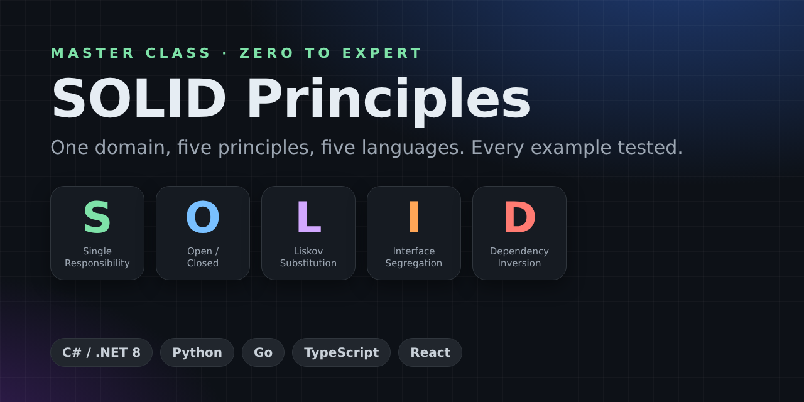
</p>

# SOLID Principles — A Master Class from Zero to Expert

[](https://github.com/danielfyo/solid-principles-dotnet/actions/workflows/ci.yml)
[](https://github.com/danielfyo/solid-principles-dotnet/actions/workflows/codeql.yml)
[](https://github.com/danielfyo/solid-principles-dotnet/releases)
[](LICENSE)
[](https://www.conventionalcommits.org/en/v1.0.0/)


> **One e-commerce domain. Five principles. Five languages. Every example runnable and tested.**
>
> This guide takes you from "I've heard the acronym" to "I can explain the trade-offs in a design review
> and refactor a legacy codebase safely". Every concept is shown as a **❌ problem** and a **✅ solution**,
> written equivalently in **C# (.NET 8)**, **Python 3.12**, **Go 1.22**, **TypeScript 5** and **React 18**.

| Language | Folder | Tests | Run |
| --- | --- | --- | --- |
| 🟣 C# / .NET 8 | [`dotnet/`](dotnet) | xUnit | `cd dotnet && dotnet test` |
| 🐍 Python 3.12 | [`python/`](python) | pytest + mypy `--strict` + ruff | `cd python && pytest` |
| 🐹 Go 1.22 | [`go/`](go) | `go test` | `cd go && go test ./...` |
| 🔷 TypeScript 5 | [`typescript/`](typescript) | Vitest | `cd typescript && npm ci && npm test` |
| ⚛️ React 18 | [`react/`](react) | Vitest + Testing Library | `cd react && npm ci && npm test` |

> [!TIP]
> The code blocks in this README are **generated from the real source files** by
> [`scripts/sync_readme.py`](scripts/sync_readme.py), and CI fails if they drift. What you read is exactly what is compiled and tested.

---

<a id="toc"></a>

## 📚 Table of Contents

- [How to use this guide](#how-to-use)
- **Part I — Foundations** 🟢 *Beginner*
  - [1. Why design matters: the cost of change](#why-design)
  - [2. Symptoms of rotting software](#design-smells)
  - [3. Coupling and cohesion: the two forces](#coupling-cohesion)
  - [4. A short history of SOLID](#history)
  - [5. The running example: an online shop](#running-example)
- **Part II — The Five Principles** 🟡 *Intermediate*
  - [S — Single Responsibility Principle](#srp)
  - [O — Open/Closed Principle](#ocp)
  - [L — Liskov Substitution Principle](#lsp)
  - [I — Interface Segregation Principle](#isp)
  - [D — Dependency Inversion Principle](#dip)
- **Part III — Putting It All Together** 🟠 *Advanced*
  - [How the principles reinforce each other](#together)
  - [SOLID idioms per language](#idioms)
  - [SOLID and design patterns](#patterns)
- **Part IV — Expert Level** 🔴 *Expert*
  - [SOLID at architecture scale](#architecture)
  - [SOLID through a functional lens](#functional)
  - [When NOT to apply SOLID](#when-not)
  - [Common misconceptions](#misconceptions)
  - [Refactoring legacy code toward SOLID](#refactoring)
  - [Code review checklist](#review-checklist)
  - [Interview questions](#interview)
- **Part V — Practice**
  - [Exercises](#exercises)
  - [Cheat sheet](#cheat-sheet)
  - [Glossary](#glossary)
- [Running the code](#running)
- [Repository structure](#structure)
- [Further reading](#reading)
- [Contributing](#contributing)
- [License](#license)
- [About the author](#author)

---

<a id="how-to-use"></a>

## 🧭 How to use this guide

There are three ways to read this repository, depending on where you are:

| If you are… | Read | Then |
| --- | --- | --- |
| **New to SOLID** | Part I, then each principle's *Definition*, *In plain words*, *Analogy* and the ❌/✅ code in **one** language you know | Do the 🟢 exercises |
| **Using SOLID already** | Part II in full, especially *Pitfalls*, *Language notes* and *Level up* | Compare how the same idea looks in a language you *don't* use daily |
| **Leading a team / reviewing code** | Part III and IV | Use the [review checklist](#review-checklist) and [cheat sheet](#cheat-sheet) in your PRs |

Every principle follows the same structure, so you can always find your way:

1. **Definition** — the canonical statement.
2. **In plain words** — what it actually means.
3. **Analogy** — a non-software picture to remember it.
4. **How to spot a violation** — smells you can see in a code review.
5. **❌ The problem** — real code, five languages.
6. **🔧 Refactoring step by step** — how to get from ❌ to ✅.
7. **✅ The solution** — real code, five languages.
8. **🧪 Proving it with tests** — what became possible.
9. **Benefits / Pitfalls / Language notes / Checklist / Level up.**

> [!NOTE]
> Click on a language to expand its code. Each block lists the file paths so you can open them in your editor and run the tests.

[⬆ Back to top](#toc)

---

# Part I — Foundations

<a id="why-design"></a>

## 1. Why design matters: the cost of change

Writing code that works **once** is easy. Writing code that keeps working while it is **changed hundreds of times by dozens of people over years** is the real job. Studies and industry experience consistently show that most of a system's lifetime cost is spent *after* the first release: fixing, extending and adapting it.

So the question that drives software design is not *"does it work?"* but:

> **"How expensive will the next change be?"**

```text
Effort per feature
  ▲
  │                                         ● Unstructured code
  │                                   ●
  │                            ●
  │                     ●
  │               ●
  │         ●                              ○ Well-designed code
  │    ●  ○      ○      ○      ○     ○     ○
  │ ●○
  └──────────────────────────────────────────▶ Time
```
Good design costs a little more up front and flattens the curve. SOLID is a set of five heuristics that, together, keep that curve flat by managing **dependencies**: who knows about whom, and who must change when something else changes.

<a id="design-smells"></a>

## 2. Symptoms of rotting software

Robert C. Martin described the symptoms of a degrading design. Learn to name them — naming a problem is the first step in a design discussion:

| Smell | What it feels like | Typical cause | Principle that helps |
| --- | --- | --- | --- |
| **Rigidity** | "A small change requires touching 12 files." | Everything depends on concrete details | OCP, DIP |
| **Fragility** | "I fixed the invoice and broke the emails." | Unrelated responsibilities share code | SRP, LSP |
| **Immobility** | "We can't reuse this module; it drags the whole app with it." | Fat dependencies, concrete coupling | ISP, DIP |
| **Viscosity** | "Doing it right is harder than hacking it." | The design fights the change | All five |
| **Needless complexity** | "Why are there 9 interfaces for one class?" | Over-applying SOLID (yes, really) | YAGNI, KISS |
| **Opacity** | "Nobody understands this method." | Mixed abstraction levels | SRP |

<a id="coupling-cohesion"></a>

## 3. Coupling and cohesion: the two forces

Every SOLID principle is a specific way of improving one of two properties:

- **Cohesion** — *how strongly the things inside a module belong together.* High cohesion = a module does one thing and everything in it serves that thing. 👉 **SRP** and **ISP** are about cohesion.
- **Coupling** — *how much a module knows about, and depends on, other modules.* Low coupling = you can change one module without changing others. 👉 **OCP**, **LSP** and **DIP** are about coupling.

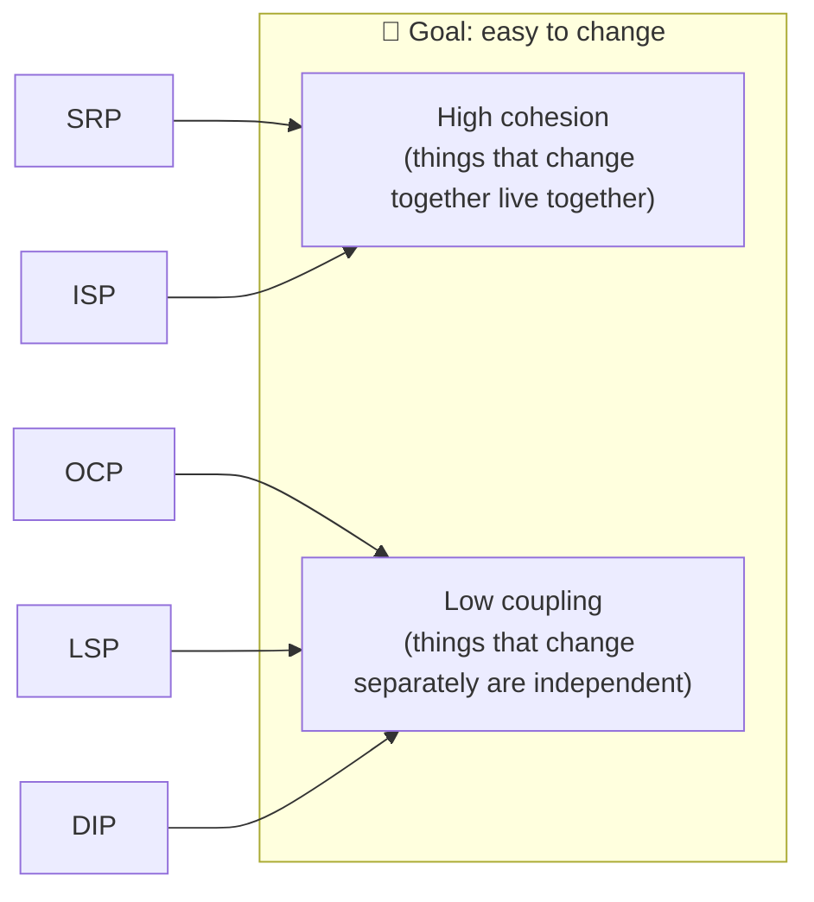

A useful mental rule that sums up both:

> **Gather together the things that change for the same reasons. Separate the things that change for different reasons.**

<a id="history"></a>

## 4. A short history of SOLID

| Year | Milestone |
| --- | --- |
| 1987–1994 | **Barbara Liskov** introduces the substitution idea (keynote *Data Abstraction and Hierarchy*, 1987) and formalises it with **Jeannette Wing** (*A Behavioral Notion of Subtyping*, 1994). |
| 1988 | **Bertrand Meyer** states the **Open/Closed Principle** in *Object-Oriented Software Construction*. |
| 1995–2000 | **Robert C. Martin** ("Uncle Bob") writes a series of articles collecting and refining these ideas, culminating in the paper *Design Principles and Design Patterns* (2000). |
| ~2004 | **Michael Feathers** notices the initials spell **SOLID**, and the acronym sticks. |
| 2002 / 2017 | Martin expands on them in *Agile Software Development: Principles, Patterns, and Practices* and later in *Clean Architecture*, where SRP is restated in terms of **actors**. |

SOLID is not a law of nature: it is a **distilled set of lessons** from decades of maintaining object-oriented systems. As you will see, the same lessons apply to Go structs, Python protocols and React components.

<a id="running-example"></a>

## 5. The running example: an online shop

To make comparison easy, **every principle uses the same business domain** — an online shop — and **every language implements the same behaviour**, verified by equivalent tests.

| Principle | Scenario | ❌ Problem | ✅ Solution |
| --- | --- | --- | --- |
| **S** | Placing an order | `OrderService` validates, prices, stores and emails | One collaborator per reason to change + a thin coordinator |
| **O** | Discounts | A `switch` that grows with every promotion | `DiscountPolicy` plug-ins; the calculator never changes |
| **L** | Payments & refunds | `GiftCard` inherits `Refund()` and throws | Separate `PaymentMethod` and `RefundablePaymentMethod` contracts + contract tests |
| **I** | Order storage | A fat `IOrderStore`; a read-only archive must fake writes | Role interfaces: `OrderReader`, `OrderWriter`, `SalesStatistics` |
| **D** | Checkout | `CheckoutService` does `new Stripe()` and `new Smtp()` | It depends on `PaymentGateway`/`CustomerNotifier` abstractions it owns; adapters plug in |

In React, the same ideas are shown the React way: hooks and pure functions (S), component registries (O), substitutable button components (L), narrow props (I) and services injected through context (D).

> [!NOTE]
> **Money representation is idiomatic per language**: `decimal` in C#, `Decimal` in Python and integer **cents** in Go, TypeScript and React. Never use binary floating point for money.

[⬆ Back to top](#toc)

---

# Part II — The Five Principles

<a id="srp"></a>

## S — Single Responsibility Principle (SRP)

### 📖 Definition

> *"A class should have only one reason to change."* — Robert C. Martin, *Agile Software Development* (2002)
>
> Refined in *Clean Architecture* (2017): *"A module should be responsible to one, and only one, **actor**."*

### 💡 In plain words

SRP is **not** "a class should do only one thing" (that is a rule for *functions*). It is about **who asks for changes**.

An **actor** is a group of people (or a system) that may request a change: the product owner who defines business rules, finance who defines taxes, the DBA who owns storage, marketing who owns the wording of emails. If a single class serves several actors, a change requested by one of them can silently break what another one depends on.

> **Gather together the things that change for the same reason. Separate the things that change for different reasons.**

### 🏠 Analogy

A Swiss Army knife is great for camping, terrible for a professional kitchen. If the scissors break, you send the whole knife to repair — and you lose the blade, the corkscrew and the screwdriver while it's away. A chef has separate tools: replacing the scissors does not affect the knife.

### 🔍 How to spot a violation

- The class name contains **"And"**, **"Manager"**, **"Processor"**, **"Helper"** or **"Utils"** and does many unrelated things.
- You can't describe what the class does in one sentence **without using "and"**.
- Methods use **disjoint sets of fields** (some use the DB connection, others the SMTP client).
- `import`/`using` lists mix **domains**: HTTP, SQL, SMTP, PDF, crypto… in one file.
- **Merge conflicts**: different teams keep editing the same file for unrelated reasons.
- Tests need to set up a database **and** an email server **and** a clock to check a price.

### ❌ The problem

`OrderService.PlaceOrder` validates the order, computes taxes, persists it and sends an email. Four actors, one class:

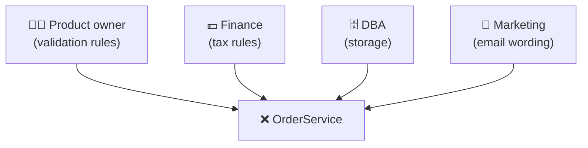

<details>
<summary><b>🟣 C# (.NET 8)</b> — <code>dotnet/src/SolidPrinciples/Srp/Bad/OrderService.cs</code></summary>

<!-- snippet: dotnet/src/SolidPrinciples/Srp/Bad/OrderService.cs -->
```csharp
using System.Globalization;

namespace SolidPrinciples.Srp.Bad;

public sealed record OrderLine(string Sku, decimal UnitPrice, int Quantity);

public sealed record Order(string Id, string CustomerEmail, IReadOnlyList<OrderLine> Lines);

/// <summary>
/// ❌ SRP violation: one class validates, prices, persists and notifies.
/// Four different actors (product owner, finance, DBA, marketing) can each
/// force a change here, and every change risks breaking the other three jobs.
/// </summary>
public sealed class OrderService
{
    private const decimal TaxRate = 0.21m;

    private readonly Dictionary<string, decimal> _ordersTable = [];
    private readonly List<string> _sentEmails = [];

    public IReadOnlyDictionary<string, decimal> OrdersTable => _ordersTable;

    public IReadOnlyList<string> SentEmails => _sentEmails;

    public decimal PlaceOrder(Order order)
    {
        ArgumentNullException.ThrowIfNull(order);

        // 1) Business rules (product owner)
        if (order.Lines.Count == 0)
        {
            throw new InvalidOperationException("An order needs at least one line.");
        }

        if (order.Lines.Any(line => line.Quantity <= 0))
        {
            throw new InvalidOperationException("Quantities must be positive.");
        }

        if (!order.CustomerEmail.Contains('@', StringComparison.Ordinal))
        {
            throw new InvalidOperationException("Customer email is invalid.");
        }

        // 2) Pricing and taxes (finance)
        var subtotal = order.Lines.Sum(line => line.UnitPrice * line.Quantity);
        var total = Math.Round(subtotal * (1 + TaxRate), 2, MidpointRounding.AwayFromZero);

        // 3) Persistence (DBA / infrastructure)
        _ordersTable[order.Id] = total;

        // 4) Notification wording and delivery (marketing)
        _sentEmails.Add(string.Create(
            CultureInfo.InvariantCulture,
            $"To: {order.CustomerEmail} | Order {order.Id} confirmed | Total: {total:0.00} EUR"));

        return total;
    }
}
```
<!-- /snippet -->

</details>
<details>
<summary><b>🐍 Python 3.12</b> — <code>python/solid/srp/bad.py</code></summary>

<!-- snippet: python/solid/srp/bad.py -->
```python
"""SRP - the problem: one class with four reasons to change."""

from dataclasses import dataclass
from decimal import ROUND_HALF_UP, Decimal


@dataclass(frozen=True)
class OrderLine:
    sku: str
    unit_price: Decimal
    quantity: int


@dataclass(frozen=True)
class Order:
    id: str
    customer_email: str
    lines: tuple[OrderLine, ...]


class OrderService:
    """❌ Validates, prices, persists AND notifies.

    Four different actors (product owner, finance, DBA, marketing) can each
    force a change here, and every change risks breaking the other three jobs.
    """

    TAX_RATE = Decimal("0.21")

    def __init__(self) -> None:
        self.orders_table: dict[str, Decimal] = {}
        self.sent_emails: list[str] = []

    def place_order(self, order: Order) -> Decimal:
        # 1) Business rules (product owner)
        if not order.lines:
            raise ValueError("An order needs at least one line.")
        if any(line.quantity <= 0 for line in order.lines):
            raise ValueError("Quantities must be positive.")
        if "@" not in order.customer_email:
            raise ValueError("Customer email is invalid.")

        # 2) Pricing and taxes (finance)
        subtotal = sum((line.unit_price * line.quantity for line in order.lines), Decimal(0))
        total = (subtotal * (1 + self.TAX_RATE)).quantize(Decimal("0.01"), ROUND_HALF_UP)

        # 3) Persistence (DBA / infrastructure)
        self.orders_table[order.id] = total

        # 4) Notification wording and delivery (marketing)
        self.sent_emails.append(
            f"To: {order.customer_email} | Order {order.id} confirmed | Total: {total:.2f} EUR"
        )
        return total
```
<!-- /snippet -->

</details>
<details>
<summary><b>🐹 Go 1.22</b> — <code>go/srp/bad/order_service.go</code></summary>

<!-- snippet: go/srp/bad/order_service.go -->
```go
// Package bad shows an SRP violation: one type with four reasons to change.
package bad

import (
	"errors"
	"fmt"
	"strings"
)

// Cents represents money as an integer number of cents to avoid float errors.
type Cents int64

type OrderLine struct {
	SKU       string
	UnitPrice Cents
	Quantity  int
}

type Order struct {
	ID            string
	CustomerEmail string
	Lines         []OrderLine
}

// taxRateBasisPoints is 21% expressed in basis points (1/100 of a percent).
const taxRateBasisPoints = 2100

// OrderService ❌ validates, prices, persists AND notifies. Product owner,
// finance, DBA and marketing can each force a change here.
type OrderService struct {
	OrdersTable map[string]Cents
	SentEmails  []string
}

func NewOrderService() *OrderService {
	return &OrderService{OrdersTable: map[string]Cents{}}
}

func (s *OrderService) PlaceOrder(order Order) (Cents, error) {
	// 1) Business rules (product owner)
	if len(order.Lines) == 0 {
		return 0, errors.New("an order needs at least one line")
	}
	for _, line := range order.Lines {
		if line.Quantity <= 0 {
			return 0, errors.New("quantities must be positive")
		}
	}
	if !strings.Contains(order.CustomerEmail, "@") {
		return 0, errors.New("customer email is invalid")
	}

	// 2) Pricing and taxes (finance)
	var subtotal Cents
	for _, line := range order.Lines {
		subtotal += line.UnitPrice * Cents(line.Quantity)
	}
	total := subtotal + (subtotal*taxRateBasisPoints+5000)/10000

	// 3) Persistence (DBA / infrastructure)
	s.OrdersTable[order.ID] = total

	// 4) Notification wording and delivery (marketing)
	s.SentEmails = append(s.SentEmails, fmt.Sprintf(
		"To: %s | Order %s confirmed | Total: %d.%02d EUR",
		order.CustomerEmail, order.ID, total/100, total%100))

	return total, nil
}
```
<!-- /snippet -->

</details>
<details>
<summary><b>🔷 TypeScript 5</b> — <code>typescript/src/srp/bad.ts</code></summary>

<!-- snippet: typescript/src/srp/bad.ts -->
```typescript
// SRP - the problem: one class with four reasons to change.

/** Money as integer cents to avoid floating-point errors. */
export type Cents = number;

export interface OrderLine {
  readonly sku: string;
  readonly unitPrice: Cents;
  readonly quantity: number;
}

export interface Order {
  readonly id: string;
  readonly customerEmail: string;
  readonly lines: readonly OrderLine[];
}

/**
 * ❌ Validates, prices, persists AND notifies. Product owner, finance, DBA and
 * marketing can each force a change here, risking the other three jobs.
 */
export class OrderService {
  private static readonly TAX_RATE = 0.21;

  readonly ordersTable = new Map<string, Cents>();
  readonly sentEmails: string[] = [];

  placeOrder(order: Order): Cents {
    // 1) Business rules (product owner)
    if (order.lines.length === 0) throw new Error("An order needs at least one line.");
    if (order.lines.some((line) => line.quantity <= 0)) throw new Error("Quantities must be positive.");
    if (!order.customerEmail.includes("@")) throw new Error("Customer email is invalid.");

    // 2) Pricing and taxes (finance)
    const subtotal = order.lines.reduce((sum, line) => sum + line.unitPrice * line.quantity, 0);
    const total = subtotal + Math.round(subtotal * OrderService.TAX_RATE);

    // 3) Persistence (DBA / infrastructure)
    this.ordersTable.set(order.id, total);

    // 4) Notification wording and delivery (marketing)
    this.sentEmails.push(
      `To: ${order.customerEmail} | Order ${order.id} confirmed | Total: ${(total / 100).toFixed(2)} EUR`,
    );
    return total;
  }
}
```
<!-- /snippet -->

</details>
<details>
<summary><b>⚛️ React 18 + TypeScript</b> — <code>react/src/srp/types.ts</code>, <code>react/src/srp/bad/OrderSummary.tsx</code></summary>

<!-- snippet: react/src/srp/types.ts, react/src/srp/bad/OrderSummary.tsx -->
```typescript
// ── react/src/srp/types.ts ──
import type { Cents } from "../shared/money";

export interface OrderLine {
  readonly sku: string;
  readonly name: string;
  readonly unitPrice: Cents;
  readonly quantity: number;
}

export interface Order {
  readonly id: string;
  readonly lines: readonly OrderLine[];
}

// ── react/src/srp/bad/OrderSummary.tsx ──
import { useEffect, useState } from "react";
import type { Order } from "../types";

/**
 * ❌ SRP violation: this component fetches data, manages loading/error state,
 * computes taxes, formats currency AND renders markup. A change to the API,
 * the tax rules, the locale or the design all land in the same file.
 */
export function OrderSummary({ orderId }: { orderId: string }) {
  const [order, setOrder] = useState<Order | null>(null);
  const [error, setError] = useState<string | null>(null);

  useEffect(() => {
    let cancelled = false;
    fetch(`/api/orders/${orderId}`)
      .then((response) => {
        if (!response.ok) throw new Error(`HTTP ${response.status}`);
        return response.json() as Promise<Order>;
      })
      .then((data) => !cancelled && setOrder(data))
      .catch((e: unknown) => !cancelled && setError(String(e)));
    return () => {
      cancelled = true;
    };
  }, [orderId]);

  if (error) return <p role="alert">Could not load order: {error}</p>;
  if (!order) return <p>Loading…</p>;

  const subtotal = order.lines.reduce((sum, l) => sum + l.unitPrice * l.quantity, 0);
  const tax = Math.round(subtotal * 0.21);
  const fmt = (cents: number) =>
    new Intl.NumberFormat("en-IE", { style: "currency", currency: "EUR" }).format(cents / 100);

  return (
    <section aria-label="Order summary">
      <h2>Order {order.id}</h2>
      <ul>
        {order.lines.map((l) => (
          <li key={l.sku}>
            {l.quantity} × {l.name} — {fmt(l.unitPrice * l.quantity)}
          </li>
        ))}
      </ul>
      <p>Subtotal: {fmt(subtotal)}</p>
      <p>Tax: {fmt(tax)}</p>
      <p>
        <strong>Total: {fmt(subtotal + tax)}</strong>
      </p>
    </section>
  );
}
```
<!-- /snippet -->

</details>

**Why it hurts:**

1. **Fragility** — finance changes the tax rounding and a typo breaks the email template in the same method.
2. **Untestable pieces** — to test the tax calculation you must run validation, persistence and notification too.
3. **No reuse** — the invoice module also needs to compute totals but cannot do so without dragging persistence and email along.
4. **Merge conflicts** — four teams, one file.

### 🔧 Refactoring step by step

1. **List the actors** and, for each line of code, ask *"who would ask me to change this?"*. Colour-code the method (validation / pricing / persistence / notification).
2. **Extract a class per actor**: `OrderValidator`, `PriceCalculator`, `OrderRepository`, `OrderConfirmationNotifier`. Move code; don't rewrite it.
3. **Introduce a value object** (`OrderTotals`) so pieces communicate through data, not shared fields.
4. **Turn the original class into a coordinator** (a *facade*/*application service*) that only calls the collaborators in order.
5. **Inject collaborators via the constructor** so they can be replaced in tests (this prepares the ground for DIP).
6. **Write a focused test per collaborator** and one integration-style test for the coordinator.

### ✅ The solution

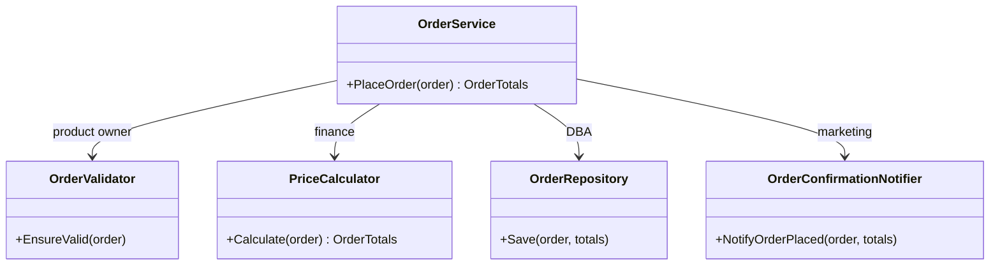

<details>
<summary><b>🟣 C# (.NET 8)</b> — <code>dotnet/src/SolidPrinciples/Srp/Good/Order.cs</code>, <code>dotnet/src/SolidPrinciples/Srp/Good/OrderValidator.cs</code>, <code>dotnet/src/SolidPrinciples/Srp/Good/PriceCalculator.cs</code>, <code>dotnet/src/SolidPrinciples/Srp/Good/OrderRepository.cs</code>, <code>dotnet/src/SolidPrinciples/Srp/Good/OrderConfirmationNotifier.cs</code>, <code>dotnet/src/SolidPrinciples/Srp/Good/OrderService.cs</code></summary>

<!-- snippet: dotnet/src/SolidPrinciples/Srp/Good/Order.cs, dotnet/src/SolidPrinciples/Srp/Good/OrderValidator.cs, dotnet/src/SolidPrinciples/Srp/Good/PriceCalculator.cs, dotnet/src/SolidPrinciples/Srp/Good/OrderRepository.cs, dotnet/src/SolidPrinciples/Srp/Good/OrderConfirmationNotifier.cs, dotnet/src/SolidPrinciples/Srp/Good/OrderService.cs -->
```csharp
// ── dotnet/src/SolidPrinciples/Srp/Good/Order.cs ──
namespace SolidPrinciples.Srp.Good;

public sealed record OrderLine(string Sku, decimal UnitPrice, int Quantity);

public sealed record Order(string Id, string CustomerEmail, IReadOnlyList<OrderLine> Lines);

public sealed record OrderTotals(decimal Subtotal, decimal Tax, decimal Total);

public sealed class InvalidOrderException(string message) : Exception(message);

// ── dotnet/src/SolidPrinciples/Srp/Good/OrderValidator.cs ──
namespace SolidPrinciples.Srp.Good;

/// <summary>Single reason to change: the business rules that define a valid order.</summary>
public sealed class OrderValidator
{
    public void EnsureValid(Order order)
    {
        ArgumentNullException.ThrowIfNull(order);

        if (order.Lines.Count == 0)
        {
            throw new InvalidOrderException("An order needs at least one line.");
        }

        if (order.Lines.Any(line => line.Quantity <= 0))
        {
            throw new InvalidOrderException("Quantities must be positive.");
        }

        if (!order.CustomerEmail.Contains('@', StringComparison.Ordinal))
        {
            throw new InvalidOrderException("Customer email is invalid.");
        }
    }
}

// ── dotnet/src/SolidPrinciples/Srp/Good/PriceCalculator.cs ──
namespace SolidPrinciples.Srp.Good;

/// <summary>Single reason to change: how finance computes money.</summary>
public sealed class PriceCalculator(decimal taxRate)
{
    public OrderTotals Calculate(Order order)
    {
        ArgumentNullException.ThrowIfNull(order);

        var subtotal = order.Lines.Sum(line => line.UnitPrice * line.Quantity);
        var tax = Math.Round(subtotal * taxRate, 2, MidpointRounding.AwayFromZero);
        return new OrderTotals(subtotal, tax, subtotal + tax);
    }
}

// ── dotnet/src/SolidPrinciples/Srp/Good/OrderRepository.cs ──
namespace SolidPrinciples.Srp.Good;

/// <summary>Single reason to change: how orders are stored.</summary>
public sealed class OrderRepository
{
    private readonly Dictionary<string, OrderTotals> _orders = [];

    public void Save(Order order, OrderTotals totals)
    {
        ArgumentNullException.ThrowIfNull(order);
        _orders[order.Id] = totals;
    }

    public OrderTotals? FindTotals(string orderId) =>
        _orders.TryGetValue(orderId, out var totals) ? totals : null;
}

// ── dotnet/src/SolidPrinciples/Srp/Good/OrderConfirmationNotifier.cs ──
using System.Globalization;

namespace SolidPrinciples.Srp.Good;

/// <summary>Single reason to change: what the customer is told and how.</summary>
public sealed class OrderConfirmationNotifier
{
    private readonly List<string> _sentMessages = [];

    public IReadOnlyList<string> SentMessages => _sentMessages;

    public void NotifyOrderPlaced(Order order, OrderTotals totals)
    {
        ArgumentNullException.ThrowIfNull(order);
        ArgumentNullException.ThrowIfNull(totals);

        _sentMessages.Add(string.Create(
            CultureInfo.InvariantCulture,
            $"To: {order.CustomerEmail} | Order {order.Id} confirmed | Total: {totals.Total:0.00} EUR"));
    }
}

// ── dotnet/src/SolidPrinciples/Srp/Good/OrderService.cs ──
namespace SolidPrinciples.Srp.Good;

/// <summary>
/// ✅ The service only coordinates the workflow. Every decision lives in a
/// collaborator that has exactly one reason to change.
/// </summary>
public sealed class OrderService(
    OrderValidator validator,
    PriceCalculator calculator,
    OrderRepository repository,
    OrderConfirmationNotifier notifier)
{
    public OrderTotals PlaceOrder(Order order)
    {
        validator.EnsureValid(order);
        var totals = calculator.Calculate(order);
        repository.Save(order, totals);
        notifier.NotifyOrderPlaced(order, totals);
        return totals;
    }
}
```
<!-- /snippet -->

</details>
<details>
<summary><b>🐍 Python 3.12</b> — <code>python/solid/srp/good.py</code></summary>

<!-- snippet: python/solid/srp/good.py -->
```python
"""SRP - the solution: one class per reason to change, plus a thin coordinator."""

from dataclasses import dataclass
from decimal import ROUND_HALF_UP, Decimal


@dataclass(frozen=True)
class OrderLine:
    sku: str
    unit_price: Decimal
    quantity: int


@dataclass(frozen=True)
class Order:
    id: str
    customer_email: str
    lines: tuple[OrderLine, ...]


@dataclass(frozen=True)
class OrderTotals:
    subtotal: Decimal
    tax: Decimal
    total: Decimal


class InvalidOrderError(ValueError):
    """Raised when an order breaks a business rule."""


class OrderValidator:
    """Single reason to change: the business rules that define a valid order."""

    def ensure_valid(self, order: Order) -> None:
        if not order.lines:
            raise InvalidOrderError("An order needs at least one line.")
        if any(line.quantity <= 0 for line in order.lines):
            raise InvalidOrderError("Quantities must be positive.")
        if "@" not in order.customer_email:
            raise InvalidOrderError("Customer email is invalid.")


class PriceCalculator:
    """Single reason to change: how finance computes money."""

    def __init__(self, tax_rate: Decimal) -> None:
        self._tax_rate = tax_rate

    def calculate(self, order: Order) -> OrderTotals:
        subtotal = sum((line.unit_price * line.quantity for line in order.lines), Decimal(0))
        tax = (subtotal * self._tax_rate).quantize(Decimal("0.01"), ROUND_HALF_UP)
        return OrderTotals(subtotal=subtotal, tax=tax, total=subtotal + tax)


class OrderRepository:
    """Single reason to change: how orders are stored."""

    def __init__(self) -> None:
        self._orders: dict[str, OrderTotals] = {}

    def save(self, order: Order, totals: OrderTotals) -> None:
        self._orders[order.id] = totals

    def find_totals(self, order_id: str) -> OrderTotals | None:
        return self._orders.get(order_id)


class OrderConfirmationNotifier:
    """Single reason to change: what the customer is told and how."""

    def __init__(self) -> None:
        self.sent_messages: list[str] = []

    def notify_order_placed(self, order: Order, totals: OrderTotals) -> None:
        self.sent_messages.append(
            f"To: {order.customer_email} | Order {order.id} confirmed | "
            f"Total: {totals.total:.2f} EUR"
        )


class OrderService:
    """✅ Only coordinates the workflow; every decision lives in a collaborator."""

    def __init__(
        self,
        validator: OrderValidator,
        calculator: PriceCalculator,
        repository: OrderRepository,
        notifier: OrderConfirmationNotifier,
    ) -> None:
        self._validator = validator
        self._calculator = calculator
        self._repository = repository
        self._notifier = notifier

    def place_order(self, order: Order) -> OrderTotals:
        self._validator.ensure_valid(order)
        totals = self._calculator.calculate(order)
        self._repository.save(order, totals)
        self._notifier.notify_order_placed(order, totals)
        return totals
```
<!-- /snippet -->

</details>
<details>
<summary><b>🐹 Go 1.22</b> — <code>go/srp/good/order.go</code>, <code>go/srp/good/validator.go</code>, <code>go/srp/good/calculator.go</code>, <code>go/srp/good/repository.go</code>, <code>go/srp/good/notifier.go</code>, <code>go/srp/good/order_service.go</code></summary>

<!-- snippet: go/srp/good/order.go, go/srp/good/validator.go, go/srp/good/calculator.go, go/srp/good/repository.go, go/srp/good/notifier.go, go/srp/good/order_service.go -->
```go
// ── go/srp/good/order.go ──
// Package good shows SRP applied: one type per reason to change, plus a thin coordinator.
package good

import "fmt"

// Cents represents money as an integer number of cents to avoid float errors.
type Cents int64

func (c Cents) String() string { return fmt.Sprintf("%d.%02d", c/100, c%100) }

type OrderLine struct {
	SKU       string
	UnitPrice Cents
	Quantity  int
}

type Order struct {
	ID            string
	CustomerEmail string
	Lines         []OrderLine
}

type OrderTotals struct {
	Subtotal Cents
	Tax      Cents
	Total    Cents
}

// ── go/srp/good/validator.go ──
package good

import (
	"errors"
	"strings"
)

// ErrInvalidOrder is wrapped by every validation failure.
var ErrInvalidOrder = errors.New("invalid order")

// OrderValidator has a single reason to change: the business rules of a valid order.
type OrderValidator struct{}

func (OrderValidator) Validate(order Order) error {
	if len(order.Lines) == 0 {
		return invalid("an order needs at least one line")
	}
	for _, line := range order.Lines {
		if line.Quantity <= 0 {
			return invalid("quantities must be positive")
		}
	}
	if !strings.Contains(order.CustomerEmail, "@") {
		return invalid("customer email is invalid")
	}
	return nil
}

func invalid(reason string) error { return errors.Join(ErrInvalidOrder, errors.New(reason)) }

// ── go/srp/good/calculator.go ──
package good

// PriceCalculator has a single reason to change: how finance computes money.
type PriceCalculator struct {
	TaxRateBasisPoints int64 // 2100 = 21%
}

func (c PriceCalculator) Calculate(order Order) OrderTotals {
	var subtotal Cents
	for _, line := range order.Lines {
		subtotal += line.UnitPrice * Cents(line.Quantity)
	}
	tax := (subtotal*Cents(c.TaxRateBasisPoints) + 5000) / 10000 // round half up
	return OrderTotals{Subtotal: subtotal, Tax: tax, Total: subtotal + tax}
}

// ── go/srp/good/repository.go ──
package good

// OrderRepository has a single reason to change: how orders are stored.
type OrderRepository struct {
	orders map[string]OrderTotals
}

func NewOrderRepository() *OrderRepository {
	return &OrderRepository{orders: map[string]OrderTotals{}}
}

func (r *OrderRepository) Save(order Order, totals OrderTotals) {
	r.orders[order.ID] = totals
}

func (r *OrderRepository) FindTotals(orderID string) (OrderTotals, bool) {
	totals, ok := r.orders[orderID]
	return totals, ok
}

// ── go/srp/good/notifier.go ──
package good

import "fmt"

// OrderConfirmationNotifier has a single reason to change: what the customer is told.
type OrderConfirmationNotifier struct {
	SentMessages []string
}

func (n *OrderConfirmationNotifier) NotifyOrderPlaced(order Order, totals OrderTotals) {
	n.SentMessages = append(n.SentMessages, fmt.Sprintf(
		"To: %s | Order %s confirmed | Total: %s EUR", order.CustomerEmail, order.ID, totals.Total))
}

// ── go/srp/good/order_service.go ──
package good

// OrderService ✅ only coordinates the workflow; every decision lives in a collaborator.
type OrderService struct {
	validator  OrderValidator
	calculator PriceCalculator
	repository *OrderRepository
	notifier   *OrderConfirmationNotifier
}

func NewOrderService(
	validator OrderValidator,
	calculator PriceCalculator,
	repository *OrderRepository,
	notifier *OrderConfirmationNotifier,
) *OrderService {
	return &OrderService{validator, calculator, repository, notifier}
}

func (s *OrderService) PlaceOrder(order Order) (OrderTotals, error) {
	if err := s.validator.Validate(order); err != nil {
		return OrderTotals{}, err
	}
	totals := s.calculator.Calculate(order)
	s.repository.Save(order, totals)
	s.notifier.NotifyOrderPlaced(order, totals)
	return totals, nil
}
```
<!-- /snippet -->

</details>
<details>
<summary><b>🔷 TypeScript 5</b> — <code>typescript/src/srp/good.ts</code></summary>

<!-- snippet: typescript/src/srp/good.ts -->
```typescript
// SRP - the solution: one class per reason to change, plus a thin coordinator.

/** Money as integer cents to avoid floating-point errors. */
export type Cents = number;

export interface OrderLine {
  readonly sku: string;
  readonly unitPrice: Cents;
  readonly quantity: number;
}

export interface Order {
  readonly id: string;
  readonly customerEmail: string;
  readonly lines: readonly OrderLine[];
}

export interface OrderTotals {
  readonly subtotal: Cents;
  readonly tax: Cents;
  readonly total: Cents;
}

export class InvalidOrderError extends Error {
  override readonly name = "InvalidOrderError";
}

/** Single reason to change: the business rules that define a valid order. */
export class OrderValidator {
  ensureValid(order: Order): void {
    if (order.lines.length === 0) throw new InvalidOrderError("An order needs at least one line.");
    if (order.lines.some((line) => line.quantity <= 0)) {
      throw new InvalidOrderError("Quantities must be positive.");
    }
    if (!order.customerEmail.includes("@")) throw new InvalidOrderError("Customer email is invalid.");
  }
}

/** Single reason to change: how finance computes money. */
export class PriceCalculator {
  constructor(private readonly taxRate: number) {}

  calculate(order: Order): OrderTotals {
    const subtotal = order.lines.reduce((sum, line) => sum + line.unitPrice * line.quantity, 0);
    const tax = Math.round(subtotal * this.taxRate);
    return { subtotal, tax, total: subtotal + tax };
  }
}

/** Single reason to change: how orders are stored. */
export class OrderRepository {
  private readonly orders = new Map<string, OrderTotals>();

  save(order: Order, totals: OrderTotals): void {
    this.orders.set(order.id, totals);
  }

  findTotals(orderId: string): OrderTotals | undefined {
    return this.orders.get(orderId);
  }
}

/** Single reason to change: what the customer is told and how. */
export class OrderConfirmationNotifier {
  readonly sentMessages: string[] = [];

  notifyOrderPlaced(order: Order, totals: OrderTotals): void {
    this.sentMessages.push(
      `To: ${order.customerEmail} | Order ${order.id} confirmed | Total: ${(totals.total / 100).toFixed(2)} EUR`,
    );
  }
}

/** ✅ Only coordinates the workflow; every decision lives in a collaborator. */
export class OrderService {
  constructor(
    private readonly validator: OrderValidator,
    private readonly calculator: PriceCalculator,
    private readonly repository: OrderRepository,
    private readonly notifier: OrderConfirmationNotifier,
  ) {}

  placeOrder(order: Order): OrderTotals {
    this.validator.ensureValid(order);
    const totals = this.calculator.calculate(order);
    this.repository.save(order, totals);
    this.notifier.notifyOrderPlaced(order, totals);
    return totals;
  }
}
```
<!-- /snippet -->

</details>
<details>
<summary><b>⚛️ React 18 + TypeScript</b> — <code>react/src/srp/good/orderTotals.ts</code>, <code>react/src/srp/good/orderApi.ts</code>, <code>react/src/srp/good/useOrder.ts</code>, <code>react/src/srp/good/OrderSummaryView.tsx</code>, <code>react/src/srp/good/OrderSummary.tsx</code></summary>

<!-- snippet: react/src/srp/good/orderTotals.ts, react/src/srp/good/orderApi.ts, react/src/srp/good/useOrder.ts, react/src/srp/good/OrderSummaryView.tsx, react/src/srp/good/OrderSummary.tsx -->
```typescript
// ── react/src/srp/good/orderTotals.ts ──
import type { Cents } from "../../shared/money";
import type { Order } from "../types";

export interface OrderTotals {
  readonly subtotal: Cents;
  readonly tax: Cents;
  readonly total: Cents;
}

/** Single reason to change: pricing rules. A pure function, trivial to test. */
export function calculateTotals(order: Order, taxRate: number): OrderTotals {
  const subtotal = order.lines.reduce((sum, line) => sum + line.unitPrice * line.quantity, 0);
  const tax = Math.round(subtotal * taxRate);
  return { subtotal, tax, total: subtotal + tax };
}

// ── react/src/srp/good/orderApi.ts ──
import type { Order } from "../types";

export type LoadOrder = (orderId: string, signal?: AbortSignal) => Promise<Order>;

/** Single reason to change: the HTTP contract with the backend. */
export const fetchOrder: LoadOrder = async (orderId, signal) => {
  const response = await fetch(`/api/orders/${encodeURIComponent(orderId)}`, signal ? { signal } : {});
  if (!response.ok) throw new Error(`HTTP ${response.status}`);
  return (await response.json()) as Order;
};

// ── react/src/srp/good/useOrder.ts ──
import { useEffect, useState } from "react";
import type { Order } from "../types";
import { fetchOrder, type LoadOrder } from "./orderApi";

export type OrderState =
  | { readonly status: "loading" }
  | { readonly status: "error"; readonly message: string }
  | { readonly status: "ready"; readonly order: Order };

/** Single reason to change: how the UI loads and tracks remote state. */
export function useOrder(orderId: string, loadOrder: LoadOrder = fetchOrder): OrderState {
  const [state, setState] = useState<OrderState>({ status: "loading" });

  useEffect(() => {
    const controller = new AbortController();
    setState({ status: "loading" });
    loadOrder(orderId, controller.signal)
      .then((order) => setState({ status: "ready", order }))
      .catch((error: unknown) => {
        if (!controller.signal.aborted) setState({ status: "error", message: String(error) });
      });
    return () => controller.abort();
  }, [orderId, loadOrder]);

  return state;
}

// ── react/src/srp/good/OrderSummaryView.tsx ──
import { formatMoney } from "../../shared/money";
import type { Order } from "../types";
import type { OrderTotals } from "./orderTotals";

interface OrderSummaryViewProps {
  readonly order: Order;
  readonly totals: OrderTotals;
}

/** Single reason to change: how the summary looks. Pure, props in → markup out. */
export function OrderSummaryView({ order, totals }: OrderSummaryViewProps) {
  return (
    <section aria-label="Order summary">
      <h2>Order {order.id}</h2>
      <ul>
        {order.lines.map((line) => (
          <li key={line.sku}>
            {line.quantity} × {line.name} — {formatMoney(line.unitPrice * line.quantity)}
          </li>
        ))}
      </ul>
      <p>Subtotal: {formatMoney(totals.subtotal)}</p>
      <p>Tax: {formatMoney(totals.tax)}</p>
      <p>
        <strong>Total: {formatMoney(totals.total)}</strong>
      </p>
    </section>
  );
}

// ── react/src/srp/good/OrderSummary.tsx ──
import type { LoadOrder } from "./orderApi";
import { calculateTotals } from "./orderTotals";
import { OrderSummaryView } from "./OrderSummaryView";
import { useOrder } from "./useOrder";

const TAX_RATE = 0.21;

interface OrderSummaryProps {
  readonly orderId: string;
  readonly loadOrder?: LoadOrder;
}

/** ✅ A thin container: wires the hook, the pricing function and the view. */
export function OrderSummary({ orderId, loadOrder }: OrderSummaryProps) {
  const state = useOrder(orderId, loadOrder);

  if (state.status === "loading") return <p>Loading…</p>;
  if (state.status === "error") return <p role="alert">Could not load order: {state.message}</p>;

  return <OrderSummaryView order={state.order} totals={calculateTotals(state.order, TAX_RATE)} />;
}
```
<!-- /snippet -->

</details>

### 🧪 Proving it with tests

The same behaviour is preserved (the first test checks that ❌ and ✅ compute the same total), but now **each responsibility is tested in isolation**: the price calculator needs no database, the validator needs no email server.

<details>
<summary><b>🟣 C# (.NET 8)</b> — <code>dotnet/tests/SolidPrinciples.Tests/SrpTests.cs</code></summary>

<!-- snippet: dotnet/tests/SolidPrinciples.Tests/SrpTests.cs -->
```csharp
using SolidPrinciples.Srp.Good;

namespace SolidPrinciples.Tests;

public class SrpTests
{
    private static Order SampleOrder() =>
        new("A-1", "ana@example.com", [new OrderLine("BOOK", 10.00m, 2)]);

    [Fact]
    public void Bad_and_good_versions_compute_the_same_total()
    {
        var bad = new Srp.Bad.OrderService();
        var badTotal = bad.PlaceOrder(new Srp.Bad.Order("A-1", "ana@example.com", [new Srp.Bad.OrderLine("BOOK", 10.00m, 2)]));

        var good = new PriceCalculator(0.21m).Calculate(SampleOrder());

        Assert.Equal(24.20m, badTotal);
        Assert.Equal(badTotal, good.Total);
    }

    // Each responsibility can now be tested in isolation, with no database or email involved.
    [Fact]
    public void PriceCalculator_splits_subtotal_and_tax()
    {
        var totals = new PriceCalculator(0.21m).Calculate(SampleOrder());

        Assert.Equal(new OrderTotals(20.00m, 4.20m, 24.20m), totals);
    }

    [Theory]
    [InlineData("no-at-sign", 1, "Customer email is invalid.")]
    [InlineData("ana@example.com", 0, "Quantities must be positive.")]
    public void OrderValidator_rejects_invalid_orders(string email, int quantity, string expected)
    {
        var order = new Order("A-2", email, [new OrderLine("BOOK", 10m, quantity)]);

        var error = Assert.Throws<InvalidOrderException>(() => new OrderValidator().EnsureValid(order));
        Assert.Equal(expected, error.Message);
    }

    [Fact]
    public void OrderService_coordinates_the_collaborators()
    {
        var repository = new OrderRepository();
        var notifier = new OrderConfirmationNotifier();
        var service = new OrderService(new OrderValidator(), new PriceCalculator(0.21m), repository, notifier);

        var totals = service.PlaceOrder(SampleOrder());

        Assert.Equal(totals, repository.FindTotals("A-1"));
        Assert.Equal("To: ana@example.com | Order A-1 confirmed | Total: 24.20 EUR", Assert.Single(notifier.SentMessages));
    }

    [Fact]
    public void OrderService_does_not_save_or_notify_invalid_orders()
    {
        var repository = new OrderRepository();
        var notifier = new OrderConfirmationNotifier();
        var service = new OrderService(new OrderValidator(), new PriceCalculator(0.21m), repository, notifier);

        Assert.Throws<InvalidOrderException>(() => service.PlaceOrder(new Order("A-3", "ana@example.com", [])));
        Assert.Null(repository.FindTotals("A-3"));
        Assert.Empty(notifier.SentMessages);
    }
}
```
<!-- /snippet -->

</details>
<details>
<summary><b>🐍 Python 3.12</b> — <code>python/tests/test_srp.py</code></summary>

<!-- snippet: python/tests/test_srp.py -->
```python
from decimal import Decimal

import pytest

from solid.srp import bad
from solid.srp.good import (
    InvalidOrderError,
    Order,
    OrderConfirmationNotifier,
    OrderLine,
    OrderRepository,
    OrderService,
    OrderTotals,
    OrderValidator,
    PriceCalculator,
)

TAX = Decimal("0.21")


def sample_order() -> Order:
    return Order("A-1", "ana@example.com", (OrderLine("BOOK", Decimal("10.00"), 2),))


def make_service() -> tuple[OrderService, OrderRepository, OrderConfirmationNotifier]:
    repository, notifier = OrderRepository(), OrderConfirmationNotifier()
    service = OrderService(OrderValidator(), PriceCalculator(TAX), repository, notifier)
    return service, repository, notifier


def test_bad_and_good_versions_compute_the_same_total() -> None:
    bad_order = bad.Order("A-1", "ana@example.com", (bad.OrderLine("BOOK", Decimal("10.00"), 2),))
    bad_total = bad.OrderService().place_order(bad_order)

    assert bad_total == Decimal("24.20")
    assert PriceCalculator(TAX).calculate(sample_order()).total == bad_total


def test_price_calculator_splits_subtotal_and_tax() -> None:
    totals = PriceCalculator(TAX).calculate(sample_order())

    assert totals == OrderTotals(Decimal("20.00"), Decimal("4.20"), Decimal("24.20"))


@pytest.mark.parametrize(
    ("email", "quantity", "expected"),
    [
        ("no-at-sign", 1, "Customer email is invalid."),
        ("ana@example.com", 0, "Quantities must be positive."),
    ],
)
def test_validator_rejects_invalid_orders(email: str, quantity: int, expected: str) -> None:
    order = Order("A-2", email, (OrderLine("BOOK", Decimal(10), quantity),))

    with pytest.raises(InvalidOrderError, match=expected):
        OrderValidator().ensure_valid(order)


def test_service_coordinates_the_collaborators() -> None:
    service, repository, notifier = make_service()

    totals = service.place_order(sample_order())

    assert repository.find_totals("A-1") == totals
    assert notifier.sent_messages == [
        "To: ana@example.com | Order A-1 confirmed | Total: 24.20 EUR"
    ]


def test_service_does_not_save_or_notify_invalid_orders() -> None:
    service, repository, notifier = make_service()

    with pytest.raises(InvalidOrderError):
        service.place_order(Order("A-3", "ana@example.com", ()))

    assert repository.find_totals("A-3") is None
    assert notifier.sent_messages == []
```
<!-- /snippet -->

</details>
<details>
<summary><b>🐹 Go 1.22</b> — <code>go/srp/good/order_service_test.go</code></summary>

<!-- snippet: go/srp/good/order_service_test.go -->
```go
package good_test

import (
	"errors"
	"testing"

	"github.com/danielfyo/solid-principles-dotnet/go/srp/bad"
	"github.com/danielfyo/solid-principles-dotnet/go/srp/good"
)

var calculator = good.PriceCalculator{TaxRateBasisPoints: 2100}

func sampleOrder() good.Order {
	return good.Order{ID: "A-1", CustomerEmail: "ana@example.com",
		Lines: []good.OrderLine{{SKU: "BOOK", UnitPrice: 1000, Quantity: 2}}}
}

func newService() (*good.OrderService, *good.OrderRepository, *good.OrderConfirmationNotifier) {
	repository, notifier := good.NewOrderRepository(), &good.OrderConfirmationNotifier{}
	return good.NewOrderService(good.OrderValidator{}, calculator, repository, notifier), repository, notifier
}

func TestBadAndGoodComputeTheSameTotal(t *testing.T) {
	badTotal, err := bad.NewOrderService().PlaceOrder(bad.Order{ID: "A-1", CustomerEmail: "ana@example.com",
		Lines: []bad.OrderLine{{SKU: "BOOK", UnitPrice: 1000, Quantity: 2}}})
	if err != nil {
		t.Fatal(err)
	}
	if badTotal != 2420 || good.Cents(badTotal) != calculator.Calculate(sampleOrder()).Total {
		t.Fatalf("totals differ: bad=%d", badTotal)
	}
}

func TestPriceCalculatorSplitsSubtotalAndTax(t *testing.T) {
	got := calculator.Calculate(sampleOrder())
	want := good.OrderTotals{Subtotal: 2000, Tax: 420, Total: 2420}
	if got != want {
		t.Fatalf("got %+v, want %+v", got, want)
	}
}

func TestValidatorRejectsInvalidOrders(t *testing.T) {
	cases := map[string]good.Order{
		"bad email":     {ID: "A-2", CustomerEmail: "no-at-sign", Lines: []good.OrderLine{{"BOOK", 1000, 1}}},
		"zero quantity": {ID: "A-2", CustomerEmail: "ana@example.com", Lines: []good.OrderLine{{"BOOK", 1000, 0}}},
		"no lines":      {ID: "A-2", CustomerEmail: "ana@example.com"},
	}
	for name, order := range cases {
		t.Run(name, func(t *testing.T) {
			if err := (good.OrderValidator{}).Validate(order); !errors.Is(err, good.ErrInvalidOrder) {
				t.Fatalf("expected ErrInvalidOrder, got %v", err)
			}
		})
	}
}

func TestServiceCoordinatesTheCollaborators(t *testing.T) {
	service, repository, notifier := newService()

	totals, err := service.PlaceOrder(sampleOrder())
	if err != nil {
		t.Fatal(err)
	}
	if saved, ok := repository.FindTotals("A-1"); !ok || saved != totals {
		t.Fatalf("order not saved: %+v", saved)
	}
	want := "To: ana@example.com | Order A-1 confirmed | Total: 24.20 EUR"
	if len(notifier.SentMessages) != 1 || notifier.SentMessages[0] != want {
		t.Fatalf("unexpected messages: %v", notifier.SentMessages)
	}
}

func TestServiceDoesNotSaveOrNotifyInvalidOrders(t *testing.T) {
	service, repository, notifier := newService()

	if _, err := service.PlaceOrder(good.Order{ID: "A-3", CustomerEmail: "ana@example.com"}); err == nil {
		t.Fatal("expected an error")
	}
	if _, ok := repository.FindTotals("A-3"); ok || len(notifier.SentMessages) != 0 {
		t.Fatal("invalid order must not be saved or notified")
	}
}
```
<!-- /snippet -->

</details>
<details>
<summary><b>🔷 TypeScript 5</b> — <code>typescript/tests/srp.test.ts</code></summary>

<!-- snippet: typescript/tests/srp.test.ts -->
```typescript
import { describe, expect, it } from "vitest";
import * as bad from "../src/srp/bad.js";
import {
  InvalidOrderError,
  OrderConfirmationNotifier,
  OrderRepository,
  OrderService,
  OrderValidator,
  PriceCalculator,
  type Order,
} from "../src/srp/good.js";

const sampleOrder: Order = {
  id: "A-1",
  customerEmail: "ana@example.com",
  lines: [{ sku: "BOOK", unitPrice: 1000, quantity: 2 }],
};

const makeService = () => {
  const repository = new OrderRepository();
  const notifier = new OrderConfirmationNotifier();
  const service = new OrderService(new OrderValidator(), new PriceCalculator(0.21), repository, notifier);
  return { service, repository, notifier };
};

describe("SRP", () => {
  it("bad and good versions compute the same total", () => {
    const badTotal = new bad.OrderService().placeOrder(sampleOrder);

    expect(badTotal).toBe(2420);
    expect(new PriceCalculator(0.21).calculate(sampleOrder).total).toBe(badTotal);
  });

  it("PriceCalculator splits subtotal and tax", () => {
    expect(new PriceCalculator(0.21).calculate(sampleOrder)).toEqual({ subtotal: 2000, tax: 420, total: 2420 });
  });

  it.each([
    ["no-at-sign", 1, "Customer email is invalid."],
    ["ana@example.com", 0, "Quantities must be positive."],
  ])("OrderValidator rejects %s with quantity %i", (customerEmail, quantity, expected) => {
    const order: Order = { id: "A-2", customerEmail, lines: [{ sku: "BOOK", unitPrice: 1000, quantity }] };

    expect(() => new OrderValidator().ensureValid(order)).toThrowError(new InvalidOrderError(expected));
  });

  it("OrderService coordinates the collaborators", () => {
    const { service, repository, notifier } = makeService();

    const totals = service.placeOrder(sampleOrder);

    expect(repository.findTotals("A-1")).toEqual(totals);
    expect(notifier.sentMessages).toEqual(["To: ana@example.com | Order A-1 confirmed | Total: 24.20 EUR"]);
  });

  it("OrderService does not save or notify invalid orders", () => {
    const { service, repository, notifier } = makeService();

    expect(() => service.placeOrder({ id: "A-3", customerEmail: "ana@example.com", lines: [] })).toThrow(
      InvalidOrderError,
    );
    expect(repository.findTotals("A-3")).toBeUndefined();
    expect(notifier.sentMessages).toEqual([]);
  });
});
```
<!-- /snippet -->

</details>
<details>
<summary><b>⚛️ React 18 + TypeScript</b> — <code>react/src/srp/srp.test.tsx</code></summary>

<!-- snippet: react/src/srp/srp.test.tsx -->
```tsx
import { render, screen } from "@testing-library/react";
import { OrderSummary as BadOrderSummary } from "./bad/OrderSummary";
import { OrderSummary } from "./good/OrderSummary";
import { OrderSummaryView } from "./good/OrderSummaryView";
import { calculateTotals } from "./good/orderTotals";
import type { Order } from "./types";

const order: Order = { id: "A-1", lines: [{ sku: "BOOK", name: "Clean Code", unitPrice: 1000, quantity: 2 }] };

describe("SRP - the problem", () => {
  it("can only be tested by stubbing the global fetch", async () => {
    vi.stubGlobal("fetch", vi.fn().mockResolvedValue({ ok: true, json: async () => order }));

    render(<BadOrderSummary orderId="A-1" />);

    expect(await screen.findByText("Total: €24.20")).toBeInTheDocument();
    vi.unstubAllGlobals();
  });
});

describe("SRP - the solution", () => {
  it("pricing is a pure function", () => {
    expect(calculateTotals(order, 0.21)).toEqual({ subtotal: 2000, tax: 420, total: 2420 });
  });

  it("the view renders from props alone", () => {
    render(<OrderSummaryView order={order} totals={{ subtotal: 2000, tax: 420, total: 2420 }} />);

    expect(screen.getByText("2 × Clean Code — €20.00")).toBeInTheDocument();
    expect(screen.getByText("Total: €24.20")).toBeInTheDocument();
  });

  it("the container composes the pieces with an injected loader", async () => {
    render(<OrderSummary orderId="A-1" loadOrder={async () => order} />);

    expect(await screen.findByText("Total: €24.20")).toBeInTheDocument();
  });

  it("shows loading errors", async () => {
    render(<OrderSummary orderId="A-1" loadOrder={() => Promise.reject(new Error("offline"))} />);

    expect(await screen.findByRole("alert")).toHaveTextContent("offline");
  });
});
```
<!-- /snippet -->

</details>

### ✅ Benefits

- **Isolation of change** — a new tax rule touches only `PriceCalculator`.
- **Focused, fast tests** — pure classes with no infrastructure.
- **Reuse** — the invoice module can use `PriceCalculator` directly.
- **Readability** — `PlaceOrder` now reads like the business process: *validate → calculate → save → notify*.
- **Parallel work** — different teams edit different files.

### ⚠️ Pitfalls and trade-offs

- **Over-splitting ("class explosion")**: one-method classes for things that *always* change together is **fragmentation**, not SRP. If two pieces have the same actor and always change together, keep them together.
- **Anemic coordinators**: splitting is not an excuse to move all logic into "services" and leave your domain objects as bags of data. Behaviour that belongs to an entity (e.g. `Order.AddLine` enforcing invariants) should stay there.
- SRP applies at every level — **functions, classes, modules, services** — but the "actor" lens is most useful at class and module level.

### 🌍 Language notes

| Language | How SRP usually shows up |
| --- | --- |
| **C#** | Small `sealed` classes with primary constructors; records for data (`OrderTotals`); one public type per file. |
| **Python** | A **module** is often the natural unit of responsibility. Pure functions are fine — not everything needs a class. |
| **Go** | Packages are the unit of cohesion: `order/pricing`, `order/storage`… Prefer small structs and plain functions. |
| **TypeScript** | Pure functions + classes only where state or polymorphism is needed. Use `readonly` interfaces for data. |
| **React** | Split **data fetching** (custom hook), **business logic** (pure functions), **formatting** (utils) and **presentation** (dumb components). A component that fetches, computes and renders has three actors. |

### ☑️ Checklist

- [ ] I can describe each class in one sentence without "and".
- [ ] Each class has one actor who would request its changes.
- [ ] Business logic does not import infrastructure (HTTP, SQL, SMTP).
- [ ] I can unit-test the pricing rules without a database.

### 🎓 Level up

- **SRP is about cohesion, measured by change.** Tools like `git log --format= --name-only | sort | uniq -c` reveal files that change together (*change coupling*). Files that always change together may belong together; a file that changes for many unrelated tickets probably violates SRP.
- At the architecture level SRP becomes the **Common Closure Principle** (CCP): *gather into components the classes that change for the same reasons and at the same times*.
- In Domain-Driven Design, SRP maps to **bounded contexts**: the "Order" of Billing and the "Order" of Shipping are different models with different actors.

[⬆ Back to top](#toc)

---

<a id="ocp"></a>

## O — Open/Closed Principle (OCP)

### 📖 Definition

> *"Software entities (classes, modules, functions, etc.) should be open for extension, but closed for modification."* — Bertrand Meyer, *Object-Oriented Software Construction* (1988)

### 💡 In plain words

You should be able to **add new behaviour by adding new code**, not by editing code that already works, is tested and is deployed. You achieve this by identifying the **axis of change** (here: *"marketing keeps inventing promotions"*) and putting an **abstraction** (an extension point) on that axis.

- **Open for extension** → new promotions can be plugged in.
- **Closed for modification** → the calculator's source code does not change when they are.

### 🏠 Analogy

A power strip. You don't rewire your house every time you buy a new appliance: the socket is a stable **interface**, and any device that implements the plug standard can be added. The wiring (closed) never changes; the set of devices (open) grows freely.

### 🔍 How to spot a violation

- `switch`/`if-else` chains on a **type code** (`customerType`, `paymentMethod`, `shape.kind`) — especially when the same switch appears in several places.
- Every new feature request ends with *"…and then add another `case` to `DiscountCalculator`"*.
- Enums that keep growing, plus code that branches on them everywhere.
- Shotgun surgery: adding one variant requires editing many files.

### ❌ The problem

<details>
<summary><b>🟣 C# (.NET 8)</b> — <code>dotnet/src/SolidPrinciples/Ocp/Bad/DiscountCalculator.cs</code></summary>

<!-- snippet: dotnet/src/SolidPrinciples/Ocp/Bad/DiscountCalculator.cs -->
```csharp
namespace SolidPrinciples.Ocp.Bad;

public enum CustomerTier
{
    Regular,
    Premium,
    Vip,
}

public sealed record Cart(CustomerTier Tier, decimal Subtotal, int ItemCount);

/// <summary>
/// ❌ OCP violation: every new promotion forces us to open, edit and re-test
/// this method. The switch grows forever and becomes a merge-conflict magnet.
/// </summary>
public sealed class DiscountCalculator
{
    public decimal CalculateDiscount(Cart cart)
    {
        ArgumentNullException.ThrowIfNull(cart);

        var discount = cart.Tier switch
        {
            CustomerTier.Regular => 0m,
            CustomerTier.Premium => cart.Subtotal * 0.10m,
            CustomerTier.Vip => cart.Subtotal * 0.20m,
            _ => throw new ArgumentOutOfRangeException(nameof(cart), cart.Tier, "Unknown tier."),
        };

        // Marketing asked for a bulk discount... so we patched it in here.
        // Next month: Black Friday, coupons, first purchase... more edits.
        if (cart.ItemCount >= 10)
        {
            discount = Math.Max(discount, cart.Subtotal * 0.05m);
        }

        return Math.Round(discount, 2, MidpointRounding.AwayFromZero);
    }
}
```
<!-- /snippet -->

</details>
<details>
<summary><b>🐍 Python 3.12</b> — <code>python/solid/ocp/bad.py</code></summary>

<!-- snippet: python/solid/ocp/bad.py -->
```python
"""OCP - the problem: every new promotion means editing the same function."""

from dataclasses import dataclass
from decimal import ROUND_HALF_UP, Decimal
from enum import Enum


class CustomerTier(Enum):
    REGULAR = "regular"
    PREMIUM = "premium"
    VIP = "vip"


@dataclass(frozen=True)
class Cart:
    tier: CustomerTier
    subtotal: Decimal
    item_count: int


class DiscountCalculator:
    """❌ Closed for extension, open for (endless) modification."""

    def calculate_discount(self, cart: Cart) -> Decimal:
        match cart.tier:
            case CustomerTier.REGULAR:
                discount = Decimal(0)
            case CustomerTier.PREMIUM:
                discount = cart.subtotal * Decimal("0.10")
            case CustomerTier.VIP:
                discount = cart.subtotal * Decimal("0.20")

        # Marketing asked for a bulk discount... so we patched it in here.
        # Next month: Black Friday, coupons, first purchase... more edits.
        if cart.item_count >= 10:
            discount = max(discount, cart.subtotal * Decimal("0.05"))

        return discount.quantize(Decimal("0.01"), ROUND_HALF_UP)
```
<!-- /snippet -->

</details>
<details>
<summary><b>🐹 Go 1.22</b> — <code>go/ocp/bad/discount.go</code></summary>

<!-- snippet: go/ocp/bad/discount.go -->
```go
// Package bad shows an OCP violation: every new promotion edits the same function.
package bad

// Cents represents money as an integer number of cents.
type Cents int64

type CustomerTier int

const (
	Regular CustomerTier = iota
	Premium
	VIP
)

type Cart struct {
	Tier      CustomerTier
	Subtotal  Cents
	ItemCount int
}

// CalculateDiscount ❌ grows a new branch for every promotion marketing invents.
func CalculateDiscount(cart Cart) Cents {
	var discount Cents
	switch cart.Tier {
	case Regular:
		discount = 0
	case Premium:
		discount = cart.Subtotal * 10 / 100
	case VIP:
		discount = cart.Subtotal * 20 / 100
	}

	// Marketing asked for a bulk discount... so we patched it in here.
	// Next month: Black Friday, coupons, first purchase... more edits.
	if cart.ItemCount >= 10 {
		discount = max(discount, cart.Subtotal*5/100)
	}
	return discount
}
```
<!-- /snippet -->

</details>
<details>
<summary><b>🔷 TypeScript 5</b> — <code>typescript/src/ocp/bad.ts</code></summary>

<!-- snippet: typescript/src/ocp/bad.ts -->
```typescript
// OCP - the problem: every new promotion means editing the same function.

export type Cents = number;
export type CustomerTier = "regular" | "premium" | "vip";

export interface Cart {
  readonly tier: CustomerTier;
  readonly subtotal: Cents;
  readonly itemCount: number;
}

/** ❌ Grows a new branch for every promotion marketing invents. */
export function calculateDiscount(cart: Cart): Cents {
  let discount: Cents;
  switch (cart.tier) {
    case "regular":
      discount = 0;
      break;
    case "premium":
      discount = cart.subtotal * 0.1;
      break;
    case "vip":
      discount = cart.subtotal * 0.2;
      break;
  }

  // Marketing asked for a bulk discount... so we patched it in here.
  // Next month: Black Friday, coupons, first purchase... more edits.
  if (cart.itemCount >= 10) {
    discount = Math.max(discount, cart.subtotal * 0.05);
  }
  return Math.round(discount);
}
```
<!-- /snippet -->

</details>
<details>
<summary><b>⚛️ React 18 + TypeScript</b> — <code>react/src/ocp/bad/PaymentOptions.tsx</code></summary>

<!-- snippet: react/src/ocp/bad/PaymentOptions.tsx -->
```tsx
import { useState } from "react";

type PaymentMethodId = "card" | "paypal";

/**
 * ❌ OCP violation: supporting a new payment method (Bizum, Apple Pay...) means
 * editing this component: the type union, the radio list AND the switch.
 */
export function PaymentOptions() {
  const [selected, setSelected] = useState<PaymentMethodId>("card");

  const renderForm = () => {
    switch (selected) {
      case "card":
        return (
          <label>
            Card number <input name="cardNumber" inputMode="numeric" />
          </label>
        );
      case "paypal":
        return <p>You will be redirected to PayPal.</p>;
    }
  };

  return (
    <fieldset>
      <legend>Payment method</legend>
      <label>
        <input type="radio" checked={selected === "card"} onChange={() => setSelected("card")} /> Card
      </label>
      <label>
        <input type="radio" checked={selected === "paypal"} onChange={() => setSelected("paypal")} /> PayPal
      </label>
      {renderForm()}
    </fieldset>
  );
}
```
<!-- /snippet -->

</details>

**Why it hurts:**

1. **Every promotion edits tested code** — and risks breaking the existing promotions.
2. **The method grows without limit** and becomes a merge-conflict magnet.
3. **Rules interact implicitly** (is bulk combined with VIP? which wins?) and that logic is buried in the branches.
4. **Cannot be extended by others** — a plugin, a different team or a config file cannot add a promotion without changing this class.

### 🔧 Refactoring step by step

1. **Identify the axis of change**: "new types of discount".
2. **Extract an interface** that represents *one* discount rule: `DiscountFor(cart) → amount`.
3. **Move each branch into its own class** (`TierDiscount`, `BulkDiscount`). Parameterise them (rate, tier, minimum items) so one class can cover many configurations.
4. **Make the calculator depend on a collection of policies** and contain only the *combination rule* (here: "best discount wins, never above the subtotal").
5. **Build the list of policies in one place** (`DefaultDiscounts`, a DI container, config, or a database).
6. **Add the new promotion as a new class** — and confirm with a test that the calculator was not touched.

This is the **Strategy** pattern applied to a growing family of rules.

### ✅ The solution

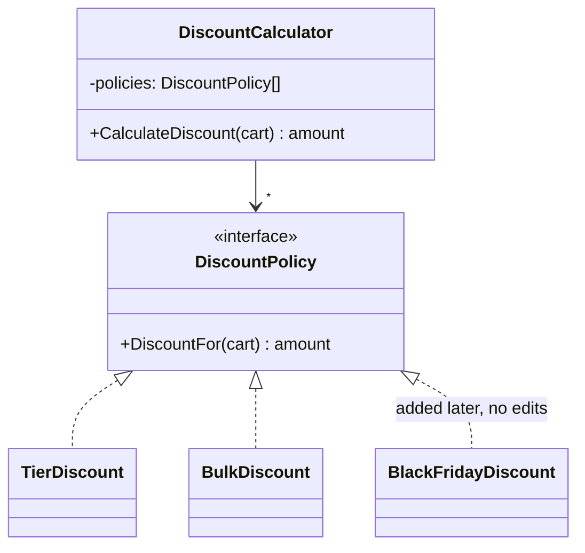

<details>
<summary><b>🟣 C# (.NET 8)</b> — <code>dotnet/src/SolidPrinciples/Ocp/Good/Cart.cs</code>, <code>dotnet/src/SolidPrinciples/Ocp/Good/IDiscountPolicy.cs</code>, <code>dotnet/src/SolidPrinciples/Ocp/Good/DiscountPolicies.cs</code>, <code>dotnet/src/SolidPrinciples/Ocp/Good/DiscountCalculator.cs</code></summary>

<!-- snippet: dotnet/src/SolidPrinciples/Ocp/Good/Cart.cs, dotnet/src/SolidPrinciples/Ocp/Good/IDiscountPolicy.cs, dotnet/src/SolidPrinciples/Ocp/Good/DiscountPolicies.cs, dotnet/src/SolidPrinciples/Ocp/Good/DiscountCalculator.cs -->
```csharp
// ── dotnet/src/SolidPrinciples/Ocp/Good/Cart.cs ──
namespace SolidPrinciples.Ocp.Good;

public enum CustomerTier
{
    Regular,
    Premium,
    Vip,
}

public sealed record Cart(CustomerTier Tier, decimal Subtotal, int ItemCount);

// ── dotnet/src/SolidPrinciples/Ocp/Good/IDiscountPolicy.cs ──
namespace SolidPrinciples.Ocp.Good;

/// <summary>
/// The extension point. New promotions are new classes implementing this
/// interface; existing, tested code is never edited.
/// </summary>
public interface IDiscountPolicy
{
    decimal DiscountFor(Cart cart);
}

// ── dotnet/src/SolidPrinciples/Ocp/Good/DiscountPolicies.cs ──
namespace SolidPrinciples.Ocp.Good;

public sealed class TierDiscount(CustomerTier tier, decimal rate) : IDiscountPolicy
{
    public decimal DiscountFor(Cart cart)
    {
        ArgumentNullException.ThrowIfNull(cart);
        return cart.Tier == tier ? cart.Subtotal * rate : 0m;
    }
}

public sealed class BulkDiscount(int minimumItems, decimal rate) : IDiscountPolicy
{
    public decimal DiscountFor(Cart cart)
    {
        ArgumentNullException.ThrowIfNull(cart);
        return cart.ItemCount >= minimumItems ? cart.Subtotal * rate : 0m;
    }
}

public static class DefaultDiscounts
{
    public static IReadOnlyList<IDiscountPolicy> Create() =>
    [
        new TierDiscount(CustomerTier.Premium, 0.10m),
        new TierDiscount(CustomerTier.Vip, 0.20m),
        new BulkDiscount(minimumItems: 10, rate: 0.05m),
    ];
}

// ── dotnet/src/SolidPrinciples/Ocp/Good/DiscountCalculator.cs ──
namespace SolidPrinciples.Ocp.Good;

/// <summary>
/// ✅ Closed for modification: it applies the best available policy and
/// never needs to know which policies exist. Open for extension: pass more.
/// </summary>
public sealed class DiscountCalculator(IEnumerable<IDiscountPolicy> policies)
{
    private readonly IReadOnlyList<IDiscountPolicy> _policies = policies.ToList();

    public decimal CalculateDiscount(Cart cart)
    {
        ArgumentNullException.ThrowIfNull(cart);

        var best = _policies
            .Select(policy => policy.DiscountFor(cart))
            .DefaultIfEmpty(0m)
            .Max();

        var bounded = Math.Clamp(best, 0m, cart.Subtotal);
        return Math.Round(bounded, 2, MidpointRounding.AwayFromZero);
    }
}
```
<!-- /snippet -->

</details>
<details>
<summary><b>🐍 Python 3.12</b> — <code>python/solid/ocp/good.py</code></summary>

<!-- snippet: python/solid/ocp/good.py -->
```python
"""OCP - the solution: a stable calculator plus pluggable discount policies."""

from collections.abc import Iterable
from dataclasses import dataclass
from decimal import ROUND_HALF_UP, Decimal
from enum import Enum
from typing import Protocol


class CustomerTier(Enum):
    REGULAR = "regular"
    PREMIUM = "premium"
    VIP = "vip"


@dataclass(frozen=True)
class Cart:
    tier: CustomerTier
    subtotal: Decimal
    item_count: int


class DiscountPolicy(Protocol):
    """The extension point: new promotions are new classes, not edits."""

    def discount_for(self, cart: Cart) -> Decimal: ...


@dataclass(frozen=True)
class TierDiscount:
    tier: CustomerTier
    rate: Decimal

    def discount_for(self, cart: Cart) -> Decimal:
        return cart.subtotal * self.rate if cart.tier is self.tier else Decimal(0)


@dataclass(frozen=True)
class BulkDiscount:
    minimum_items: int
    rate: Decimal

    def discount_for(self, cart: Cart) -> Decimal:
        return cart.subtotal * self.rate if cart.item_count >= self.minimum_items else Decimal(0)


def default_discounts() -> list[DiscountPolicy]:
    return [
        TierDiscount(CustomerTier.PREMIUM, Decimal("0.10")),
        TierDiscount(CustomerTier.VIP, Decimal("0.20")),
        BulkDiscount(minimum_items=10, rate=Decimal("0.05")),
    ]


class DiscountCalculator:
    """✅ Applies the best available policy without knowing which ones exist."""

    def __init__(self, policies: Iterable[DiscountPolicy]) -> None:
        self._policies = tuple(policies)

    def calculate_discount(self, cart: Cart) -> Decimal:
        best = max((policy.discount_for(cart) for policy in self._policies), default=Decimal(0))
        bounded = min(max(best, Decimal(0)), cart.subtotal)
        return bounded.quantize(Decimal("0.01"), ROUND_HALF_UP)
```
<!-- /snippet -->

</details>
<details>
<summary><b>🐹 Go 1.22</b> — <code>go/ocp/good/discount.go</code></summary>

<!-- snippet: go/ocp/good/discount.go -->
```go
// Package good shows OCP applied: a stable calculator plus pluggable policies.
package good

// Cents represents money as an integer number of cents.
type Cents int64

type CustomerTier int

const (
	Regular CustomerTier = iota
	Premium
	VIP
)

type Cart struct {
	Tier      CustomerTier
	Subtotal  Cents
	ItemCount int
}

// DiscountPolicy is the extension point: new promotions are new types, not edits.
type DiscountPolicy interface {
	DiscountFor(cart Cart) Cents
}

// DiscountPolicyFunc lets a plain function act as a policy (like http.HandlerFunc).
type DiscountPolicyFunc func(cart Cart) Cents

func (f DiscountPolicyFunc) DiscountFor(cart Cart) Cents { return f(cart) }

type TierDiscount struct {
	Tier    CustomerTier
	Percent int64
}

func (d TierDiscount) DiscountFor(cart Cart) Cents {
	if cart.Tier != d.Tier {
		return 0
	}
	return cart.Subtotal * Cents(d.Percent) / 100
}

type BulkDiscount struct {
	MinimumItems int
	Percent      int64
}

func (d BulkDiscount) DiscountFor(cart Cart) Cents {
	if cart.ItemCount < d.MinimumItems {
		return 0
	}
	return cart.Subtotal * Cents(d.Percent) / 100
}

func DefaultDiscounts() []DiscountPolicy {
	return []DiscountPolicy{
		TierDiscount{Tier: Premium, Percent: 10},
		TierDiscount{Tier: VIP, Percent: 20},
		BulkDiscount{MinimumItems: 10, Percent: 5},
	}
}

// DiscountCalculator ✅ applies the best policy without knowing which ones exist.
type DiscountCalculator struct {
	policies []DiscountPolicy
}

func NewDiscountCalculator(policies ...DiscountPolicy) DiscountCalculator {
	return DiscountCalculator{policies: policies}
}

func (c DiscountCalculator) CalculateDiscount(cart Cart) Cents {
	var best Cents
	for _, policy := range c.policies {
		best = max(best, policy.DiscountFor(cart))
	}
	return min(best, cart.Subtotal)
}
```
<!-- /snippet -->

</details>
<details>
<summary><b>🔷 TypeScript 5</b> — <code>typescript/src/ocp/good.ts</code></summary>

<!-- snippet: typescript/src/ocp/good.ts -->
```typescript
// OCP - the solution: a stable calculator plus pluggable discount policies.

export type Cents = number;
export type CustomerTier = "regular" | "premium" | "vip";

export interface Cart {
  readonly tier: CustomerTier;
  readonly subtotal: Cents;
  readonly itemCount: number;
}

/** The extension point: new promotions are new implementations, not edits. */
export interface DiscountPolicy {
  discountFor(cart: Cart): Cents;
}

export class TierDiscount implements DiscountPolicy {
  constructor(
    private readonly tier: CustomerTier,
    private readonly rate: number,
  ) {}

  discountFor(cart: Cart): Cents {
    return cart.tier === this.tier ? cart.subtotal * this.rate : 0;
  }
}

export class BulkDiscount implements DiscountPolicy {
  constructor(
    private readonly minimumItems: number,
    private readonly rate: number,
  ) {}

  discountFor(cart: Cart): Cents {
    return cart.itemCount >= this.minimumItems ? cart.subtotal * this.rate : 0;
  }
}

export const defaultDiscounts = (): DiscountPolicy[] => [
  new TierDiscount("premium", 0.1),
  new TierDiscount("vip", 0.2),
  new BulkDiscount(10, 0.05),
];

/** ✅ Applies the best policy without knowing which policies exist. */
export class DiscountCalculator {
  private readonly policies: readonly DiscountPolicy[];

  constructor(policies: Iterable<DiscountPolicy>) {
    this.policies = [...policies];
  }

  calculateDiscount(cart: Cart): Cents {
    const best = Math.max(0, ...this.policies.map((policy) => policy.discountFor(cart)));
    return Math.round(Math.min(best, cart.subtotal));
  }
}
```
<!-- /snippet -->

</details>
<details>
<summary><b>⚛️ React 18 + TypeScript</b> — <code>react/src/ocp/good/PaymentOptions.tsx</code>, <code>react/src/ocp/good/paymentRegistry.tsx</code></summary>

<!-- snippet: react/src/ocp/good/PaymentOptions.tsx, react/src/ocp/good/paymentRegistry.tsx -->
```tsx
// ── react/src/ocp/good/PaymentOptions.tsx ──
import { useState, type ComponentType } from "react";

/** The extension point: a payment option is data + a component. */
export interface PaymentOption {
  readonly id: string;
  readonly label: string;
  readonly Form: ComponentType;
}

interface PaymentOptionsProps {
  readonly options: readonly PaymentOption[];
}

/**
 * ✅ Closed for modification: it renders whatever options it receives.
 * Open for extension: add a new PaymentOption to the list, never edit this file.
 */
export function PaymentOptions({ options }: PaymentOptionsProps) {
  const [selectedId, setSelectedId] = useState(options[0]?.id);
  const selected = options.find((option) => option.id === selectedId);

  return (
    <fieldset>
      <legend>Payment method</legend>
      {options.map((option) => (
        <label key={option.id}>
          <input
            type="radio"
            name="payment-method"
            checked={option.id === selectedId}
            onChange={() => setSelectedId(option.id)}
          />{" "}
          {option.label}
        </label>
      ))}
      {selected && <selected.Form />}
    </fieldset>
  );
}

// ── react/src/ocp/good/paymentRegistry.tsx ──
import type { PaymentOption } from "./PaymentOptions";

function CardForm() {
  return (
    <label>
      Card number <input name="cardNumber" inputMode="numeric" />
    </label>
  );
}

function PayPalForm() {
  return <p>You will be redirected to PayPal.</p>;
}

/** The registry. Adding a method = adding an entry (or a new module that exports one). */
export const defaultPaymentOptions: readonly PaymentOption[] = [
  { id: "card", label: "Card", Form: CardForm },
  { id: "paypal", label: "PayPal", Form: PayPalForm },
];
```
<!-- /snippet -->

</details>

### 🧪 Proving it with tests

The decisive test is *"a new policy extends behaviour without modifying the calculator"*: the new `FlatCouponDiscount` lives **in the test project** and the calculator works with it unchanged.

<details>
<summary><b>🟣 C# (.NET 8)</b> — <code>dotnet/tests/SolidPrinciples.Tests/OcpTests.cs</code></summary>

<!-- snippet: dotnet/tests/SolidPrinciples.Tests/OcpTests.cs -->
```csharp
using SolidPrinciples.Ocp.Good;

namespace SolidPrinciples.Tests;

public class OcpTests
{
    private static readonly DiscountCalculator Calculator = new(DefaultDiscounts.Create());

    [Theory]
    [InlineData(CustomerTier.Regular, 100, 1, 0)]
    [InlineData(CustomerTier.Premium, 100, 1, 10)]
    [InlineData(CustomerTier.Vip, 100, 12, 20)]
    [InlineData(CustomerTier.Regular, 100, 12, 5)]
    public void Good_calculator_applies_the_best_policy(CustomerTier tier, decimal subtotal, int items, decimal expected)
    {
        Assert.Equal(expected, Calculator.CalculateDiscount(new Cart(tier, subtotal, items)));
    }

    [Theory]
    [InlineData(Ocp.Bad.CustomerTier.Regular, 100, 1, 0)]
    [InlineData(Ocp.Bad.CustomerTier.Premium, 100, 1, 10)]
    [InlineData(Ocp.Bad.CustomerTier.Vip, 100, 12, 20)]
    [InlineData(Ocp.Bad.CustomerTier.Regular, 100, 12, 5)]
    public void Bad_calculator_gives_the_same_results_today(Ocp.Bad.CustomerTier tier, decimal subtotal, int items, decimal expected)
    {
        var bad = new Ocp.Bad.DiscountCalculator();

        Assert.Equal(expected, bad.CalculateDiscount(new Ocp.Bad.Cart(tier, subtotal, items)));
    }

    /// <summary>A brand-new promotion, written without touching any production class.</summary>
    private sealed class FlatCouponDiscount(decimal amount) : IDiscountPolicy
    {
        public decimal DiscountFor(Cart cart) => amount;
    }

    [Fact]
    public void New_policies_extend_behaviour_without_modifying_the_calculator()
    {
        var calculator = new DiscountCalculator([.. DefaultDiscounts.Create(), new FlatCouponDiscount(15m)]);

        Assert.Equal(15m, calculator.CalculateDiscount(new Cart(CustomerTier.Premium, 100m, 1)));
    }

    [Fact]
    public void Discount_never_exceeds_the_subtotal()
    {
        var calculator = new DiscountCalculator([new FlatCouponDiscount(50m)]);

        Assert.Equal(30m, calculator.CalculateDiscount(new Cart(CustomerTier.Regular, 30m, 1)));
    }
}
```
<!-- /snippet -->

</details>
<details>
<summary><b>🐍 Python 3.12</b> — <code>python/tests/test_ocp.py</code></summary>

<!-- snippet: python/tests/test_ocp.py -->
```python
from decimal import Decimal

import pytest

from solid.ocp import bad
from solid.ocp.good import Cart, CustomerTier, DiscountCalculator, default_discounts

CASES = [
    ("REGULAR", "100", 1, "0"),
    ("PREMIUM", "100", 1, "10"),
    ("VIP", "100", 12, "20"),
    ("REGULAR", "100", 12, "5"),
]


@pytest.mark.parametrize(("tier", "subtotal", "items", "expected"), CASES)
def test_good_calculator_applies_the_best_policy(
    tier: str, subtotal: str, items: int, expected: str
) -> None:
    calculator = DiscountCalculator(default_discounts())
    cart = Cart(CustomerTier[tier], Decimal(subtotal), items)

    assert calculator.calculate_discount(cart) == Decimal(expected)


@pytest.mark.parametrize(("tier", "subtotal", "items", "expected"), CASES)
def test_bad_calculator_gives_the_same_results_today(
    tier: str, subtotal: str, items: int, expected: str
) -> None:
    cart = bad.Cart(bad.CustomerTier[tier], Decimal(subtotal), items)

    assert bad.DiscountCalculator().calculate_discount(cart) == Decimal(expected)


class FlatCouponDiscount:
    """A brand-new promotion, written without touching any production class."""

    def __init__(self, amount: Decimal) -> None:
        self._amount = amount

    def discount_for(self, cart: Cart) -> Decimal:
        return self._amount


def test_new_policies_extend_behaviour_without_modifying_the_calculator() -> None:
    calculator = DiscountCalculator([*default_discounts(), FlatCouponDiscount(Decimal(15))])

    cart = Cart(CustomerTier.PREMIUM, Decimal(100), 1)
    assert calculator.calculate_discount(cart) == Decimal(15)


def test_discount_never_exceeds_the_subtotal() -> None:
    calculator = DiscountCalculator([FlatCouponDiscount(Decimal(50))])

    cart = Cart(CustomerTier.REGULAR, Decimal(30), 1)
    assert calculator.calculate_discount(cart) == Decimal(30)
```
<!-- /snippet -->

</details>
<details>
<summary><b>🐹 Go 1.22</b> — <code>go/ocp/good/discount_test.go</code></summary>

<!-- snippet: go/ocp/good/discount_test.go -->
```go
package good_test

import (
	"testing"

	"github.com/danielfyo/solid-principles-dotnet/go/ocp/bad"
	"github.com/danielfyo/solid-principles-dotnet/go/ocp/good"
)

var cases = []struct {
	name     string
	tier     good.CustomerTier
	subtotal good.Cents
	items    int
	want     good.Cents
}{
	{"regular", good.Regular, 10000, 1, 0},
	{"premium", good.Premium, 10000, 1, 1000},
	{"vip bulk", good.VIP, 10000, 12, 2000},
	{"regular bulk", good.Regular, 10000, 12, 500},
}

func TestGoodCalculatorAppliesTheBestPolicy(t *testing.T) {
	calculator := good.NewDiscountCalculator(good.DefaultDiscounts()...)
	for _, tc := range cases {
		t.Run(tc.name, func(t *testing.T) {
			got := calculator.CalculateDiscount(good.Cart{Tier: tc.tier, Subtotal: tc.subtotal, ItemCount: tc.items})
			if got != tc.want {
				t.Fatalf("got %d, want %d", got, tc.want)
			}
		})
	}
}

func TestBadCalculatorGivesTheSameResultsToday(t *testing.T) {
	for _, tc := range cases {
		cart := bad.Cart{Tier: bad.CustomerTier(tc.tier), Subtotal: bad.Cents(tc.subtotal), ItemCount: tc.items}
		if got := bad.CalculateDiscount(cart); got != bad.Cents(tc.want) {
			t.Fatalf("%s: got %d, want %d", tc.name, got, tc.want)
		}
	}
}

func TestNewPoliciesExtendBehaviourWithoutModifyingTheCalculator(t *testing.T) {
	// A brand-new promotion, written without touching any production code.
	flatCoupon := good.DiscountPolicyFunc(func(good.Cart) good.Cents { return 1500 })
	calculator := good.NewDiscountCalculator(append(good.DefaultDiscounts(), flatCoupon)...)

	if got := calculator.CalculateDiscount(good.Cart{Tier: good.Premium, Subtotal: 10000, ItemCount: 1}); got != 1500 {
		t.Fatalf("got %d, want 1500", got)
	}
}

func TestDiscountNeverExceedsTheSubtotal(t *testing.T) {
	calculator := good.NewDiscountCalculator(good.DiscountPolicyFunc(func(good.Cart) good.Cents { return 5000 }))

	if got := calculator.CalculateDiscount(good.Cart{Subtotal: 3000, ItemCount: 1}); got != 3000 {
		t.Fatalf("got %d, want 3000", got)
	}
}
```
<!-- /snippet -->

</details>
<details>
<summary><b>🔷 TypeScript 5</b> — <code>typescript/tests/ocp.test.ts</code></summary>

<!-- snippet: typescript/tests/ocp.test.ts -->
```typescript
import { describe, expect, it } from "vitest";
import * as bad from "../src/ocp/bad.js";
import { DiscountCalculator, defaultDiscounts, type Cart, type DiscountPolicy } from "../src/ocp/good.js";

const cases: Array<[Cart, number]> = [
  [{ tier: "regular", subtotal: 10_000, itemCount: 1 }, 0],
  [{ tier: "premium", subtotal: 10_000, itemCount: 1 }, 1_000],
  [{ tier: "vip", subtotal: 10_000, itemCount: 12 }, 2_000],
  [{ tier: "regular", subtotal: 10_000, itemCount: 12 }, 500],
];

/** A brand-new promotion, written without touching any production code. */
const flatCoupon = (amount: number): DiscountPolicy => ({ discountFor: () => amount });

describe("OCP", () => {
  it.each(cases)("good calculator applies the best policy to %o", (cart, expected) => {
    expect(new DiscountCalculator(defaultDiscounts()).calculateDiscount(cart)).toBe(expected);
  });

  it.each(cases)("bad calculator gives the same result today for %o", (cart, expected) => {
    expect(bad.calculateDiscount(cart)).toBe(expected);
  });

  it("new policies extend behaviour without modifying the calculator", () => {
    const calculator = new DiscountCalculator([...defaultDiscounts(), flatCoupon(1_500)]);

    expect(calculator.calculateDiscount({ tier: "premium", subtotal: 10_000, itemCount: 1 })).toBe(1_500);
  });

  it("discount never exceeds the subtotal", () => {
    const calculator = new DiscountCalculator([flatCoupon(5_000)]);

    expect(calculator.calculateDiscount({ tier: "regular", subtotal: 3_000, itemCount: 1 })).toBe(3_000);
  });
});
```
<!-- /snippet -->

</details>
<details>
<summary><b>⚛️ React 18 + TypeScript</b> — <code>react/src/ocp/ocp.test.tsx</code></summary>

<!-- snippet: react/src/ocp/ocp.test.tsx -->
```tsx
import { render, screen } from "@testing-library/react";
import userEvent from "@testing-library/user-event";
import { PaymentOptions as BadPaymentOptions } from "./bad/PaymentOptions";
import { PaymentOptions, type PaymentOption } from "./good/PaymentOptions";
import { defaultPaymentOptions } from "./good/paymentRegistry";

describe("OCP", () => {
  it("bad and good versions behave the same today", async () => {
    for (const ui of [<BadPaymentOptions key="bad" />, <PaymentOptions key="good" options={defaultPaymentOptions} />]) {
      const { unmount } = render(ui);
      expect(screen.getByLabelText("Card number")).toBeInTheDocument();

      await userEvent.click(screen.getByLabelText("PayPal"));
      expect(screen.getByText("You will be redirected to PayPal.")).toBeInTheDocument();
      unmount();
    }
  });

  it("a new payment method is added without touching PaymentOptions", async () => {
    const bizum: PaymentOption = { id: "bizum", label: "Bizum", Form: () => <p>Enter your phone number.</p> };

    render(<PaymentOptions options={[...defaultPaymentOptions, bizum]} />);
    await userEvent.click(screen.getByLabelText("Bizum"));

    expect(screen.getByText("Enter your phone number.")).toBeInTheDocument();
  });
});
```
<!-- /snippet -->

</details>

### ✅ Benefits

- **New features = new code**, so existing tests keep protecting existing behaviour.
- **Each rule is small and independently testable.**
- **Configurable** — the list of active promotions can come from configuration or a feature flag.
- **Parallel development** — two developers can add two promotions without touching the same file.

### ⚠️ Pitfalls and trade-offs

- **You cannot be closed against every change.** Choose the axis that *actually* changes. Martin calls this *strategic closure*. Abstracting everything "just in case" creates needless complexity.
- **Wait for the second (or third) variant.** A common heuristic: *"Fool me once, shame on you; fool me twice, shame on me"* — write the simple version first; introduce the extension point when the first change of that kind arrives.
- **A `switch` is not always evil.** A switch over a **closed** set that never grows (days of the week, HTTP methods) is fine. A switch over an **open** set (promotions, payment providers) is the smell. In languages with exhaustive pattern matching, a switch over a closed sum type is often *better* than polymorphism — see [the functional lens](#functional).
- **The combination rule is still a decision** (best wins vs. stacking). Keep it explicit and in one place.

### 🌍 Language notes

| Language | Idiomatic extension point |
| --- | --- |
| **C#** | Interface + DI: `services.AddSingleton<IDiscountPolicy, BulkDiscount>()`, then inject `IEnumerable<IDiscountPolicy>`. |
| **Python** | `typing.Protocol` (structural), plain callables, or entry points for plugins. |
| **Go** | Small interface + the **func adapter** idiom (`DiscountPolicyFunc`, like `http.HandlerFunc`), so a closure can be a policy. |
| **TypeScript** | Interface or simply an object literal `{ discountFor: (cart) => … }` thanks to structural typing. |
| **React** | **Composition**: `children`, render props, component registries (`{ id, label, Form }`). A component that receives *what to render* is closed for modification and open for extension. |

### ☑️ Checklist

- [ ] Adding the most common type of feature does **not** require editing existing, tested classes.
- [ ] Extension points exist **only** where change has actually happened or is clearly expected.
- [ ] There is a single place where the set of plug-ins is assembled.

### 🎓 Level up

- OCP is the *goal*; **DIP and LSP are the mechanisms**: the calculator depends on an abstraction (DIP) and every policy must be a faithful substitute (LSP).
- Meyer's original OCP was about **inheritance** (extend a class without modifying it). Martin's version, used today, is about **polymorphism through abstractions** — usually interfaces, not base classes.
- At architecture level OCP drives **plugin architectures**: the core is closed, features are plugins (IDE extensions, payment providers, webhooks).

[⬆ Back to top](#toc)

---

<a id="lsp"></a>

## L — Liskov Substitution Principle (LSP)

### 📖 Definition

> *"If for each object o1 of type S there is an object o2 of type T such that for all programs P defined in terms of T, the behavior of P is unchanged when o1 is substituted for o2, then S is a subtype of T."* — Barbara Liskov, 1987

> The usable version: **"Subtypes must be substitutable for their base types."** — Robert C. Martin

### 💡 In plain words

If your code works with a `PaymentMethod`, it must keep working with **any** `PaymentMethod` — card, PayPal or gift card — **without knowing which one it got**. Inheritance or "implements" is a *syntactic* promise; LSP demands that it is also a *behavioural* promise.

LSP is about **contracts** (Design by Contract, Bertrand Meyer). A subtype:

| Rule | Meaning | Violation example |
| --- | --- | --- |
| **Preconditions cannot be strengthened** | Accept at least everything the base accepts | Base accepts any positive amount; subtype throws for amounts > 100 |
| **Postconditions cannot be weakened** | Guarantee at least everything the base guarantees | Base returns a receipt for the exact amount; subtype returns `null` sometimes |
| **Invariants must be preserved** | What is always true for the base stays true | `Square.SetWidth` also changes the height of a `Rectangle` |
| **No new exceptions** | Don't throw exception types callers can't expect | `GiftCard.Refund()` throws `NotSupportedException` |
| **History constraint** | Don't allow state changes the base forbids | An immutable base with a mutable subtype |

### 🏠 Analogy

If it looks like a duck, quacks like a duck, but **needs batteries**, you probably have the wrong abstraction. A toy duck *is-a* duck in the type system, but every pond-management program that expects to feed it will fail.

> **The classic textbook example — Rectangle vs. Square.** Mathematically a square *is a* rectangle. But if `Rectangle` has independent `setWidth`/`setHeight`, a `Square` subclass must change both dimensions together, and this innocent test breaks: `r.setWidth(5); r.setHeight(4); assert r.area() == 20` (a square gives 16). The lesson: **"is-a" in the real world does not mean "is substitutable" in code**. What matters is behaviour, not taxonomy.

### 🔍 How to spot a violation

- Overrides that **throw `NotSupported`/`NotImplemented`** or do nothing (`{ }`).
- Callers checking the concrete type: `if (method is GiftCard)`, `isinstance`, type switches, `instanceof`.
- Documentation like *"don't call X on Y"*.
- Subtypes that **ignore parameters** (a React component that accepts `disabled` and ignores it).
- Tests that pass for the base type but need special cases for one subtype.

### ❌ The problem

The base class promises that every payment method can be **refunded**. Gift cards can't, so `GiftCardPayment.Refund` throws. `RefundService` is written correctly against the base type… and still explodes in production.

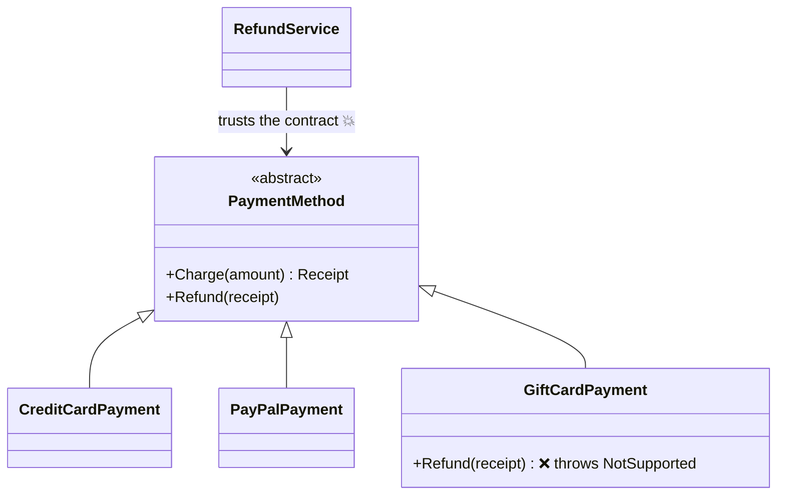

<details>
<summary><b>🟣 C# (.NET 8)</b> — <code>dotnet/src/SolidPrinciples/Lsp/Bad/PaymentMethods.cs</code></summary>

<!-- snippet: dotnet/src/SolidPrinciples/Lsp/Bad/PaymentMethods.cs -->
```csharp
namespace SolidPrinciples.Lsp.Bad;

public sealed record Receipt(string TransactionId, decimal Amount);

/// <summary>
/// The base class promises that every payment method can be charged AND refunded.
/// </summary>
public abstract class PaymentMethod
{
    private readonly HashSet<string> _issued = [];
    private int _sequence;

    public abstract string Name { get; }

    public Receipt Charge(decimal amount)
    {
        ArgumentOutOfRangeException.ThrowIfNegativeOrZero(amount);
        var receipt = new Receipt($"{Name}-{++_sequence}", amount);
        _issued.Add(receipt.TransactionId);
        return receipt;
    }

    public virtual void Refund(Receipt receipt)
    {
        ArgumentNullException.ThrowIfNull(receipt);
        if (!_issued.Remove(receipt.TransactionId))
        {
            throw new InvalidOperationException($"Unknown transaction {receipt.TransactionId}.");
        }
    }
}

public sealed class CreditCardPayment : PaymentMethod
{
    public override string Name => "card";
}

public sealed class PayPalPayment : PaymentMethod
{
    public override string Name => "paypal";
}

/// <summary>
/// ❌ LSP violation: it IS-A PaymentMethod by inheritance, but it cannot keep the
/// promise of <see cref="PaymentMethod.Refund"/>. It strengthens the precondition
/// ("never call me") and surprises every caller that trusted the base type.
/// </summary>
public sealed class GiftCardPayment : PaymentMethod
{
    public override string Name => "giftcard";

    public override void Refund(Receipt receipt) =>
        throw new NotSupportedException("Gift card payments cannot be refunded.");
}

/// <summary>Written against the base type, as it should be... and it still breaks.</summary>
public sealed class RefundService
{
    public void RefundOrder(PaymentMethod method, Receipt receipt)
    {
        ArgumentNullException.ThrowIfNull(method);
        method.Refund(receipt); // 💥 NotSupportedException at runtime for gift cards
    }
}
```
<!-- /snippet -->

</details>
<details>
<summary><b>🐍 Python 3.12</b> — <code>python/solid/lsp/bad.py</code></summary>

<!-- snippet: python/solid/lsp/bad.py -->
```python
"""LSP - the problem: a subclass that cannot keep the base class promise."""

from abc import ABC, abstractmethod
from dataclasses import dataclass
from decimal import Decimal


@dataclass(frozen=True)
class Receipt:
    transaction_id: str
    amount: Decimal


class PaymentMethod(ABC):
    """Promises that every payment method can be charged AND refunded."""

    def __init__(self) -> None:
        self._issued: set[str] = set()
        self._sequence = 0

    @property
    @abstractmethod
    def name(self) -> str: ...

    def charge(self, amount: Decimal) -> Receipt:
        if amount <= 0:
            raise ValueError("Amount must be positive.")
        self._sequence += 1
        receipt = Receipt(f"{self.name}-{self._sequence}", amount)
        self._issued.add(receipt.transaction_id)
        return receipt

    def refund(self, receipt: Receipt) -> None:
        if receipt.transaction_id not in self._issued:
            raise LookupError(f"Unknown transaction {receipt.transaction_id}.")
        self._issued.remove(receipt.transaction_id)


class CreditCardPayment(PaymentMethod):
    @property
    def name(self) -> str:
        return "card"


class PayPalPayment(PaymentMethod):
    @property
    def name(self) -> str:
        return "paypal"


class GiftCardPayment(PaymentMethod):
    """❌ IS-A PaymentMethod by inheritance, but breaks the refund promise."""

    @property
    def name(self) -> str:
        return "giftcard"

    def refund(self, receipt: Receipt) -> None:
        raise NotImplementedError("Gift card payments cannot be refunded.")


class RefundService:
    """Written against the base type, as it should be... and it still breaks."""

    def refund_order(self, method: PaymentMethod, receipt: Receipt) -> None:
        method.refund(receipt)  # 💥 NotImplementedError at runtime for gift cards
```
<!-- /snippet -->

</details>
<details>
<summary><b>🐹 Go 1.22</b> — <code>go/lsp/bad/payments.go</code></summary>

<!-- snippet: go/lsp/bad/payments.go -->
```go
// Package bad shows an LSP violation: an implementation that breaks the contract.
package bad

import (
	"errors"
	"fmt"
)

// ErrNotSupported is the tell-tale sign of a broken promise.
var ErrNotSupported = errors.New("operation not supported")

type Receipt struct {
	TransactionID string
	AmountCents   int64
}

// PaymentMethod promises that every payment method can be charged AND refunded.
type PaymentMethod interface {
	Charge(amountCents int64) (Receipt, error)
	Refund(receipt Receipt) error
}

type ledger struct {
	prefix   string
	sequence int
	issued   map[string]bool
}

func newLedger(prefix string) *ledger { return &ledger{prefix: prefix, issued: map[string]bool{}} }

func (l *ledger) record(amountCents int64) (Receipt, error) {
	if amountCents <= 0 {
		return Receipt{}, errors.New("amount must be positive")
	}
	l.sequence++
	receipt := Receipt{TransactionID: fmt.Sprintf("%s-%d", l.prefix, l.sequence), AmountCents: amountCents}
	l.issued[receipt.TransactionID] = true
	return receipt, nil
}

func (l *ledger) reverse(receipt Receipt) error {
	if !l.issued[receipt.TransactionID] {
		return fmt.Errorf("unknown transaction %s", receipt.TransactionID)
	}
	delete(l.issued, receipt.TransactionID)
	return nil
}

type CreditCard struct{ l *ledger }

func NewCreditCard() *CreditCard                           { return &CreditCard{newLedger("card")} }
func (c *CreditCard) Charge(amount int64) (Receipt, error) { return c.l.record(amount) }
func (c *CreditCard) Refund(receipt Receipt) error         { return c.l.reverse(receipt) }

// GiftCard ❌ satisfies the interface's method set, but not its behavioural contract.
type GiftCard struct{ l *ledger }

func NewGiftCard() *GiftCard                             { return &GiftCard{newLedger("giftcard")} }
func (g *GiftCard) Charge(amount int64) (Receipt, error) { return g.l.record(amount) }
func (g *GiftCard) Refund(Receipt) error                 { return ErrNotSupported }

// RefundOrder is written against the interface, as it should be... and still fails.
func RefundOrder(method PaymentMethod, receipt Receipt) error {
	return method.Refund(receipt) // 💥 ErrNotSupported for gift cards
}
```
<!-- /snippet -->

</details>
<details>
<summary><b>🔷 TypeScript 5</b> — <code>typescript/src/lsp/bad.ts</code></summary>

<!-- snippet: typescript/src/lsp/bad.ts -->
```typescript
// LSP - the problem: a subclass that cannot keep the base class promise.

export type Cents = number;

export interface Receipt {
  readonly transactionId: string;
  readonly amount: Cents;
}

/** Promises that every payment method can be charged AND refunded. */
export abstract class PaymentMethod {
  private readonly issued = new Set<string>();
  private sequence = 0;

  abstract readonly name: string;

  charge(amount: Cents): Receipt {
    if (amount <= 0) throw new RangeError("Amount must be positive.");
    const receipt = { transactionId: `${this.name}-${++this.sequence}`, amount };
    this.issued.add(receipt.transactionId);
    return receipt;
  }

  refund(receipt: Receipt): void {
    if (!this.issued.delete(receipt.transactionId)) {
      throw new Error(`Unknown transaction ${receipt.transactionId}.`);
    }
  }
}

export class CreditCardPayment extends PaymentMethod {
  readonly name = "card";
}

export class PayPalPayment extends PaymentMethod {
  readonly name = "paypal";
}

/** ❌ IS-A PaymentMethod by inheritance, but breaks the refund promise. */
export class GiftCardPayment extends PaymentMethod {
  readonly name = "giftcard";

  override refund(_receipt: Receipt): void {
    throw new Error("Gift card payments cannot be refunded.");
  }
}

/** Written against the base type, as it should be... and it still breaks. */
export class RefundService {
  refundOrder(method: PaymentMethod, receipt: Receipt): void {
    method.refund(receipt); // 💥 throws at runtime for gift cards
  }
}
```
<!-- /snippet -->

</details>
<details>
<summary><b>⚛️ React 18 + TypeScript</b> — <code>react/src/lsp/bad/Buttons.tsx</code></summary>

<!-- snippet: react/src/lsp/bad/Buttons.tsx -->
```tsx
import type { ButtonHTMLAttributes, ReactNode } from "react";

type ButtonProps = ButtonHTMLAttributes<HTMLButtonElement>;

/** The base contract: behaves exactly like a native <button>. */
export function Button(props: ButtonProps) {
  return <button type="button" {...props} />;
}

/**
 * ❌ LSP violation: it claims to accept ButtonProps, so callers expect a drop-in
 * replacement, but it renders a <div>: `disabled` is ignored, it is not
 * focusable and keyboard users cannot activate it.
 */
export function IconButton({ onClick, children, icon }: ButtonProps & { icon: ReactNode }) {
  return (
    <div className="icon-button" onClick={onClick as never}>
      {icon} {children}
    </div>
  );
}
```
<!-- /snippet -->

</details>

**Why it hurts:**

1. **Runtime surprises** — the type checker says the call is valid; production says otherwise.
2. **Type checks spread everywhere** — the "fix" is `if (method is GiftCardPayment) …` in every caller, which also violates OCP (each new non-refundable method edits all callers).
3. **Polymorphism becomes a lie**, and developers stop trusting abstractions.

In React the same violation appears as a component that **claims** to accept `ButtonHTMLAttributes` but ignores `disabled` — callers asked for a disabled button and the click still goes through.

### 🔧 Refactoring step by step

1. **Write down the contract** of the base type (pre/postconditions, exceptions, invariants).
2. **Find the subtype that cannot honour it** — here, gift cards can't refund.
3. **Split the abstraction by capability**: a smaller contract that *everyone* can honour (`PaymentMethod.Charge`) and a richer one for those who can (`RefundablePaymentMethod.Refund`).
4. **Make callers ask for what they need**: `RefundService` takes a `RefundablePaymentMethod`. Passing a gift card now fails **at compile time** (C#, Go, TS, mypy).
5. **Prefer composition over inheritance** for shared code (`PaymentLedger`) so you don't inherit promises you can't keep.
6. **Write contract tests**: one test suite parameterised over *all* implementations. A new subtype that fails it is not a valid substitute.

### ✅ The solution

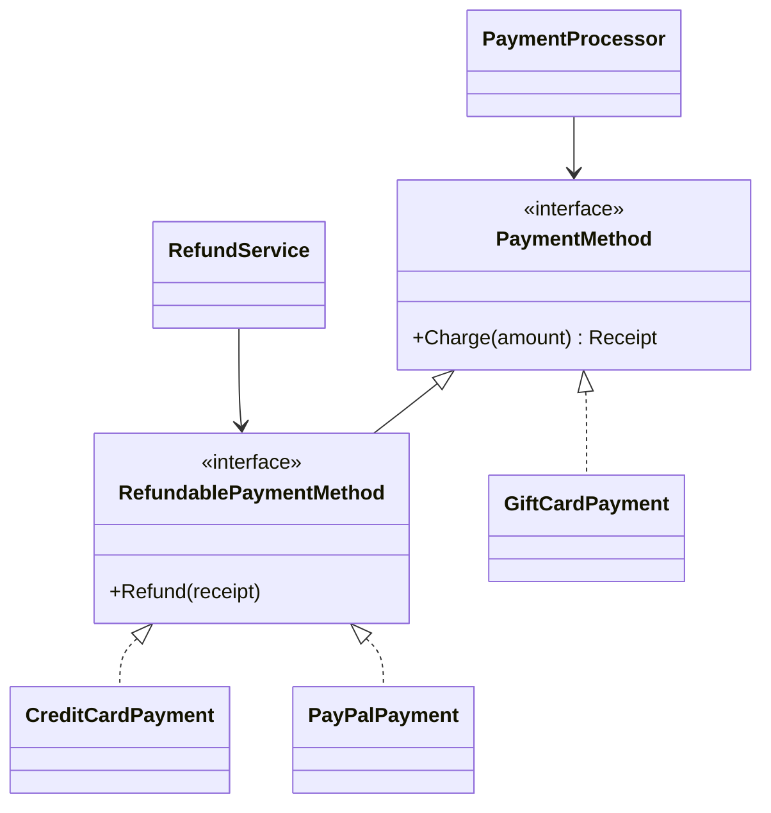

<details>
<summary><b>🟣 C# (.NET 8)</b> — <code>dotnet/src/SolidPrinciples/Lsp/Good/PaymentContracts.cs</code>, <code>dotnet/src/SolidPrinciples/Lsp/Good/PaymentLedger.cs</code>, <code>dotnet/src/SolidPrinciples/Lsp/Good/PaymentMethods.cs</code>, <code>dotnet/src/SolidPrinciples/Lsp/Good/PaymentServices.cs</code></summary>

<!-- snippet: dotnet/src/SolidPrinciples/Lsp/Good/PaymentContracts.cs, dotnet/src/SolidPrinciples/Lsp/Good/PaymentLedger.cs, dotnet/src/SolidPrinciples/Lsp/Good/PaymentMethods.cs, dotnet/src/SolidPrinciples/Lsp/Good/PaymentServices.cs -->
```csharp
// ── dotnet/src/SolidPrinciples/Lsp/Good/PaymentContracts.cs ──
namespace SolidPrinciples.Lsp.Good;

public sealed record Receipt(string TransactionId, decimal Amount);

/// <summary>
/// Contract: amount must be positive; returns a receipt for exactly that amount.
/// Every implementation honours it, so any of them can replace any other.
/// </summary>
public interface IPaymentMethod
{
    string Name { get; }

    Receipt Charge(decimal amount);
}

/// <summary>
/// A richer promise, made only by types that can actually keep it.
/// Contract: refunding a receipt issued by this method succeeds exactly once.
/// </summary>
public interface IRefundablePaymentMethod : IPaymentMethod
{
    void Refund(Receipt receipt);
}

// ── dotnet/src/SolidPrinciples/Lsp/Good/PaymentLedger.cs ──
namespace SolidPrinciples.Lsp.Good;

/// <summary>Shared bookkeeping, reused through composition instead of inheritance.</summary>
internal sealed class PaymentLedger(string prefix)
{
    private readonly HashSet<string> _refundable = [];
    private int _sequence;

    public Receipt Record(decimal amount)
    {
        ArgumentOutOfRangeException.ThrowIfNegativeOrZero(amount);
        var receipt = new Receipt($"{prefix}-{++_sequence}", amount);
        _refundable.Add(receipt.TransactionId);
        return receipt;
    }

    public void Reverse(Receipt receipt)
    {
        ArgumentNullException.ThrowIfNull(receipt);
        if (!_refundable.Remove(receipt.TransactionId))
        {
            throw new InvalidOperationException($"Unknown transaction {receipt.TransactionId}.");
        }
    }
}

// ── dotnet/src/SolidPrinciples/Lsp/Good/PaymentMethods.cs ──
namespace SolidPrinciples.Lsp.Good;

public sealed class CreditCardPayment : IRefundablePaymentMethod
{
    private readonly PaymentLedger _ledger = new("card");

    public string Name => "card";

    public Receipt Charge(decimal amount) => _ledger.Record(amount);

    public void Refund(Receipt receipt) => _ledger.Reverse(receipt);
}

public sealed class PayPalPayment : IRefundablePaymentMethod
{
    private readonly PaymentLedger _ledger = new("paypal");

    public string Name => "paypal";

    public Receipt Charge(decimal amount) => _ledger.Record(amount);

    public void Refund(Receipt receipt) => _ledger.Reverse(receipt);
}

/// <summary>
/// ✅ A gift card only promises what it can deliver: it can be charged.
/// It is a perfectly substitutable <see cref="IPaymentMethod"/>.
/// </summary>
public sealed class GiftCardPayment : IPaymentMethod
{
    private readonly PaymentLedger _ledger = new("giftcard");

    public string Name => "giftcard";

    public Receipt Charge(decimal amount) => _ledger.Record(amount);
}

// ── dotnet/src/SolidPrinciples/Lsp/Good/PaymentServices.cs ──
namespace SolidPrinciples.Lsp.Good;

/// <summary>Works with every payment method, no type checks needed.</summary>
public sealed class PaymentProcessor
{
    public Receipt Pay(IPaymentMethod method, decimal amount)
    {
        ArgumentNullException.ThrowIfNull(method);
        return method.Charge(amount);
    }
}

/// <summary>
/// ✅ Asks only for methods that can be refunded. Passing a gift card is now a
/// compile-time error instead of a production incident.
/// </summary>
public sealed class RefundService
{
    public void RefundOrder(IRefundablePaymentMethod method, Receipt receipt)
    {
        ArgumentNullException.ThrowIfNull(method);
        method.Refund(receipt);
    }
}
```
<!-- /snippet -->

</details>
<details>
<summary><b>🐍 Python 3.12</b> — <code>python/solid/lsp/good.py</code></summary>

<!-- snippet: python/solid/lsp/good.py -->
```python
"""LSP - the solution: only promise what every subtype can deliver."""

from dataclasses import dataclass
from decimal import Decimal
from typing import Protocol


@dataclass(frozen=True)
class Receipt:
    transaction_id: str
    amount: Decimal


class PaymentMethod(Protocol):
    """Contract: amount must be positive; returns a receipt for exactly that amount."""

    @property
    def name(self) -> str: ...

    def charge(self, amount: Decimal) -> Receipt: ...


class RefundablePaymentMethod(PaymentMethod, Protocol):
    """A richer promise, made only by types that can keep it.

    Contract: refunding a receipt issued by this method succeeds exactly once.
    """

    def refund(self, receipt: Receipt) -> None: ...


class _PaymentLedger:
    """Shared bookkeeping, reused through composition instead of inheritance."""

    def __init__(self, prefix: str) -> None:
        self._prefix = prefix
        self._refundable: set[str] = set()
        self._sequence = 0

    def record(self, amount: Decimal) -> Receipt:
        if amount <= 0:
            raise ValueError("Amount must be positive.")
        self._sequence += 1
        receipt = Receipt(f"{self._prefix}-{self._sequence}", amount)
        self._refundable.add(receipt.transaction_id)
        return receipt

    def reverse(self, receipt: Receipt) -> None:
        if receipt.transaction_id not in self._refundable:
            raise LookupError(f"Unknown transaction {receipt.transaction_id}.")
        self._refundable.remove(receipt.transaction_id)


class CreditCardPayment:
    name = "card"

    def __init__(self) -> None:
        self._ledger = _PaymentLedger(self.name)

    def charge(self, amount: Decimal) -> Receipt:
        return self._ledger.record(amount)

    def refund(self, receipt: Receipt) -> None:
        self._ledger.reverse(receipt)


class PayPalPayment:
    name = "paypal"

    def __init__(self) -> None:
        self._ledger = _PaymentLedger(self.name)

    def charge(self, amount: Decimal) -> Receipt:
        return self._ledger.record(amount)

    def refund(self, receipt: Receipt) -> None:
        self._ledger.reverse(receipt)


class GiftCardPayment:
    """✅ Only promises what it can deliver: it can be charged."""

    name = "giftcard"

    def __init__(self) -> None:
        self._ledger = _PaymentLedger(self.name)

    def charge(self, amount: Decimal) -> Receipt:
        return self._ledger.record(amount)


class PaymentProcessor:
    """Works with every payment method, no isinstance checks needed."""

    def pay(self, method: PaymentMethod, amount: Decimal) -> Receipt:
        return method.charge(amount)


class RefundService:
    """✅ Asks only for refundable methods: mypy rejects a gift card here."""

    def refund_order(self, method: RefundablePaymentMethod, receipt: Receipt) -> None:
        method.refund(receipt)
```
<!-- /snippet -->

</details>
<details>
<summary><b>🐹 Go 1.22</b> — <code>go/lsp/good/payments.go</code></summary>

<!-- snippet: go/lsp/good/payments.go -->
```go
// Package good shows LSP applied: only promise what every implementation can deliver.
package good

import (
	"errors"
	"fmt"
)

// ErrInvalidAmount is returned by every PaymentMethod for non-positive amounts.
var ErrInvalidAmount = errors.New("amount must be positive")

// ErrUnknownTransaction is returned by every Refundable for foreign or reused receipts.
var ErrUnknownTransaction = errors.New("unknown transaction")

type Receipt struct {
	TransactionID string
	AmountCents   int64
}

// PaymentMethod contract: amount must be positive (else ErrInvalidAmount);
// returns a receipt for exactly that amount.
type PaymentMethod interface {
	Charge(amountCents int64) (Receipt, error)
}

// Refundable is a richer promise, made only by types that can keep it.
// Contract: refunding a receipt issued by this method succeeds exactly once.
type Refundable interface {
	PaymentMethod
	Refund(receipt Receipt) error
}

// Compile-time proof of which types satisfy which contract.
var (
	_ Refundable    = (*CreditCard)(nil)
	_ Refundable    = (*PayPal)(nil)
	_ PaymentMethod = (*GiftCard)(nil)
)

// ledger is shared bookkeeping, reused through composition (embedding).
type ledger struct {
	prefix   string
	sequence int
	issued   map[string]bool
}

func newLedger(prefix string) *ledger { return &ledger{prefix: prefix, issued: map[string]bool{}} }

func (l *ledger) Charge(amountCents int64) (Receipt, error) {
	if amountCents <= 0 {
		return Receipt{}, ErrInvalidAmount
	}
	l.sequence++
	receipt := Receipt{TransactionID: fmt.Sprintf("%s-%d", l.prefix, l.sequence), AmountCents: amountCents}
	l.issued[receipt.TransactionID] = true
	return receipt, nil
}

func (l *ledger) refund(receipt Receipt) error {
	if !l.issued[receipt.TransactionID] {
		return fmt.Errorf("%w: %s", ErrUnknownTransaction, receipt.TransactionID)
	}
	delete(l.issued, receipt.TransactionID)
	return nil
}

type CreditCard struct{ *ledger }

func NewCreditCard() *CreditCard                   { return &CreditCard{newLedger("card")} }
func (c *CreditCard) Refund(receipt Receipt) error { return c.refund(receipt) }

type PayPal struct{ *ledger }

func NewPayPal() *PayPal                       { return &PayPal{newLedger("paypal")} }
func (p *PayPal) Refund(receipt Receipt) error { return p.refund(receipt) }

// GiftCard ✅ only promises what it can deliver: it can be charged.
type GiftCard struct{ *ledger }

func NewGiftCard() *GiftCard { return &GiftCard{newLedger("giftcard")} }

// Pay works with every payment method, no type switches needed.
func Pay(method PaymentMethod, amountCents int64) (Receipt, error) {
	return method.Charge(amountCents)
}

// RefundOrder ✅ asks only for refundable methods: passing a GiftCard does not compile.
func RefundOrder(method Refundable, receipt Receipt) error {
	return method.Refund(receipt)
}
```
<!-- /snippet -->

</details>
<details>
<summary><b>🔷 TypeScript 5</b> — <code>typescript/src/lsp/good.ts</code></summary>

<!-- snippet: typescript/src/lsp/good.ts -->
```typescript
// LSP - the solution: only promise what every implementation can deliver.

export type Cents = number;

export interface Receipt {
  readonly transactionId: string;
  readonly amount: Cents;
}

/** Contract: amount must be positive (else RangeError); receipt for exactly that amount. */
export interface PaymentMethod {
  readonly name: string;
  charge(amount: Cents): Receipt;
}

/** A richer promise, made only by types that can keep it. Refunds succeed exactly once. */
export interface RefundablePaymentMethod extends PaymentMethod {
  refund(receipt: Receipt): void;
}

/** Shared bookkeeping, reused through composition instead of inheritance. */
class PaymentLedger {
  private readonly refundable = new Set<string>();
  private sequence = 0;

  constructor(private readonly prefix: string) {}

  record(amount: Cents): Receipt {
    if (amount <= 0) throw new RangeError("Amount must be positive.");
    const receipt = { transactionId: `${this.prefix}-${++this.sequence}`, amount };
    this.refundable.add(receipt.transactionId);
    return receipt;
  }

  reverse(receipt: Receipt): void {
    if (!this.refundable.delete(receipt.transactionId)) {
      throw new Error(`Unknown transaction ${receipt.transactionId}.`);
    }
  }
}

export class CreditCardPayment implements RefundablePaymentMethod {
  readonly name = "card";
  private readonly ledger = new PaymentLedger(this.name);

  charge(amount: Cents): Receipt {
    return this.ledger.record(amount);
  }

  refund(receipt: Receipt): void {
    this.ledger.reverse(receipt);
  }
}

export class PayPalPayment implements RefundablePaymentMethod {
  readonly name = "paypal";
  private readonly ledger = new PaymentLedger(this.name);

  charge(amount: Cents): Receipt {
    return this.ledger.record(amount);
  }

  refund(receipt: Receipt): void {
    this.ledger.reverse(receipt);
  }
}

/** ✅ Only promises what it can deliver: it can be charged. */
export class GiftCardPayment implements PaymentMethod {
  readonly name = "giftcard";
  private readonly ledger = new PaymentLedger(this.name);

  charge(amount: Cents): Receipt {
    return this.ledger.record(amount);
  }
}

/** Works with every payment method, no instanceof checks needed. */
export class PaymentProcessor {
  pay(method: PaymentMethod, amount: Cents): Receipt {
    return method.charge(amount);
  }
}

/** ✅ Asks only for refundable methods: passing a gift card fails to compile. */
export class RefundService {
  refundOrder(method: RefundablePaymentMethod, receipt: Receipt): void {
    method.refund(receipt);
  }
}
```
<!-- /snippet -->

</details>
<details>
<summary><b>⚛️ React 18 + TypeScript</b> — <code>react/src/lsp/good/Buttons.tsx</code></summary>

<!-- snippet: react/src/lsp/good/Buttons.tsx -->
```tsx
import { forwardRef, type ButtonHTMLAttributes, type ReactNode } from "react";

export type ButtonProps = ButtonHTMLAttributes<HTMLButtonElement>;

/** The base contract: behaves exactly like a native <button>. */
export const Button = forwardRef<HTMLButtonElement, ButtonProps>(function Button(
  { type = "button", ...rest },
  ref,
) {
  return <button ref={ref} type={type} {...rest} />;
});

/** ✅ Specialises the look, keeps the whole contract (props, ref, disabled, a11y). */
export const PrimaryButton = forwardRef<HTMLButtonElement, ButtonProps>(function PrimaryButton(
  { className, ...rest },
  ref,
) {
  return <Button ref={ref} className={["btn-primary", className].filter(Boolean).join(" ")} {...rest} />;
});

interface IconButtonProps extends ButtonProps {
  readonly icon: ReactNode;
}

/** ✅ Adds an icon, still a real <button>: substitutable anywhere a Button is. */
export const IconButton = forwardRef<HTMLButtonElement, IconButtonProps>(function IconButton(
  { icon, children, ...rest },
  ref,
) {
  return (
    <Button ref={ref} {...rest}>
      <span aria-hidden="true">{icon}</span> {children}
    </Button>
  );
});
```
<!-- /snippet -->

</details>

### 🧪 Proving it with tests — contract tests

This is the most valuable LSP technique: **one suite, run against every implementation**. In xUnit it's `[MemberData]`, in pytest `@pytest.mark.parametrize`, in Go a table of constructors, in Vitest `describe.each`. In React, the same contract suite checks that every button variant is a real `<button>`, honours `disabled`, calls `onClick` and forwards refs.

<details>
<summary><b>🟣 C# (.NET 8)</b> — <code>dotnet/tests/SolidPrinciples.Tests/LspTests.cs</code></summary>

<!-- snippet: dotnet/tests/SolidPrinciples.Tests/LspTests.cs -->
```csharp
using SolidPrinciples.Lsp.Good;

namespace SolidPrinciples.Tests;

public class LspTests
{
    [Fact]
    public void Bad_hierarchy_breaks_callers_that_trust_the_base_type()
    {
        var giftCard = new Lsp.Bad.GiftCardPayment();
        var receipt = giftCard.Charge(25m);

        // The caller did nothing wrong, yet substitution fails at runtime.
        Assert.Throws<NotSupportedException>(() => new Lsp.Bad.RefundService().RefundOrder(giftCard, receipt));
    }

    // Contract tests: ONE suite that every implementation must pass.
    // If a new subtype fails it, it is not a valid substitute.
    public static TheoryData<Func<IPaymentMethod>> AllPaymentMethods => new()
    {
        () => new CreditCardPayment(),
        () => new PayPalPayment(),
        () => new GiftCardPayment(),
    };

    public static TheoryData<Func<IRefundablePaymentMethod>> RefundablePaymentMethods => new()
    {
        () => new CreditCardPayment(),
        () => new PayPalPayment(),
    };

    [Theory]
    [MemberData(nameof(AllPaymentMethods))]
    public void Every_payment_method_charges_the_exact_amount(Func<IPaymentMethod> create)
    {
        var receipt = new PaymentProcessor().Pay(create(), 42.50m);

        Assert.Equal(42.50m, receipt.Amount);
        Assert.False(string.IsNullOrWhiteSpace(receipt.TransactionId));
    }

    [Theory]
    [MemberData(nameof(AllPaymentMethods))]
    public void Every_payment_method_rejects_non_positive_amounts(Func<IPaymentMethod> create)
    {
        Assert.Throws<ArgumentOutOfRangeException>(() => create().Charge(0m));
    }

    [Theory]
    [MemberData(nameof(RefundablePaymentMethods))]
    public void Every_refundable_method_refunds_its_own_receipts_once(Func<IRefundablePaymentMethod> create)
    {
        var method = create();
        var receipt = method.Charge(10m);
        var refunds = new RefundService();

        refunds.RefundOrder(method, receipt);

        Assert.Throws<InvalidOperationException>(() => refunds.RefundOrder(method, receipt));
    }

    [Fact]
    public void Gift_cards_are_simply_not_refundable_by_type()
    {
        // new RefundService().RefundOrder(new GiftCardPayment(), receipt); // ⛔ does not compile
        Assert.False(typeof(IRefundablePaymentMethod).IsAssignableFrom(typeof(GiftCardPayment)));
    }
}
```
<!-- /snippet -->

</details>
<details>
<summary><b>🐍 Python 3.12</b> — <code>python/tests/test_lsp.py</code></summary>

<!-- snippet: python/tests/test_lsp.py -->
```python
from collections.abc import Callable
from decimal import Decimal

import pytest

from solid.lsp import bad
from solid.lsp.good import (
    CreditCardPayment,
    GiftCardPayment,
    PaymentMethod,
    PaymentProcessor,
    PayPalPayment,
    RefundablePaymentMethod,
    RefundService,
)


def test_bad_hierarchy_breaks_callers_that_trust_the_base_type() -> None:
    gift_card = bad.GiftCardPayment()
    receipt = gift_card.charge(Decimal(25))

    # The caller did nothing wrong, yet substitution fails at runtime.
    with pytest.raises(NotImplementedError):
        bad.RefundService().refund_order(gift_card, receipt)


# Contract tests: ONE suite that every implementation must pass.
ALL_METHODS: list[Callable[[], PaymentMethod]] = [CreditCardPayment, PayPalPayment, GiftCardPayment]
REFUNDABLE_METHODS: list[Callable[[], RefundablePaymentMethod]] = [CreditCardPayment, PayPalPayment]


@pytest.mark.parametrize("create", ALL_METHODS)
def test_every_method_charges_the_exact_amount(create: Callable[[], PaymentMethod]) -> None:
    receipt = PaymentProcessor().pay(create(), Decimal("42.50"))

    assert receipt.amount == Decimal("42.50")
    assert receipt.transaction_id


@pytest.mark.parametrize("create", ALL_METHODS)
def test_every_method_rejects_non_positive_amounts(create: Callable[[], PaymentMethod]) -> None:
    with pytest.raises(ValueError, match="positive"):
        create().charge(Decimal(0))


@pytest.mark.parametrize("create", REFUNDABLE_METHODS)
def test_every_refundable_method_refunds_its_own_receipts_once(
    create: Callable[[], RefundablePaymentMethod],
) -> None:
    method = create()
    receipt = method.charge(Decimal(10))
    refunds = RefundService()

    refunds.refund_order(method, receipt)

    with pytest.raises(LookupError):
        refunds.refund_order(method, receipt)


def test_gift_cards_are_simply_not_refundable() -> None:
    # RefundService().refund_order(GiftCardPayment(), receipt)  # ⛔ rejected by mypy
    assert not hasattr(GiftCardPayment(), "refund")
```
<!-- /snippet -->

</details>
<details>
<summary><b>🐹 Go 1.22</b> — <code>go/lsp/good/payments_test.go</code></summary>

<!-- snippet: go/lsp/good/payments_test.go -->
```go
package good_test

import (
	"errors"
	"testing"

	"github.com/danielfyo/solid-principles-dotnet/go/lsp/bad"
	"github.com/danielfyo/solid-principles-dotnet/go/lsp/good"
)

func TestBadHierarchyBreaksCallersThatTrustTheInterface(t *testing.T) {
	giftCard := bad.NewGiftCard()
	receipt, _ := giftCard.Charge(2500)

	// The caller did nothing wrong, yet substitution fails at runtime.
	if err := bad.RefundOrder(giftCard, receipt); !errors.Is(err, bad.ErrNotSupported) {
		t.Fatalf("expected ErrNotSupported, got %v", err)
	}
}

// Contract tests: ONE suite that every implementation must pass.
var allMethods = map[string]func() good.PaymentMethod{
	"card":     func() good.PaymentMethod { return good.NewCreditCard() },
	"paypal":   func() good.PaymentMethod { return good.NewPayPal() },
	"giftcard": func() good.PaymentMethod { return good.NewGiftCard() },
}

var refundableMethods = map[string]func() good.Refundable{
	"card":   func() good.Refundable { return good.NewCreditCard() },
	"paypal": func() good.Refundable { return good.NewPayPal() },
}

func TestEveryMethodHonoursTheChargeContract(t *testing.T) {
	for name, create := range allMethods {
		t.Run(name, func(t *testing.T) {
			receipt, err := good.Pay(create(), 4250)
			if err != nil || receipt.AmountCents != 4250 || receipt.TransactionID == "" {
				t.Fatalf("unexpected receipt %+v, err %v", receipt, err)
			}
			if _, err := create().Charge(0); !errors.Is(err, good.ErrInvalidAmount) {
				t.Fatalf("expected ErrInvalidAmount, got %v", err)
			}
		})
	}
}

func TestEveryRefundableMethodRefundsItsOwnReceiptsOnce(t *testing.T) {
	for name, create := range refundableMethods {
		t.Run(name, func(t *testing.T) {
			method := create()
			receipt, _ := method.Charge(1000)

			if err := good.RefundOrder(method, receipt); err != nil {
				t.Fatal(err)
			}
			if err := good.RefundOrder(method, receipt); !errors.Is(err, good.ErrUnknownTransaction) {
				t.Fatalf("expected ErrUnknownTransaction, got %v", err)
			}
		})
	}
}

func TestGiftCardsAreSimplyNotRefundable(t *testing.T) {
	// good.RefundOrder(good.NewGiftCard(), receipt) // ⛔ does not compile
	var method good.PaymentMethod = good.NewGiftCard()
	if _, ok := method.(good.Refundable); ok {
		t.Fatal("gift cards must not claim to be refundable")
	}
}
```
<!-- /snippet -->

</details>
<details>
<summary><b>🔷 TypeScript 5</b> — <code>typescript/tests/lsp.test.ts</code></summary>

<!-- snippet: typescript/tests/lsp.test.ts -->
```typescript
import { describe, expect, it } from "vitest";
import * as bad from "../src/lsp/bad.js";
import {
  CreditCardPayment,
  GiftCardPayment,
  PaymentProcessor,
  PayPalPayment,
  RefundService,
  type PaymentMethod,
  type RefundablePaymentMethod,
} from "../src/lsp/good.js";

describe("LSP - the problem", () => {
  it("breaks callers that trust the base type", () => {
    const giftCard = new bad.GiftCardPayment();
    const receipt = giftCard.charge(2_500);

    // The caller did nothing wrong, yet substitution fails at runtime.
    expect(() => new bad.RefundService().refundOrder(giftCard, receipt)).toThrow("cannot be refunded");
  });
});

// Contract tests: ONE suite that every implementation must pass.
const allMethods: Array<[string, () => PaymentMethod]> = [
  ["card", () => new CreditCardPayment()],
  ["paypal", () => new PayPalPayment()],
  ["giftcard", () => new GiftCardPayment()],
];

const refundableMethods: Array<[string, () => RefundablePaymentMethod]> = [
  ["card", () => new CreditCardPayment()],
  ["paypal", () => new PayPalPayment()],
];

describe.each(allMethods)("PaymentMethod contract: %s", (_name, create) => {
  it("charges the exact amount", () => {
    const receipt = new PaymentProcessor().pay(create(), 4_250);

    expect(receipt.amount).toBe(4_250);
    expect(receipt.transactionId).not.toBe("");
  });

  it("rejects non-positive amounts", () => {
    expect(() => create().charge(0)).toThrow(RangeError);
  });
});

describe.each(refundableMethods)("RefundablePaymentMethod contract: %s", (_name, create) => {
  it("refunds its own receipts exactly once", () => {
    const method = create();
    const receipt = method.charge(1_000);
    const refunds = new RefundService();

    refunds.refundOrder(method, receipt);

    expect(() => refunds.refundOrder(method, receipt)).toThrow("Unknown transaction");
  });
});

describe("LSP - the solution", () => {
  it("gift cards are simply not refundable", () => {
    const giftCard = new GiftCardPayment();
    // @ts-expect-error ⛔ a GiftCardPayment is not a RefundablePaymentMethod
    const refund = () => new RefundService().refundOrder(giftCard, giftCard.charge(100));

    expect(refund).toThrow(TypeError);
  });
});
```
<!-- /snippet -->

</details>
<details>
<summary><b>⚛️ React 18 + TypeScript</b> — <code>react/src/lsp/lsp.test.tsx</code></summary>

<!-- snippet: react/src/lsp/lsp.test.tsx -->
```tsx
import { render, screen } from "@testing-library/react";
import userEvent from "@testing-library/user-event";
import { createRef, forwardRef, type ForwardRefExoticComponent, type RefAttributes } from "react";
import { IconButton as BadIconButton } from "./bad/Buttons";
import { Button, IconButton, PrimaryButton, type ButtonProps } from "./good/Buttons";

describe("LSP - the problem", () => {
  it("a disabled bad IconButton still fires onClick", async () => {
    const onClick = vi.fn();
    render(
      <BadIconButton icon="🛒" disabled onClick={onClick}>
        Add to cart
      </BadIconButton>,
    );

    await userEvent.click(screen.getByText(/Add to cart/));

    expect(onClick).toHaveBeenCalled(); // 💥 the caller asked for disabled
  });
});

// Contract tests: every variant must behave like the base Button.
type ButtonComponent = ForwardRefExoticComponent<ButtonProps & RefAttributes<HTMLButtonElement>>;

const CartIconButton = forwardRef<HTMLButtonElement, ButtonProps>(function CartIconButton(props, ref) {
  return <IconButton ref={ref} icon="🛒" {...props} />;
});

const variants: Array<[string, ButtonComponent]> = [
  ["Button", Button],
  ["PrimaryButton", PrimaryButton],
  ["IconButton", CartIconButton],
];

describe.each(variants)("Button contract: %s", (_name, Variant) => {
  it("is a real, accessible button", () => {
    render(<Variant>Add to cart</Variant>);

    expect(screen.getByRole("button", { name: /Add to cart/ })).toHaveAttribute("type", "button");
  });

  it("calls onClick when enabled", async () => {
    const onClick = vi.fn();
    render(<Variant onClick={onClick}>Add to cart</Variant>);

    await userEvent.click(screen.getByRole("button"));

    expect(onClick).toHaveBeenCalledTimes(1);
  });

  it("honours disabled", async () => {
    const onClick = vi.fn();
    render(
      <Variant disabled onClick={onClick}>
        Add to cart
      </Variant>,
    );

    await userEvent.click(screen.getByRole("button"));

    expect(onClick).not.toHaveBeenCalled();
  });

  it("forwards refs", () => {
    const ref = createRef<HTMLButtonElement>();
    render(<Variant ref={ref}>Add to cart</Variant>);

    expect(ref.current).toBeInstanceOf(HTMLButtonElement);
  });
});
```
<!-- /snippet -->

</details>

### ✅ Benefits

- **Trustworthy polymorphism** — callers never need to know the concrete type.
- **Errors move from runtime to compile time.**
- **Contract tests** make the rules executable and protect future implementations.
- **Fewer type checks** means OCP is preserved: new subtypes don't edit callers.

### ⚠️ Pitfalls and trade-offs

- **LSP is about behaviour, which compilers can't fully check.** Interfaces guarantee the *shape*; only tests and documentation guarantee the *meaning*.
- **Don't model the real world, model the behaviour.** "Is-a" taxonomies (Square is-a Rectangle, Penguin is-a Bird) are the classic trap.
- **Returning a "do nothing" implementation** (Null Object) is fine only if *doing nothing* satisfies the contract. A refund that silently does nothing would be an even worse violation than throwing.

### 🌍 Language notes

| Language | Notes |
| --- | --- |
| **C#** | Favour interfaces over abstract base classes; seal classes (`sealed`) unless designed for inheritance. `NotSupportedException` in an override is a red flag (though the BCL itself has some, e.g. `ReadOnlyCollection<T>.Add`). |
| **Python** | Duck typing makes LSP *more* important, not less — there's no compiler to save you. Use `Protocol`s + `mypy --strict`; avoid overriding to `raise NotImplementedError`. |
| **Go** | No inheritance, but interfaces still carry behavioural contracts (`io.Reader` must not return `n > len(p)`). Use compile-time assertions `var _ Refundable = (*CreditCard)(nil)` and table-driven contract tests. |
| **TypeScript** | Structural typing checks shape only. Use `@ts-expect-error` in tests to document illegal substitutions; discriminated unions model "can/can't" capabilities well. |
| **React** | A component that accepts a props type must **honour it**: spread `...rest`, forward `ref`, respect `disabled`, keep the semantic element. Wrapping a `<button>` in a `<div onClick>` breaks keyboard users and every caller's expectations. |

### ☑️ Checklist

- [ ] No override throws "not supported" or silently does nothing.
- [ ] No caller checks the concrete type of an abstraction.
- [ ] Every implementation passes a shared contract test suite.
- [ ] Subtypes accept at least the same inputs and guarantee at least the same outputs.

### 🎓 Level up

- **Variance** is LSP in the type system: parameters should be *contravariant* and return types *covariant*. C# `in`/`out` generics (`IEnumerable<out T>`, `IComparer<in T>`) and TypeScript's `strictFunctionTypes` enforce it.
- LSP applies to **APIs and services**: a v2 endpoint that rejects requests v1 accepted (stronger precondition) breaks clients. Semantic versioning is LSP across releases.
- **Liskov and Wing's "history rule"**: subtypes must not allow state transitions the supertype forbids — the reason a mutable subclass of an immutable type is never safe.

[⬆ Back to top](#toc)

---

<a id="isp"></a>

## I — Interface Segregation Principle (ISP)

### 📖 Definition

> *"Clients should not be forced to depend upon interfaces that they do not use."* — Robert C. Martin

### 💡 In plain words

Design interfaces **from the client's point of view**. A class that only reads orders should depend on something that only reads orders. Big "do-everything" interfaces couple unrelated clients together and force implementers to fake methods they can't support.

Think of interfaces as **roles** (`OrderReader`, `OrderWriter`, `SalesStatistics`), not as mirrors of a class (`IOrderStore` = every public method of `OrderStore`).

### 🏠 Analogy

A restaurant gives you **the menu**, not the kitchen's full operations manual. The waiter needs order-taking; the chef needs recipes; the accountant needs invoices. Handing everyone the entire manual makes each of them depend on pages they never read — and reprint it every time any page changes.

### 🔍 How to spot a violation

- Implementations with methods that **throw `NotSupported`/`NotImplemented`** or are empty (ISP violations often *cause* LSP violations).
- **Test doubles** that need to stub ten methods to test a class that calls one.
- Interfaces named after the implementation (`IOrderStore` for `OrderStore`) with 15+ members.
- Clients recompile/redeploy because an interface they barely use changed.
- In React: components that receive a whole `user`/`order` object but read two fields.

### ❌ The problem

<details>
<summary><b>🟣 C# (.NET 8)</b> — <code>dotnet/src/SolidPrinciples/Isp/Bad/OrderStore.cs</code></summary>

<!-- snippet: dotnet/src/SolidPrinciples/Isp/Bad/OrderStore.cs -->
```csharp
using System.Globalization;

namespace SolidPrinciples.Isp.Bad;

public sealed record StoredOrder(string Id, string CustomerName, decimal Total, DateOnly PlacedOn);

/// <summary>
/// ❌ ISP violation: a "fat" interface that mixes reading, writing and reporting.
/// Every client depends on all of it, even if it uses one method.
/// </summary>
public interface IOrderStore
{
    StoredOrder? GetById(string id);

    void Save(StoredOrder order);

    void Delete(string id);

    decimal TotalSalesFor(int year, int month);
}

/// <summary>
/// Read-only archive of old orders. It is forced to "implement" writes it can
/// never support, so it lies with exceptions (which is also an LSP smell).
/// </summary>
public sealed class ArchivedOrderStore(IEnumerable<StoredOrder> orders) : IOrderStore
{
    private readonly Dictionary<string, StoredOrder> _orders = orders.ToDictionary(o => o.Id);

    public StoredOrder? GetById(string id) => _orders.GetValueOrDefault(id);

    public void Save(StoredOrder order) =>
        throw new NotSupportedException("The archive is read-only.");

    public void Delete(string id) =>
        throw new NotSupportedException("The archive is read-only.");

    public decimal TotalSalesFor(int year, int month) =>
        _orders.Values
            .Where(o => o.PlacedOn.Year == year && o.PlacedOn.Month == month)
            .Sum(o => o.Total);
}

/// <summary>
/// Only needs <c>GetById</c>, yet it is coupled to writes and reports. Any change
/// to those members recompiles/redeploys it, and its test doubles must fake all four.
/// </summary>
public sealed class InvoicePrinter(IOrderStore store)
{
    public string Print(string orderId)
    {
        var order = store.GetById(orderId)
            ?? throw new KeyNotFoundException($"Order {orderId} not found.");

        return string.Create(
            CultureInfo.InvariantCulture,
            $"Invoice {order.Id} | {order.CustomerName} | {order.Total:0.00} EUR");
    }
}
```
<!-- /snippet -->

</details>
<details>
<summary><b>🐍 Python 3.12</b> — <code>python/solid/isp/bad.py</code></summary>

<!-- snippet: python/solid/isp/bad.py -->
```python
"""ISP - the problem: a fat interface that every client must depend on."""

from abc import ABC, abstractmethod
from collections.abc import Iterable
from dataclasses import dataclass
from datetime import date
from decimal import Decimal


@dataclass(frozen=True)
class StoredOrder:
    id: str
    customer_name: str
    total: Decimal
    placed_on: date


class OrderStore(ABC):
    """❌ Mixes reading, writing and reporting in one abstraction."""

    @abstractmethod
    def get_by_id(self, order_id: str) -> StoredOrder | None: ...

    @abstractmethod
    def save(self, order: StoredOrder) -> None: ...

    @abstractmethod
    def delete(self, order_id: str) -> None: ...

    @abstractmethod
    def total_sales_for(self, year: int, month: int) -> Decimal: ...


class ArchivedOrderStore(OrderStore):
    """Read-only archive forced to 'implement' writes it can never support."""

    def __init__(self, orders: Iterable[StoredOrder]) -> None:
        self._orders = {order.id: order for order in orders}

    def get_by_id(self, order_id: str) -> StoredOrder | None:
        return self._orders.get(order_id)

    def save(self, order: StoredOrder) -> None:
        raise NotImplementedError("The archive is read-only.")

    def delete(self, order_id: str) -> None:
        raise NotImplementedError("The archive is read-only.")

    def total_sales_for(self, year: int, month: int) -> Decimal:
        return sum(
            (
                o.total
                for o in self._orders.values()
                if o.placed_on.year == year and o.placed_on.month == month
            ),
            Decimal(0),
        )


class InvoicePrinter:
    """Only needs get_by_id, yet any test double must fake all four methods."""

    def __init__(self, store: OrderStore) -> None:
        self._store = store

    def print(self, order_id: str) -> str:
        order = self._store.get_by_id(order_id)
        if order is None:
            raise LookupError(f"Order {order_id} not found.")
        return f"Invoice {order.id} | {order.customer_name} | {order.total:.2f} EUR"
```
<!-- /snippet -->

</details>
<details>
<summary><b>🐹 Go 1.22</b> — <code>go/isp/bad/order_store.go</code></summary>

<!-- snippet: go/isp/bad/order_store.go -->
```go
// Package bad shows an ISP violation: a fat interface every client must depend on.
package bad

import (
	"errors"
	"fmt"
	"time"
)

var ErrReadOnly = errors.New("the archive is read-only")

type StoredOrder struct {
	ID           string
	CustomerName string
	TotalCents   int64
	PlacedOn     time.Time
}

// OrderStore ❌ mixes reading, writing and reporting in one abstraction.
type OrderStore interface {
	GetByID(id string) (StoredOrder, bool)
	Save(order StoredOrder) error
	Delete(id string) error
	TotalSalesFor(year int, month time.Month) int64
}

// ArchivedOrderStore is read-only, yet is forced to "implement" writes.
type ArchivedOrderStore struct{ orders map[string]StoredOrder }

func NewArchivedOrderStore(orders ...StoredOrder) *ArchivedOrderStore {
	store := &ArchivedOrderStore{orders: map[string]StoredOrder{}}
	for _, o := range orders {
		store.orders[o.ID] = o
	}
	return store
}

func (a *ArchivedOrderStore) GetByID(id string) (StoredOrder, bool) {
	o, ok := a.orders[id]
	return o, ok
}

func (a *ArchivedOrderStore) Save(StoredOrder) error { return ErrReadOnly }
func (a *ArchivedOrderStore) Delete(string) error    { return ErrReadOnly }

func (a *ArchivedOrderStore) TotalSalesFor(year int, month time.Month) int64 {
	var total int64
	for _, o := range a.orders {
		if o.PlacedOn.Year() == year && o.PlacedOn.Month() == month {
			total += o.TotalCents
		}
	}
	return total
}

// InvoicePrinter only needs GetByID, yet any fake must implement all four methods.
type InvoicePrinter struct{ Store OrderStore }

func (p InvoicePrinter) Print(orderID string) (string, error) {
	o, ok := p.Store.GetByID(orderID)
	if !ok {
		return "", fmt.Errorf("order %s not found", orderID)
	}
	return fmt.Sprintf("Invoice %s | %s | %d.%02d EUR", o.ID, o.CustomerName, o.TotalCents/100, o.TotalCents%100), nil
}
```
<!-- /snippet -->

</details>
<details>
<summary><b>🔷 TypeScript 5</b> — <code>typescript/src/isp/bad.ts</code></summary>

<!-- snippet: typescript/src/isp/bad.ts -->
```typescript
// ISP - the problem: a fat interface that every client must depend on.

export type Cents = number;

export interface StoredOrder {
  readonly id: string;
  readonly customerName: string;
  readonly total: Cents;
  readonly placedOn: Date;
}

/** ❌ Mixes reading, writing and reporting in one abstraction. */
export interface OrderStore {
  getById(id: string): StoredOrder | undefined;
  save(order: StoredOrder): void;
  delete(id: string): void;
  totalSalesFor(year: number, month: number): Cents;
}

/** Read-only archive forced to "implement" writes it can never support. */
export class ArchivedOrderStore implements OrderStore {
  private readonly orders: ReadonlyMap<string, StoredOrder>;

  constructor(orders: Iterable<StoredOrder>) {
    this.orders = new Map([...orders].map((o) => [o.id, o]));
  }

  getById(id: string): StoredOrder | undefined {
    return this.orders.get(id);
  }

  save(_order: StoredOrder): void {
    throw new Error("The archive is read-only.");
  }

  delete(_id: string): void {
    throw new Error("The archive is read-only.");
  }

  totalSalesFor(year: number, month: number): Cents {
    return [...this.orders.values()]
      .filter((o) => o.placedOn.getUTCFullYear() === year && o.placedOn.getUTCMonth() + 1 === month)
      .reduce((sum, o) => sum + o.total, 0);
  }
}

/** Only needs getById, yet any test double must fake all four methods. */
export class InvoicePrinter {
  constructor(private readonly store: OrderStore) {}

  print(orderId: string): string {
    const order = this.store.getById(orderId);
    if (!order) throw new Error(`Order ${orderId} not found.`);
    return `Invoice ${order.id} | ${order.customerName} | ${(order.total / 100).toFixed(2)} EUR`;
  }
}
```
<!-- /snippet -->

</details>
<details>
<summary><b>⚛️ React 18 + TypeScript</b> — <code>react/src/isp/types.ts</code>, <code>react/src/isp/bad/CustomerBadge.tsx</code></summary>

<!-- snippet: react/src/isp/types.ts, react/src/isp/bad/CustomerBadge.tsx -->
```typescript
// ── react/src/isp/types.ts ──
import type { Cents } from "../shared/money";

/** A rich domain object, as it typically comes from the API. */
export interface Order {
  readonly id: string;
  readonly placedAt: string;
  readonly customer: {
    readonly id: string;
    readonly name: string;
    readonly email: string;
    readonly tier: "regular" | "premium" | "vip";
    readonly addresses: readonly { readonly street: string; readonly city: string }[];
  };
  readonly lines: readonly { readonly sku: string; readonly quantity: number; readonly unitPrice: Cents }[];
  readonly payment: { readonly method: string; readonly status: "pending" | "paid" | "refunded" };
  readonly total: Cents;
}

// ── react/src/isp/bad/CustomerBadge.tsx ──
import type { Order } from "../types";

/**
 * ❌ ISP violation: it needs a name and a tier, but demands a whole Order.
 * - It re-renders/breaks whenever ANY part of Order changes shape.
 * - It cannot be reused where there is no order (profile page, admin list...).
 * - Tests and stories must build a full Order fixture.
 */
export function CustomerBadge({ order }: { order: Order }) {
  const isVip = order.customer.tier === "vip";
  return (
    <span className={isVip ? "badge badge-vip" : "badge"}>
      {order.customer.name}
      {isVip && " ★ VIP"}
    </span>
  );
}
```
<!-- /snippet -->

</details>

**Why it hurts:**

1. **The archive lies** — it implements `Save`/`Delete` by throwing (an LSP violation caused by an ISP violation).
2. **`InvoicePrinter` is coupled to writes and reports** it never uses; changes to them ripple to it.
3. **Test doubles are expensive** — fake four methods to test one.
4. In React, `CustomerBadge` can't be reused on a profile page because there is no order there, and its test needs a full `Order` fixture.

### 🔧 Refactoring step by step

1. **List each client and the members it actually uses.** (`InvoicePrinter` → `GetById`; dashboard → `TotalSalesFor`; admin → `Save`, `Delete`.)
2. **Group members into role interfaces** by client need.
3. **Let implementations play several roles**: `InMemoryOrderStore : IOrderReader, IOrderWriter, ISalesStatistics`. The read-only archive implements only reader + statistics.
4. **Change each client to depend on the narrowest role** it needs.
5. **(Optional) keep a composite** `IOrderStore : IOrderReader, IOrderWriter, ISalesStatistics` for clients that genuinely need everything.
6. **In React: replace object props with the primitive values used**, and let the parent do the mapping.

### ✅ The solution

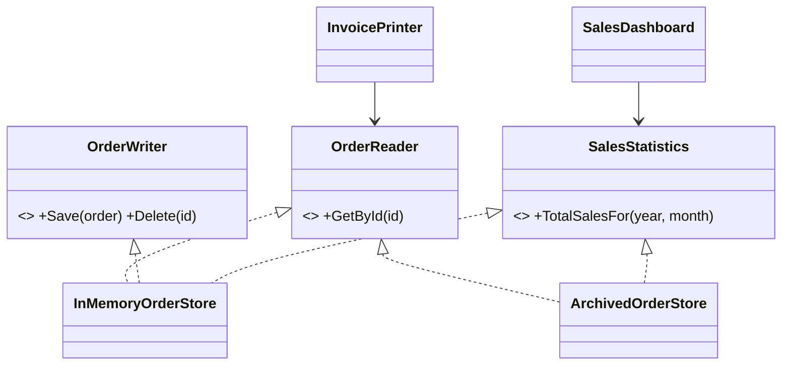

<details>
<summary><b>🟣 C# (.NET 8)</b> — <code>dotnet/src/SolidPrinciples/Isp/Good/StoredOrder.cs</code>, <code>dotnet/src/SolidPrinciples/Isp/Good/OrderRoleInterfaces.cs</code>, <code>dotnet/src/SolidPrinciples/Isp/Good/OrderStores.cs</code>, <code>dotnet/src/SolidPrinciples/Isp/Good/OrderClients.cs</code></summary>

<!-- snippet: dotnet/src/SolidPrinciples/Isp/Good/StoredOrder.cs, dotnet/src/SolidPrinciples/Isp/Good/OrderRoleInterfaces.cs, dotnet/src/SolidPrinciples/Isp/Good/OrderStores.cs, dotnet/src/SolidPrinciples/Isp/Good/OrderClients.cs -->
```csharp
// ── dotnet/src/SolidPrinciples/Isp/Good/StoredOrder.cs ──
namespace SolidPrinciples.Isp.Good;

public sealed record StoredOrder(string Id, string CustomerName, decimal Total, DateOnly PlacedOn);

// ── dotnet/src/SolidPrinciples/Isp/Good/OrderRoleInterfaces.cs ──
namespace SolidPrinciples.Isp.Good;

// ✅ Small "role interfaces", each shaped by what one kind of client needs.

public interface IOrderReader
{
    StoredOrder? GetById(string id);
}

public interface IOrderWriter
{
    void Save(StoredOrder order);

    void Delete(string id);
}

public interface ISalesStatistics
{
    decimal TotalSalesFor(int year, int month);
}

// ── dotnet/src/SolidPrinciples/Isp/Good/OrderStores.cs ──
namespace SolidPrinciples.Isp.Good;

/// <summary>A full-featured store simply implements every role.</summary>
public sealed class InMemoryOrderStore : IOrderReader, IOrderWriter, ISalesStatistics
{
    private readonly Dictionary<string, StoredOrder> _orders = [];

    public StoredOrder? GetById(string id) => _orders.GetValueOrDefault(id);

    public void Save(StoredOrder order)
    {
        ArgumentNullException.ThrowIfNull(order);
        _orders[order.Id] = order;
    }

    public void Delete(string id) => _orders.Remove(id);

    public decimal TotalSalesFor(int year, int month) => SalesMath.Total(_orders.Values, year, month);
}

/// <summary>✅ The archive implements only what it can honestly do. No fake writes.</summary>
public sealed class ArchivedOrderStore(IEnumerable<StoredOrder> orders) : IOrderReader, ISalesStatistics
{
    private readonly Dictionary<string, StoredOrder> _orders = orders.ToDictionary(o => o.Id);

    public StoredOrder? GetById(string id) => _orders.GetValueOrDefault(id);

    public decimal TotalSalesFor(int year, int month) => SalesMath.Total(_orders.Values, year, month);
}

internal static class SalesMath
{
    public static decimal Total(IEnumerable<StoredOrder> orders, int year, int month) =>
        orders
            .Where(o => o.PlacedOn.Year == year && o.PlacedOn.Month == month)
            .Sum(o => o.Total);
}

// ── dotnet/src/SolidPrinciples/Isp/Good/OrderClients.cs ──
using System.Globalization;

namespace SolidPrinciples.Isp.Good;

/// <summary>✅ Depends only on reading. Works with the live store and the archive.</summary>
public sealed class InvoicePrinter(IOrderReader orders)
{
    public string Print(string orderId)
    {
        var order = orders.GetById(orderId)
            ?? throw new KeyNotFoundException($"Order {orderId} not found.");

        return string.Create(
            CultureInfo.InvariantCulture,
            $"Invoice {order.Id} | {order.CustomerName} | {order.Total:0.00} EUR");
    }
}

/// <summary>✅ Depends only on statistics.</summary>
public sealed class SalesDashboard(ISalesStatistics statistics)
{
    public string MonthlySummary(int year, int month) =>
        string.Create(
            CultureInfo.InvariantCulture,
            $"{year:D4}-{month:D2}: {statistics.TotalSalesFor(year, month):0.00} EUR");
}
```
<!-- /snippet -->

</details>
<details>
<summary><b>🐍 Python 3.12</b> — <code>python/solid/isp/good.py</code></summary>

<!-- snippet: python/solid/isp/good.py -->
```python
"""ISP - the solution: small role interfaces shaped by each client's needs."""

from collections.abc import Iterable
from dataclasses import dataclass
from datetime import date
from decimal import Decimal
from typing import Protocol


@dataclass(frozen=True)
class StoredOrder:
    id: str
    customer_name: str
    total: Decimal
    placed_on: date


class OrderReader(Protocol):
    def get_by_id(self, order_id: str) -> StoredOrder | None: ...


class OrderWriter(Protocol):
    def save(self, order: StoredOrder) -> None: ...

    def delete(self, order_id: str) -> None: ...


class SalesStatistics(Protocol):
    def total_sales_for(self, year: int, month: int) -> Decimal: ...


def _total_sales(orders: Iterable[StoredOrder], year: int, month: int) -> Decimal:
    return sum(
        (o.total for o in orders if o.placed_on.year == year and o.placed_on.month == month),
        Decimal(0),
    )


class InMemoryOrderStore:
    """A full-featured store simply satisfies every role."""

    def __init__(self) -> None:
        self._orders: dict[str, StoredOrder] = {}

    def get_by_id(self, order_id: str) -> StoredOrder | None:
        return self._orders.get(order_id)

    def save(self, order: StoredOrder) -> None:
        self._orders[order.id] = order

    def delete(self, order_id: str) -> None:
        self._orders.pop(order_id, None)

    def total_sales_for(self, year: int, month: int) -> Decimal:
        return _total_sales(self._orders.values(), year, month)


class ArchivedOrderStore:
    """✅ Implements only what it can honestly do: read and report."""

    def __init__(self, orders: Iterable[StoredOrder]) -> None:
        self._orders = {order.id: order for order in orders}

    def get_by_id(self, order_id: str) -> StoredOrder | None:
        return self._orders.get(order_id)

    def total_sales_for(self, year: int, month: int) -> Decimal:
        return _total_sales(self._orders.values(), year, month)


class InvoicePrinter:
    """✅ Depends only on reading."""

    def __init__(self, orders: OrderReader) -> None:
        self._orders = orders

    def print(self, order_id: str) -> str:
        order = self._orders.get_by_id(order_id)
        if order is None:
            raise LookupError(f"Order {order_id} not found.")
        return f"Invoice {order.id} | {order.customer_name} | {order.total:.2f} EUR"


class SalesDashboard:
    """✅ Depends only on statistics."""

    def __init__(self, statistics: SalesStatistics) -> None:
        self._statistics = statistics

    def monthly_summary(self, year: int, month: int) -> str:
        total = self._statistics.total_sales_for(year, month)
        return f"{year:04d}-{month:02d}: {total:.2f} EUR"
```
<!-- /snippet -->

</details>
<details>
<summary><b>🐹 Go 1.22</b> — <code>go/isp/good/orders.go</code></summary>

<!-- snippet: go/isp/good/orders.go -->
```go
// Package good shows ISP applied. In Go, small interfaces are idiomatic
// ("the bigger the interface, the weaker the abstraction") and are best
// declared next to the code that CONSUMES them.
package good

import (
	"errors"
	"fmt"
	"time"
)

var ErrOrderNotFound = errors.New("order not found")

type StoredOrder struct {
	ID           string
	CustomerName string
	TotalCents   int64
	PlacedOn     time.Time
}

// ✅ Role interfaces, each shaped by what one kind of client needs.

type OrderReader interface {
	GetByID(id string) (StoredOrder, bool)
}

type OrderWriter interface {
	Save(order StoredOrder)
	Delete(id string)
}

type SalesStatistics interface {
	TotalSalesFor(year int, month time.Month) int64
}

// Compile-time proof of which roles each store plays.
var (
	_ OrderReader     = (*InMemoryOrderStore)(nil)
	_ OrderWriter     = (*InMemoryOrderStore)(nil)
	_ SalesStatistics = (*InMemoryOrderStore)(nil)
	_ OrderReader     = (*ArchivedOrderStore)(nil)
	_ SalesStatistics = (*ArchivedOrderStore)(nil)
)

type orderMap map[string]StoredOrder

func (m orderMap) GetByID(id string) (StoredOrder, bool) {
	o, ok := m[id]
	return o, ok
}

func (m orderMap) TotalSalesFor(year int, month time.Month) int64 {
	var total int64
	for _, o := range m {
		if o.PlacedOn.Year() == year && o.PlacedOn.Month() == month {
			total += o.TotalCents
		}
	}
	return total
}

// InMemoryOrderStore is a full-featured store: it plays every role.
type InMemoryOrderStore struct{ orderMap }

func NewInMemoryOrderStore() *InMemoryOrderStore { return &InMemoryOrderStore{orderMap{}} }

func (s *InMemoryOrderStore) Save(order StoredOrder) { s.orderMap[order.ID] = order }
func (s *InMemoryOrderStore) Delete(id string)       { delete(s.orderMap, id) }

// ArchivedOrderStore ✅ implements only what it can honestly do: read and report.
type ArchivedOrderStore struct{ orderMap }

func NewArchivedOrderStore(orders ...StoredOrder) *ArchivedOrderStore {
	m := orderMap{}
	for _, o := range orders {
		m[o.ID] = o
	}
	return &ArchivedOrderStore{m}
}

// InvoicePrinter ✅ depends only on reading.
type InvoicePrinter struct{ Orders OrderReader }

func (p InvoicePrinter) Print(orderID string) (string, error) {
	o, ok := p.Orders.GetByID(orderID)
	if !ok {
		return "", fmt.Errorf("%w: %s", ErrOrderNotFound, orderID)
	}
	return fmt.Sprintf("Invoice %s | %s | %d.%02d EUR", o.ID, o.CustomerName, o.TotalCents/100, o.TotalCents%100), nil
}

// SalesDashboard ✅ depends only on statistics.
type SalesDashboard struct{ Statistics SalesStatistics }

func (d SalesDashboard) MonthlySummary(year int, month time.Month) string {
	total := d.Statistics.TotalSalesFor(year, month)
	return fmt.Sprintf("%04d-%02d: %d.%02d EUR", year, int(month), total/100, total%100)
}
```
<!-- /snippet -->

</details>
<details>
<summary><b>🔷 TypeScript 5</b> — <code>typescript/src/isp/good.ts</code></summary>

<!-- snippet: typescript/src/isp/good.ts -->
```typescript
// ISP - the solution: small role interfaces shaped by each client's needs.

export type Cents = number;

export interface StoredOrder {
  readonly id: string;
  readonly customerName: string;
  readonly total: Cents;
  readonly placedOn: Date;
}

// ✅ Role interfaces.
export interface OrderReader {
  getById(id: string): StoredOrder | undefined;
}

export interface OrderWriter {
  save(order: StoredOrder): void;
  delete(id: string): void;
}

export interface SalesStatistics {
  totalSalesFor(year: number, month: number): Cents;
}

const totalSales = (orders: Iterable<StoredOrder>, year: number, month: number): Cents =>
  [...orders]
    .filter((o) => o.placedOn.getUTCFullYear() === year && o.placedOn.getUTCMonth() + 1 === month)
    .reduce((sum, o) => sum + o.total, 0);

/** A full-featured store simply implements every role. */
export class InMemoryOrderStore implements OrderReader, OrderWriter, SalesStatistics {
  private readonly orders = new Map<string, StoredOrder>();

  getById(id: string): StoredOrder | undefined {
    return this.orders.get(id);
  }

  save(order: StoredOrder): void {
    this.orders.set(order.id, order);
  }

  delete(id: string): void {
    this.orders.delete(id);
  }

  totalSalesFor(year: number, month: number): Cents {
    return totalSales(this.orders.values(), year, month);
  }
}

/** ✅ Implements only what it can honestly do: read and report. */
export class ArchivedOrderStore implements OrderReader, SalesStatistics {
  private readonly orders: ReadonlyMap<string, StoredOrder>;

  constructor(orders: Iterable<StoredOrder>) {
    this.orders = new Map([...orders].map((o) => [o.id, o]));
  }

  getById(id: string): StoredOrder | undefined {
    return this.orders.get(id);
  }

  totalSalesFor(year: number, month: number): Cents {
    return totalSales(this.orders.values(), year, month);
  }
}

/** ✅ Depends only on reading. */
export class InvoicePrinter {
  constructor(private readonly orders: OrderReader) {}

  print(orderId: string): string {
    const order = this.orders.getById(orderId);
    if (!order) throw new Error(`Order ${orderId} not found.`);
    return `Invoice ${order.id} | ${order.customerName} | ${(order.total / 100).toFixed(2)} EUR`;
  }
}

/** ✅ Depends only on statistics. */
export class SalesDashboard {
  constructor(private readonly statistics: SalesStatistics) {}

  monthlySummary(year: number, month: number): string {
    const total = this.statistics.totalSalesFor(year, month);
    return `${year}-${String(month).padStart(2, "0")}: ${(total / 100).toFixed(2)} EUR`;
  }
}
```
<!-- /snippet -->

</details>
<details>
<summary><b>⚛️ React 18 + TypeScript</b> — <code>react/src/isp/good/CustomerBadge.tsx</code>, <code>react/src/isp/good/OrderHeader.tsx</code></summary>

<!-- snippet: react/src/isp/good/CustomerBadge.tsx, react/src/isp/good/OrderHeader.tsx -->
```tsx
// ── react/src/isp/good/CustomerBadge.tsx ──
/** ✅ Props are the component's interface: ask only for what you use. */
interface CustomerBadgeProps {
  readonly name: string;
  readonly isVip: boolean;
}

export function CustomerBadge({ name, isVip }: CustomerBadgeProps) {
  return (
    <span className={isVip ? "badge badge-vip" : "badge"}>
      {name}
      {isVip && " ★ VIP"}
    </span>
  );
}

// ── react/src/isp/good/OrderHeader.tsx ──
import type { Order } from "../types";
import { CustomerBadge } from "./CustomerBadge";

/** The parent that owns the rich object maps it to the narrow props. */
export function OrderHeader({ order }: { order: Pick<Order, "id" | "customer"> }) {
  return (
    <header>
      <h2>Order {order.id}</h2>
      <CustomerBadge name={order.customer.name} isVip={order.customer.tier === "vip"} />
    </header>
  );
}
```
<!-- /snippet -->

</details>

### 🧪 Proving it with tests

Notice the size of the test doubles: a stub `OrderReader` is **one method**. The archive now works with every client that only reads or reports — no exceptions, no lies.

<details>
<summary><b>🟣 C# (.NET 8)</b> — <code>dotnet/tests/SolidPrinciples.Tests/IspTests.cs</code></summary>

<!-- snippet: dotnet/tests/SolidPrinciples.Tests/IspTests.cs -->
```csharp
using SolidPrinciples.Isp.Good;

namespace SolidPrinciples.Tests;

public class IspTests
{
    private static readonly StoredOrder March = new("O-1", "Ana", 120.00m, new DateOnly(2026, 3, 14));
    private static readonly StoredOrder MarchToo = new("O-2", "Luis", 30.50m, new DateOnly(2026, 3, 20));
    private static readonly StoredOrder April = new("O-3", "Eva", 99.99m, new DateOnly(2026, 4, 2));

    [Fact]
    public void Bad_fat_interface_forces_the_archive_to_lie()
    {
        var archive = new Isp.Bad.ArchivedOrderStore([]);

        Assert.Throws<NotSupportedException>(() => archive.Delete("O-1"));
    }

    /// <summary>With a narrow interface, a test double is one line long.</summary>
    private sealed class StubReader(StoredOrder order) : IOrderReader
    {
        public StoredOrder? GetById(string id) => id == order.Id ? order : null;
    }

    [Fact]
    public void InvoicePrinter_only_needs_a_reader()
    {
        var printer = new InvoicePrinter(new StubReader(March));

        Assert.Equal("Invoice O-1 | Ana | 120.00 EUR", printer.Print("O-1"));
        Assert.Throws<KeyNotFoundException>(() => printer.Print("missing"));
    }

    [Fact]
    public void Read_only_archive_works_with_reading_and_reporting_clients()
    {
        var archive = new ArchivedOrderStore([March, MarchToo, April]);

        Assert.Equal("Invoice O-3 | Eva | 99.99 EUR", new InvoicePrinter(archive).Print("O-3"));
        Assert.Equal("2026-03: 150.50 EUR", new SalesDashboard(archive).MonthlySummary(2026, 3));
    }

    [Fact]
    public void Live_store_plays_every_role()
    {
        var store = new InMemoryOrderStore();
        store.Save(March);
        store.Save(April);
        store.Delete("O-3");

        Assert.NotNull(store.GetById("O-1"));
        Assert.Null(store.GetById("O-3"));
        Assert.Equal(0m, store.TotalSalesFor(2026, 4));
    }
}
```
<!-- /snippet -->

</details>
<details>
<summary><b>🐍 Python 3.12</b> — <code>python/tests/test_isp.py</code></summary>

<!-- snippet: python/tests/test_isp.py -->
```python
from datetime import date
from decimal import Decimal

import pytest

from solid.isp import bad
from solid.isp.good import (
    ArchivedOrderStore,
    InMemoryOrderStore,
    InvoicePrinter,
    SalesDashboard,
    StoredOrder,
)

MARCH = StoredOrder("O-1", "Ana", Decimal("120.00"), date(2026, 3, 14))
MARCH_TOO = StoredOrder("O-2", "Luis", Decimal("30.50"), date(2026, 3, 20))
APRIL = StoredOrder("O-3", "Eva", Decimal("99.99"), date(2026, 4, 2))


def test_bad_fat_interface_forces_the_archive_to_lie() -> None:
    with pytest.raises(NotImplementedError):
        bad.ArchivedOrderStore([]).delete("O-1")


class StubReader:
    """With a narrow interface, a test double is tiny."""

    def get_by_id(self, order_id: str) -> StoredOrder | None:
        return MARCH if order_id == MARCH.id else None


def test_invoice_printer_only_needs_a_reader() -> None:
    printer = InvoicePrinter(StubReader())

    assert printer.print("O-1") == "Invoice O-1 | Ana | 120.00 EUR"
    with pytest.raises(LookupError):
        printer.print("missing")


def test_read_only_archive_works_with_reading_and_reporting_clients() -> None:
    archive = ArchivedOrderStore([MARCH, MARCH_TOO, APRIL])

    assert InvoicePrinter(archive).print("O-3") == "Invoice O-3 | Eva | 99.99 EUR"
    assert SalesDashboard(archive).monthly_summary(2026, 3) == "2026-03: 150.50 EUR"


def test_live_store_plays_every_role() -> None:
    store = InMemoryOrderStore()
    store.save(MARCH)
    store.save(APRIL)
    store.delete("O-3")

    assert store.get_by_id("O-1") is not None
    assert store.get_by_id("O-3") is None
    assert store.total_sales_for(2026, 4) == Decimal(0)
```
<!-- /snippet -->

</details>
<details>
<summary><b>🐹 Go 1.22</b> — <code>go/isp/good/orders_test.go</code></summary>

<!-- snippet: go/isp/good/orders_test.go -->
```go
package good_test

import (
	"errors"
	"testing"
	"time"

	"github.com/danielfyo/solid-principles-dotnet/go/isp/bad"
	"github.com/danielfyo/solid-principles-dotnet/go/isp/good"
)

func day(y int, m time.Month, d int) time.Time { return time.Date(y, m, d, 0, 0, 0, 0, time.UTC) }

var (
	march    = good.StoredOrder{ID: "O-1", CustomerName: "Ana", TotalCents: 12000, PlacedOn: day(2026, time.March, 14)}
	marchToo = good.StoredOrder{ID: "O-2", CustomerName: "Luis", TotalCents: 3050, PlacedOn: day(2026, time.March, 20)}
	april    = good.StoredOrder{ID: "O-3", CustomerName: "Eva", TotalCents: 9999, PlacedOn: day(2026, time.April, 2)}
)

func TestBadFatInterfaceForcesTheArchiveToLie(t *testing.T) {
	if err := bad.NewArchivedOrderStore().Delete("O-1"); !errors.Is(err, bad.ErrReadOnly) {
		t.Fatalf("expected ErrReadOnly, got %v", err)
	}
}

// stubReader: with a narrow interface, a test double is one method.
type stubReader struct{ order good.StoredOrder }

func (s stubReader) GetByID(id string) (good.StoredOrder, bool) { return s.order, id == s.order.ID }

func TestInvoicePrinterOnlyNeedsAReader(t *testing.T) {
	printer := good.InvoicePrinter{Orders: stubReader{march}}

	if got, _ := printer.Print("O-1"); got != "Invoice O-1 | Ana | 120.00 EUR" {
		t.Fatalf("got %q", got)
	}
	if _, err := printer.Print("missing"); !errors.Is(err, good.ErrOrderNotFound) {
		t.Fatalf("expected ErrOrderNotFound, got %v", err)
	}
}

func TestReadOnlyArchiveWorksWithReadingAndReportingClients(t *testing.T) {
	archive := good.NewArchivedOrderStore(march, marchToo, april)

	if got, _ := (good.InvoicePrinter{Orders: archive}).Print("O-3"); got != "Invoice O-3 | Eva | 99.99 EUR" {
		t.Fatalf("got %q", got)
	}
	if got := (good.SalesDashboard{Statistics: archive}).MonthlySummary(2026, time.March); got != "2026-03: 150.50 EUR" {
		t.Fatalf("got %q", got)
	}
}

func TestLiveStorePlaysEveryRole(t *testing.T) {
	store := good.NewInMemoryOrderStore()
	store.Save(march)
	store.Save(april)
	store.Delete("O-3")

	if _, ok := store.GetByID("O-1"); !ok {
		t.Fatal("O-1 should exist")
	}
	if _, ok := store.GetByID("O-3"); ok {
		t.Fatal("O-3 should be deleted")
	}
	if got := store.TotalSalesFor(2026, time.April); got != 0 {
		t.Fatalf("got %d", got)
	}
}
```
<!-- /snippet -->

</details>
<details>
<summary><b>🔷 TypeScript 5</b> — <code>typescript/tests/isp.test.ts</code></summary>

<!-- snippet: typescript/tests/isp.test.ts -->
```typescript
import { describe, expect, it } from "vitest";
import * as bad from "../src/isp/bad.js";
import {
  ArchivedOrderStore,
  InMemoryOrderStore,
  InvoicePrinter,
  SalesDashboard,
  type OrderReader,
  type StoredOrder,
} from "../src/isp/good.js";

const march: StoredOrder = { id: "O-1", customerName: "Ana", total: 12_000, placedOn: new Date("2026-03-14") };
const marchToo: StoredOrder = { id: "O-2", customerName: "Luis", total: 3_050, placedOn: new Date("2026-03-20") };
const april: StoredOrder = { id: "O-3", customerName: "Eva", total: 9_999, placedOn: new Date("2026-04-02") };

describe("ISP", () => {
  it("bad fat interface forces the archive to lie", () => {
    expect(() => new bad.ArchivedOrderStore([]).delete("O-1")).toThrow("read-only");
  });

  it("InvoicePrinter only needs a reader (a one-line stub)", () => {
    const stub: OrderReader = { getById: (id) => (id === march.id ? march : undefined) };
    const printer = new InvoicePrinter(stub);

    expect(printer.print("O-1")).toBe("Invoice O-1 | Ana | 120.00 EUR");
    expect(() => printer.print("missing")).toThrow("not found");
  });

  it("read-only archive works with reading and reporting clients", () => {
    const archive = new ArchivedOrderStore([march, marchToo, april]);

    expect(new InvoicePrinter(archive).print("O-3")).toBe("Invoice O-3 | Eva | 99.99 EUR");
    expect(new SalesDashboard(archive).monthlySummary(2026, 3)).toBe("2026-03: 150.50 EUR");
  });

  it("live store plays every role", () => {
    const store = new InMemoryOrderStore();
    store.save(march);
    store.save(april);
    store.delete("O-3");

    expect(store.getById("O-1")).toBeDefined();
    expect(store.getById("O-3")).toBeUndefined();
    expect(store.totalSalesFor(2026, 4)).toBe(0);
  });
});
```
<!-- /snippet -->

</details>
<details>
<summary><b>⚛️ React 18 + TypeScript</b> — <code>react/src/isp/isp.test.tsx</code></summary>

<!-- snippet: react/src/isp/isp.test.tsx -->
```tsx
import { render, screen } from "@testing-library/react";
import { CustomerBadge as BadCustomerBadge } from "./bad/CustomerBadge";
import { CustomerBadge } from "./good/CustomerBadge";
import { OrderHeader } from "./good/OrderHeader";
import type { Order } from "./types";

describe("ISP", () => {
  it("the bad badge needs a full Order fixture just to show a name", () => {
    const order: Order = {
      id: "O-1",
      placedAt: "2026-03-14T10:00:00Z",
      customer: { id: "C-1", name: "Ana", email: "ana@example.com", tier: "vip", addresses: [] },
      lines: [],
      payment: { method: "card", status: "paid" },
      total: 0,
    };

    render(<BadCustomerBadge order={order} />);

    expect(screen.getByText("Ana ★ VIP")).toBeInTheDocument();
  });

  it("the good badge needs only what it shows", () => {
    render(<CustomerBadge name="Ana" isVip />);

    expect(screen.getByText("Ana ★ VIP")).toBeInTheDocument();
  });

  it("the good badge is reusable outside orders", () => {
    render(<CustomerBadge name="Luis" isVip={false} />);

    expect(screen.getByText("Luis")).not.toHaveClass("badge-vip");
  });

  it("the parent maps the rich object to narrow props", () => {
    render(<OrderHeader order={{ id: "O-1", customer: { id: "C-1", name: "Ana", email: "", tier: "vip", addresses: [] } }} />);

    expect(screen.getByRole("heading")).toHaveTextContent("Order O-1");
    expect(screen.getByText("Ana ★ VIP")).toBeInTheDocument();
  });
});
```
<!-- /snippet -->

</details>

### ✅ Benefits

- **Decoupled clients** — changes to writing don't affect readers.
- **Honest implementations** — no fake methods, no runtime surprises.
- **Cheap test doubles** and simpler mocks.
- **Better reuse** — narrow components/functions fit more contexts.
- **Clear intent** — a constructor that asks for `IOrderReader` documents that the class never writes.

### ⚠️ Pitfalls and trade-offs

- **Don't go to one-method-per-interface by reflex.** Split by *client need*, not mechanically. Members that are always used together belong together.
- **Interface pollution** in C#/Java: a dozen tiny interfaces nobody else implements adds navigation cost. Start where there is real pain (fakes, read-only variants, different clients).
- **CQRS** is ISP at architectural scale (separate read and write models) — powerful, but heavy. Don't introduce it just to satisfy a principle.

### 🌍 Language notes

| Language | Notes |
| --- | --- |
| **C#** | Classes can implement many interfaces; inject the narrow one. Interface inheritance lets you compose (`IOrderStore : IOrderReader, IOrderWriter`). The BCL does this: `IReadOnlyList<T>` vs `IList<T>`. |
| **Python** | `typing.Protocol` is ideal: the client declares the protocol it needs and any object with those methods fits — no inheritance required. |
| **Go** | ISP is the default culture: *"The bigger the interface, the weaker the abstraction"* (Rob Pike). Interfaces are satisfied implicitly, so **consumers define the interfaces they need** (`io.Reader`, `io.Writer`, composed into `io.ReadWriter`). |
| **TypeScript** | Structural typing lets you use `Pick<T, K>` or tiny interfaces; an object literal stub is a valid implementation. |
| **React** | **Props are the component's interface.** Ask for `name` and `isVip`, not `order`. This also helps memoisation (`React.memo` compares primitives cheaply) and Storybook. |

### ☑️ Checklist

- [ ] No implementation throws "not supported" for an interface member.
- [ ] Each dependency in a constructor is the **narrowest** abstraction the class needs.
- [ ] Test doubles implement only what the test exercises.
- [ ] React components receive only the data they render.

### 🎓 Level up

- ISP is about **who depends on whom**, not about the size of classes: a big class implementing several small interfaces is perfectly fine.
- At architecture level ISP becomes the **Common Reuse Principle** (CRP): *don't force users of a component to depend on things they don't need* — don't put unrelated classes in the same package/library.
- **API design**: GraphQL and backend-for-frontend (BFF) patterns are ISP applied to network APIs — each client gets the shape it needs.

[⬆ Back to top](#toc)

---

<a id="dip"></a>

## D — Dependency Inversion Principle (DIP)

### 📖 Definition

> *"A. High-level modules should not depend on low-level modules. Both should depend on abstractions.*
> *B. Abstractions should not depend on details. Details should depend on abstractions."* — Robert C. Martin

### 💡 In plain words

The important code — **business policy** (how checkout works) — should not know about **details** (Stripe, SMTP, SQL, HTTP). Instead, the policy **declares the abstractions it needs** in its own language (`PaymentGateway`, `CustomerNotifier`), and the details **implement** them (adapters).

The "inversion" is about the **direction of the source-code dependency**:

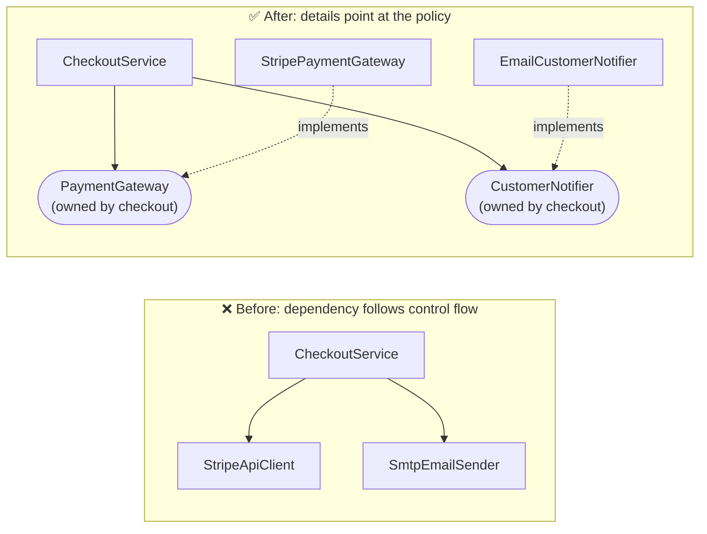

At runtime, `CheckoutService` still calls Stripe. But at **compile time**, the arrow points the other way: Stripe's adapter depends on the checkout's interface.

> [!IMPORTANT]
> **DIP ≠ Dependency Injection ≠ IoC container.**
> - **DIP** is a *design principle* about the direction of dependencies and who owns abstractions.
> - **Dependency Injection** is a *technique*: pass dependencies in (constructor parameters) instead of creating them inside.
> - An **IoC container** (ASP.NET Core DI, Spring…) is a *tool* that automates injection.
>
> You can apply DIP with plain constructor parameters and a hand-written composition root — as every example in this repository does.

### 🏠 Analogy

A wall socket. Your laptop doesn't solder itself to the power plant: it depends on a **standard socket** (abstraction). The power company (detail) adapts *to that standard*. You can change provider, use a generator, or a test bench, and the laptop never changes.

### 🔍 How to spot a violation

- `new ConcreteThing()` for **infrastructure** inside business code (`new SqlConnection`, `new HttpClient`, `new StripeClient`).
- Business code importing vendor SDKs or framework types.
- Static calls to infrastructure: `DateTime.Now`, `File.ReadAllText`, `requests.get`, `fetch` inside logic.
- Tests that need **network, database or real time**, or module-level mocking hacks (`vi.mock`, `monkeypatch`) to run.
- Interfaces defined **next to the implementation** in the infrastructure layer, shaped like the vendor's API (`IStripeClient.CreateCharge(cents)`).

### ❌ The problem

<details>
<summary><b>🟣 C# (.NET 8)</b> — <code>dotnet/src/SolidPrinciples/Dip/Bad/CheckoutService.cs</code></summary>

<!-- snippet: dotnet/src/SolidPrinciples/Dip/Bad/CheckoutService.cs -->
```csharp
using System.Globalization;

namespace SolidPrinciples.Dip.Bad;

/// <summary>Stand-in for a third-party payment SDK (low-level detail).</summary>
public sealed class StripeApiClient
{
    private int _sequence;

    public Task<string> CreateChargeAsync(string customerEmail, long amountInCents, CancellationToken ct = default)
    {
        // Imagine a real HTTP call here: network, API keys, rate limits...
        Console.WriteLine($"[stripe] charging {amountInCents} cents to {customerEmail}");
        return Task.FromResult($"ch_{++_sequence}");
    }
}

/// <summary>Stand-in for an SMTP library (low-level detail).</summary>
public sealed class SmtpEmailSender
{
    public Task SendAsync(string to, string subject, string body, CancellationToken ct = default)
    {
        Console.WriteLine($"[smtp] to={to} subject={subject} body={body}");
        return Task.CompletedTask;
    }
}

public sealed record CheckoutResult(bool Succeeded, string Message);

/// <summary>
/// ❌ DIP violation: the high-level business policy (checkout) creates and
/// depends on low-level concrete details (Stripe, SMTP).
/// - Cannot be unit-tested without hitting "Stripe" and "SMTP".
/// - Cannot simulate a declined card.
/// - Switching to another provider means rewriting business code.
/// </summary>
public sealed class CheckoutService
{
    private readonly StripeApiClient _stripe = new();
    private readonly SmtpEmailSender _email = new();

    public async Task<CheckoutResult> CheckoutAsync(string customerEmail, decimal amount, CancellationToken ct = default)
    {
        var cents = (long)Math.Round(amount * 100, MidpointRounding.AwayFromZero);
        var chargeId = await _stripe.CreateChargeAsync(customerEmail, cents, ct).ConfigureAwait(false);

        var body = string.Create(CultureInfo.InvariantCulture, $"Payment of {amount:0.00} EUR received ({chargeId}).");
        await _email.SendAsync(customerEmail, "Thanks for your order", body, ct).ConfigureAwait(false);

        return new CheckoutResult(true, body);
    }
}
```
<!-- /snippet -->

</details>
<details>
<summary><b>🐍 Python 3.12</b> — <code>python/solid/dip/bad.py</code></summary>

<!-- snippet: python/solid/dip/bad.py -->
```python
"""DIP - the problem: business policy creates and depends on concrete details."""

from dataclasses import dataclass
from decimal import ROUND_HALF_UP, Decimal


class StripeApiClient:
    """Stand-in for a third-party payment SDK (low-level detail)."""

    def __init__(self) -> None:
        self._sequence = 0

    def create_charge(self, customer_email: str, amount_in_cents: int) -> str:
        # Imagine a real HTTP call here: network, API keys, rate limits...
        print(f"[stripe] charging {amount_in_cents} cents to {customer_email}")
        self._sequence += 1
        return f"ch_{self._sequence}"


class SmtpEmailSender:
    """Stand-in for an SMTP library (low-level detail)."""

    def send(self, to: str, subject: str, body: str) -> None:
        print(f"[smtp] to={to} subject={subject} body={body}")


@dataclass(frozen=True)
class CheckoutResult:
    succeeded: bool
    message: str


class CheckoutService:
    """❌ Hard-wired to Stripe and SMTP.

    - Cannot be unit-tested without hitting "Stripe" and "SMTP".
    - Cannot simulate a declined card.
    - Switching provider means rewriting business code.
    """

    def __init__(self) -> None:
        self._stripe = StripeApiClient()
        self._email = SmtpEmailSender()

    def checkout(self, customer_email: str, amount: Decimal) -> CheckoutResult:
        cents = int((amount * 100).quantize(Decimal(1), ROUND_HALF_UP))
        charge_id = self._stripe.create_charge(customer_email, cents)

        body = f"Payment of {amount:.2f} EUR received ({charge_id})."
        self._email.send(customer_email, "Thanks for your order", body)
        return CheckoutResult(True, body)
```
<!-- /snippet -->

</details>
<details>
<summary><b>🐹 Go 1.22</b> — <code>go/dip/bad/checkout.go</code></summary>

<!-- snippet: go/dip/bad/checkout.go -->
```go
// Package bad shows a DIP violation: business policy creates concrete details.
package bad

import (
	"context"
	"fmt"
)

// StripeAPIClient is a stand-in for a third-party payment SDK (low-level detail).
type StripeAPIClient struct{ sequence int }

func (c *StripeAPIClient) CreateCharge(_ context.Context, email string, amountCents int64) (string, error) {
	// Imagine a real HTTP call here: network, API keys, rate limits...
	fmt.Printf("[stripe] charging %d cents to %s\n", amountCents, email)
	c.sequence++
	return fmt.Sprintf("ch_%d", c.sequence), nil
}

// SMTPEmailSender is a stand-in for an SMTP library (low-level detail).
type SMTPEmailSender struct{}

func (SMTPEmailSender) Send(_ context.Context, to, subject, body string) error {
	fmt.Printf("[smtp] to=%s subject=%s body=%s\n", to, subject, body)
	return nil
}

type CheckoutResult struct {
	Succeeded bool
	Message   string
}

// CheckoutService ❌ is hard-wired to Stripe and SMTP: untestable in isolation,
// cannot simulate a declined card, and switching provider means rewriting it.
type CheckoutService struct {
	stripe *StripeAPIClient
	email  SMTPEmailSender
}

func NewCheckoutService() *CheckoutService {
	return &CheckoutService{stripe: &StripeAPIClient{}, email: SMTPEmailSender{}}
}

func (s *CheckoutService) Checkout(ctx context.Context, email string, amountCents int64) (CheckoutResult, error) {
	chargeID, err := s.stripe.CreateCharge(ctx, email, amountCents)
	if err != nil {
		return CheckoutResult{}, err
	}
	body := fmt.Sprintf("Payment of %d.%02d EUR received (%s).", amountCents/100, amountCents%100, chargeID)
	if err := s.email.Send(ctx, email, "Thanks for your order", body); err != nil {
		return CheckoutResult{}, err
	}
	return CheckoutResult{Succeeded: true, Message: body}, nil
}
```
<!-- /snippet -->

</details>
<details>
<summary><b>🔷 TypeScript 5</b> — <code>typescript/src/dip/bad.ts</code></summary>

<!-- snippet: typescript/src/dip/bad.ts -->
```typescript
// DIP - the problem: business policy creates and depends on concrete details.

export type Cents = number;

/** Stand-in for a third-party payment SDK (low-level detail). */
export class StripeApiClient {
  private sequence = 0;

  async createCharge(customerEmail: string, amountInCents: Cents): Promise<string> {
    // Imagine a real HTTP call here: network, API keys, rate limits...
    console.log(`[stripe] charging ${amountInCents} cents to ${customerEmail}`);
    return `ch_${++this.sequence}`;
  }
}

/** Stand-in for an SMTP library (low-level detail). */
export class SmtpEmailSender {
  async send(to: string, subject: string, body: string): Promise<void> {
    console.log(`[smtp] to=${to} subject=${subject} body=${body}`);
  }
}

export interface CheckoutResult {
  readonly succeeded: boolean;
  readonly message: string;
}

/**
 * ❌ Hard-wired to Stripe and SMTP: untestable in isolation, cannot simulate
 * a declined card, and switching provider means rewriting business code.
 */
export class CheckoutService {
  private readonly stripe = new StripeApiClient();
  private readonly email = new SmtpEmailSender();

  async checkout(customerEmail: string, amount: Cents): Promise<CheckoutResult> {
    const chargeId = await this.stripe.createCharge(customerEmail, amount);
    const body = `Payment of ${(amount / 100).toFixed(2)} EUR received (${chargeId}).`;
    await this.email.send(customerEmail, "Thanks for your order", body);
    return { succeeded: true, message: body };
  }
}
```
<!-- /snippet -->

</details>
<details>
<summary><b>⚛️ React 18 + TypeScript</b> — <code>react/src/dip/bad/stripeClient.ts</code>, <code>react/src/dip/bad/CheckoutButton.tsx</code></summary>

<!-- snippet: react/src/dip/bad/stripeClient.ts, react/src/dip/bad/CheckoutButton.tsx -->
```typescript
// ── react/src/dip/bad/stripeClient.ts ──
/** Stand-in for a third-party payment SDK, exported as a module singleton. */
export const stripeClient = {
  async createCharge(customerEmail: string, amountInCents: number): Promise<string> {
    // Imagine a real HTTP call here: network, API keys, rate limits...
    console.log(`[stripe] charging ${amountInCents} cents to ${customerEmail}`);
    return `ch_${Date.now()}`;
  },
};

// ── react/src/dip/bad/CheckoutButton.tsx ──
import { useState } from "react";
import { formatMoney, type Cents } from "../../shared/money";
import { stripeClient } from "./stripeClient";

/**
 * ❌ DIP violation: a UI/business component imports a concrete vendor SDK.
 * - Tests must hijack the module system (vi.mock) to avoid "real" charges.
 * - Storybook, demos and other providers are impossible without editing it.
 */
export function CheckoutButton({ email, amount }: { email: string; amount: Cents }) {
  const [status, setStatus] = useState("");

  const pay = async () => {
    const chargeId = await stripeClient.createCharge(email, amount);
    setStatus(`Paid ${formatMoney(amount)} (${chargeId})`);
  };

  return (
    <div>
      <button type="button" onClick={pay}>
        Pay {formatMoney(amount)}
      </button>
      <p role="status">{status}</p>
    </div>
  );
}
```
<!-- /snippet -->

</details>

**Why it hurts:**

1. **Not unit-testable** — every test "charges" Stripe and "sends" an email.
2. **You can't simulate failures** — how do you test a declined card?
3. **Vendor lock-in** — switching to another provider means editing business code.
4. **The business rule is polluted** with details (converting to cents, SMTP subjects).

### 🔧 Refactoring step by step

1. **Identify the policy** (checkout) and the **details** (payment provider, email).
2. **Define abstractions from the policy's point of view**, in business language: `ChargeAsync(email, amount) → PaymentResult`, not `CreateCharge(cents)`. The *policy* owns these interfaces.
3. **Inject them via the constructor** — no more `new` of infrastructure inside the policy.
4. **Write adapters** in the infrastructure layer that implement the abstractions using the vendor SDK (`StripePaymentGateway`, `EmailCustomerNotifier`). Conversion to cents lives there.
5. **Create a composition root** — the single place (`Program.cs`, `main`, `main.tsx`) that wires concrete classes together.
6. **Test the policy with fakes**: approved, declined, notifier failures… all in milliseconds.

### ✅ The solution

<details>
<summary><b>🟣 C# (.NET 8)</b> — <code>dotnet/src/SolidPrinciples/Dip/Good/Abstractions.cs</code>, <code>dotnet/src/SolidPrinciples/Dip/Good/CheckoutService.cs</code>, <code>dotnet/src/SolidPrinciples/Dip/Good/Infrastructure/VendorClients.cs</code>, <code>dotnet/src/SolidPrinciples/Dip/Good/Infrastructure/Adapters.cs</code>, <code>dotnet/src/SolidPrinciples/Dip/Good/CompositionRoot.cs</code></summary>

<!-- snippet: dotnet/src/SolidPrinciples/Dip/Good/Abstractions.cs, dotnet/src/SolidPrinciples/Dip/Good/CheckoutService.cs, dotnet/src/SolidPrinciples/Dip/Good/Infrastructure/VendorClients.cs, dotnet/src/SolidPrinciples/Dip/Good/Infrastructure/Adapters.cs, dotnet/src/SolidPrinciples/Dip/Good/CompositionRoot.cs -->
```csharp
// ── dotnet/src/SolidPrinciples/Dip/Good/Abstractions.cs ──
namespace SolidPrinciples.Dip.Good;

// ✅ The abstractions belong to the high-level policy. They speak the language
// of the business ("charge a customer", "notify a customer"), not of any vendor.

public sealed record PaymentResult(bool Succeeded, string? TransactionId, string? Error)
{
    public static PaymentResult Approved(string transactionId) => new(true, transactionId, null);

    public static PaymentResult Declined(string reason) => new(false, null, reason);
}

public interface IPaymentGateway
{
    Task<PaymentResult> ChargeAsync(string customerEmail, decimal amount, CancellationToken ct = default);
}

public interface ICustomerNotifier
{
    Task NotifyAsync(string customerEmail, string message, CancellationToken ct = default);
}

// ── dotnet/src/SolidPrinciples/Dip/Good/CheckoutService.cs ──
using System.Globalization;

namespace SolidPrinciples.Dip.Good;

public sealed record CheckoutResult(bool Succeeded, string Message);

/// <summary>
/// ✅ High-level policy that depends only on abstractions it owns. It has no
/// idea whether payments go through Stripe, Adyen or a test fake.
/// </summary>
public sealed class CheckoutService(IPaymentGateway payments, ICustomerNotifier notifier)
{
    public async Task<CheckoutResult> CheckoutAsync(string customerEmail, decimal amount, CancellationToken ct = default)
    {
        var payment = await payments.ChargeAsync(customerEmail, amount, ct).ConfigureAwait(false);
        if (!payment.Succeeded)
        {
            return new CheckoutResult(false, $"Payment declined: {payment.Error}");
        }

        var message = string.Create(
            CultureInfo.InvariantCulture,
            $"Payment of {amount:0.00} EUR received ({payment.TransactionId}).");
        await notifier.NotifyAsync(customerEmail, message, ct).ConfigureAwait(false);

        return new CheckoutResult(true, message);
    }
}

// ── dotnet/src/SolidPrinciples/Dip/Good/Infrastructure/VendorClients.cs ──
namespace SolidPrinciples.Dip.Good.Infrastructure;

/// <summary>Stand-in for a third-party payment SDK. We do not control its API.</summary>
public sealed class StripeApiClient
{
    private int _sequence;

    public Task<string> CreateChargeAsync(string customerEmail, long amountInCents, CancellationToken ct = default)
    {
        Console.WriteLine($"[stripe] charging {amountInCents} cents to {customerEmail}");
        return Task.FromResult($"ch_{++_sequence}");
    }
}

/// <summary>Stand-in for an SMTP library.</summary>
public sealed class SmtpEmailSender
{
    public Task SendAsync(string to, string subject, string body, CancellationToken ct = default)
    {
        Console.WriteLine($"[smtp] to={to} subject={subject} body={body}");
        return Task.CompletedTask;
    }
}

// ── dotnet/src/SolidPrinciples/Dip/Good/Infrastructure/Adapters.cs ──
namespace SolidPrinciples.Dip.Good.Infrastructure;

/// <summary>✅ Low-level detail that depends on (implements) the domain abstraction.</summary>
public sealed class StripePaymentGateway(StripeApiClient client) : IPaymentGateway
{
    public async Task<PaymentResult> ChargeAsync(string customerEmail, decimal amount, CancellationToken ct = default)
    {
        var cents = (long)Math.Round(amount * 100, MidpointRounding.AwayFromZero);
        var chargeId = await client.CreateChargeAsync(customerEmail, cents, ct).ConfigureAwait(false);
        return PaymentResult.Approved(chargeId);
    }
}

public sealed class EmailCustomerNotifier(SmtpEmailSender smtp) : ICustomerNotifier
{
    public Task NotifyAsync(string customerEmail, string message, CancellationToken ct = default) =>
        smtp.SendAsync(customerEmail, "Thanks for your order", message, ct);
}

// ── dotnet/src/SolidPrinciples/Dip/Good/CompositionRoot.cs ──
using SolidPrinciples.Dip.Good.Infrastructure;

namespace SolidPrinciples.Dip.Good;

/// <summary>
/// The only place that knows about concrete classes. In ASP.NET Core this is
/// <c>builder.Services.AddScoped&lt;IPaymentGateway, StripePaymentGateway&gt;()</c>.
/// </summary>
public static class CompositionRoot
{
    public static CheckoutService CreateCheckoutService() =>
        new(
            new StripePaymentGateway(new StripeApiClient()),
            new EmailCustomerNotifier(new SmtpEmailSender()));
}
```
<!-- /snippet -->

</details>
<details>
<summary><b>🐍 Python 3.12</b> — <code>python/solid/dip/good.py</code></summary>

<!-- snippet: python/solid/dip/good.py -->
```python
"""DIP - the solution: policy owns abstractions; details plug into them."""

from dataclasses import dataclass
from decimal import ROUND_HALF_UP, Decimal
from typing import Protocol

# --- Abstractions owned by the high-level policy ---------------------------


@dataclass(frozen=True)
class PaymentResult:
    succeeded: bool
    transaction_id: str | None = None
    error: str | None = None

    @staticmethod
    def approved(transaction_id: str) -> "PaymentResult":
        return PaymentResult(True, transaction_id=transaction_id)

    @staticmethod
    def declined(reason: str) -> "PaymentResult":
        return PaymentResult(False, error=reason)


class PaymentGateway(Protocol):
    def charge(self, customer_email: str, amount: Decimal) -> PaymentResult: ...


class CustomerNotifier(Protocol):
    def notify(self, customer_email: str, message: str) -> None: ...


@dataclass(frozen=True)
class CheckoutResult:
    succeeded: bool
    message: str


class CheckoutService:
    """✅ Depends only on abstractions; knows nothing about Stripe or SMTP."""

    def __init__(self, payments: PaymentGateway, notifier: CustomerNotifier) -> None:
        self._payments = payments
        self._notifier = notifier

    def checkout(self, customer_email: str, amount: Decimal) -> CheckoutResult:
        payment = self._payments.charge(customer_email, amount)
        if not payment.succeeded:
            return CheckoutResult(False, f"Payment declined: {payment.error}")

        message = f"Payment of {amount:.2f} EUR received ({payment.transaction_id})."
        self._notifier.notify(customer_email, message)
        return CheckoutResult(True, message)


# --- Low-level details (infrastructure) -------------------------------------


class StripeApiClient:
    """Stand-in for a third-party payment SDK. We do not control its API."""

    def __init__(self) -> None:
        self._sequence = 0

    def create_charge(self, customer_email: str, amount_in_cents: int) -> str:
        print(f"[stripe] charging {amount_in_cents} cents to {customer_email}")
        self._sequence += 1
        return f"ch_{self._sequence}"


class SmtpEmailSender:
    def send(self, to: str, subject: str, body: str) -> None:
        print(f"[smtp] to={to} subject={subject} body={body}")


class StripePaymentGateway:
    """✅ Adapter: the detail depends on (implements) the policy's abstraction."""

    def __init__(self, client: StripeApiClient) -> None:
        self._client = client

    def charge(self, customer_email: str, amount: Decimal) -> PaymentResult:
        cents = int((amount * 100).quantize(Decimal(1), ROUND_HALF_UP))
        return PaymentResult.approved(self._client.create_charge(customer_email, cents))


class EmailCustomerNotifier:
    def __init__(self, smtp: SmtpEmailSender) -> None:
        self._smtp = smtp

    def notify(self, customer_email: str, message: str) -> None:
        self._smtp.send(customer_email, "Thanks for your order", message)


# --- Composition root: the only place that knows the concrete classes ----------


def create_checkout_service() -> CheckoutService:
    return CheckoutService(
        StripePaymentGateway(StripeApiClient()),
        EmailCustomerNotifier(SmtpEmailSender()),
    )
```
<!-- /snippet -->

</details>
<details>
<summary><b>🐹 Go 1.22</b> — <code>go/dip/good/checkout.go</code>, <code>go/dip/good/infrastructure.go</code></summary>

<!-- snippet: go/dip/good/checkout.go, go/dip/good/infrastructure.go -->
```go
// ── go/dip/good/checkout.go ──
// Package good shows DIP applied: the policy owns its abstractions and the
// details (adapters) plug into them.
package good

import (
	"context"
	"fmt"
)

// ✅ Abstractions owned by the high-level policy, in business language.

type PaymentResult struct {
	Succeeded     bool
	TransactionID string
	Error         string
}

func Approved(transactionID string) PaymentResult {
	return PaymentResult{Succeeded: true, TransactionID: transactionID}
}

func Declined(reason string) PaymentResult { return PaymentResult{Error: reason} }

type PaymentGateway interface {
	Charge(ctx context.Context, customerEmail string, amountCents int64) (PaymentResult, error)
}

type CustomerNotifier interface {
	Notify(ctx context.Context, customerEmail, message string) error
}

type CheckoutResult struct {
	Succeeded bool
	Message   string
}

// CheckoutService ✅ depends only on abstractions; knows nothing about Stripe or SMTP.
type CheckoutService struct {
	payments PaymentGateway
	notifier CustomerNotifier
}

func NewCheckoutService(payments PaymentGateway, notifier CustomerNotifier) *CheckoutService {
	return &CheckoutService{payments: payments, notifier: notifier}
}

func (s *CheckoutService) Checkout(ctx context.Context, email string, amountCents int64) (CheckoutResult, error) {
	payment, err := s.payments.Charge(ctx, email, amountCents)
	if err != nil {
		return CheckoutResult{}, fmt.Errorf("charging customer: %w", err)
	}
	if !payment.Succeeded {
		return CheckoutResult{Message: "Payment declined: " + payment.Error}, nil
	}

	message := fmt.Sprintf("Payment of %d.%02d EUR received (%s).", amountCents/100, amountCents%100, payment.TransactionID)
	if err := s.notifier.Notify(ctx, email, message); err != nil {
		return CheckoutResult{}, fmt.Errorf("notifying customer: %w", err)
	}
	return CheckoutResult{Succeeded: true, Message: message}, nil
}

// ── go/dip/good/infrastructure.go ──
package good

import (
	"context"
	"fmt"
)

// --- Low-level details (in a real project: package infrastructure) ---------

// StripeAPIClient is a stand-in for a third-party payment SDK we do not control.
type StripeAPIClient struct{ sequence int }

func (c *StripeAPIClient) CreateCharge(_ context.Context, email string, amountCents int64) (string, error) {
	fmt.Printf("[stripe] charging %d cents to %s\n", amountCents, email)
	c.sequence++
	return fmt.Sprintf("ch_%d", c.sequence), nil
}

type SMTPEmailSender struct{}

func (SMTPEmailSender) Send(_ context.Context, to, subject, body string) error {
	fmt.Printf("[smtp] to=%s subject=%s body=%s\n", to, subject, body)
	return nil
}

// StripePaymentGateway ✅ adapter: the detail implements the policy's abstraction.
type StripePaymentGateway struct{ Client *StripeAPIClient }

func (g StripePaymentGateway) Charge(ctx context.Context, email string, amountCents int64) (PaymentResult, error) {
	id, err := g.Client.CreateCharge(ctx, email, amountCents)
	if err != nil {
		return PaymentResult{}, err
	}
	return Approved(id), nil
}

type EmailCustomerNotifier struct{ SMTP SMTPEmailSender }

func (n EmailCustomerNotifier) Notify(ctx context.Context, email, message string) error {
	return n.SMTP.Send(ctx, email, "Thanks for your order", message)
}

// NewDefaultCheckoutService is the composition root: the only place that knows
// the concrete types. In a real app this lives in main().
func NewDefaultCheckoutService() *CheckoutService {
	return NewCheckoutService(
		StripePaymentGateway{Client: &StripeAPIClient{}},
		EmailCustomerNotifier{SMTP: SMTPEmailSender{}},
	)
}
```
<!-- /snippet -->

</details>
<details>
<summary><b>🔷 TypeScript 5</b> — <code>typescript/src/dip/good.ts</code></summary>

<!-- snippet: typescript/src/dip/good.ts -->
```typescript
// DIP - the solution: the policy owns its abstractions; details plug into them.

export type Cents = number;

// --- Abstractions owned by the high-level policy ---------------------------

export type PaymentResult =
  | { readonly succeeded: true; readonly transactionId: string }
  | { readonly succeeded: false; readonly error: string };

export interface PaymentGateway {
  charge(customerEmail: string, amount: Cents): Promise<PaymentResult>;
}

export interface CustomerNotifier {
  notify(customerEmail: string, message: string): Promise<void>;
}

export interface CheckoutResult {
  readonly succeeded: boolean;
  readonly message: string;
}

/** ✅ Depends only on abstractions; knows nothing about Stripe or SMTP. */
export class CheckoutService {
  constructor(
    private readonly payments: PaymentGateway,
    private readonly notifier: CustomerNotifier,
  ) {}

  async checkout(customerEmail: string, amount: Cents): Promise<CheckoutResult> {
    const payment = await this.payments.charge(customerEmail, amount);
    if (!payment.succeeded) {
      return { succeeded: false, message: `Payment declined: ${payment.error}` };
    }

    const message = `Payment of ${(amount / 100).toFixed(2)} EUR received (${payment.transactionId}).`;
    await this.notifier.notify(customerEmail, message);
    return { succeeded: true, message };
  }
}

// --- Low-level details (infrastructure) -------------------------------------

/** Stand-in for a third-party payment SDK we do not control. */
export class StripeApiClient {
  private sequence = 0;

  async createCharge(customerEmail: string, amountInCents: Cents): Promise<string> {
    console.log(`[stripe] charging ${amountInCents} cents to ${customerEmail}`);
    return `ch_${++this.sequence}`;
  }
}

export class SmtpEmailSender {
  async send(to: string, subject: string, body: string): Promise<void> {
    console.log(`[smtp] to=${to} subject=${subject} body=${body}`);
  }
}

/** ✅ Adapter: the detail implements the policy's abstraction. */
export class StripePaymentGateway implements PaymentGateway {
  constructor(private readonly client: StripeApiClient) {}

  async charge(customerEmail: string, amount: Cents): Promise<PaymentResult> {
    const transactionId = await this.client.createCharge(customerEmail, amount);
    return { succeeded: true, transactionId };
  }
}

export class EmailCustomerNotifier implements CustomerNotifier {
  constructor(private readonly smtp: SmtpEmailSender) {}

  notify(customerEmail: string, message: string): Promise<void> {
    return this.smtp.send(customerEmail, "Thanks for your order", message);
  }
}

// --- Composition root: the only place that knows the concrete classes --------

export const createCheckoutService = (): CheckoutService =>
  new CheckoutService(
    new StripePaymentGateway(new StripeApiClient()),
    new EmailCustomerNotifier(new SmtpEmailSender()),
  );
```
<!-- /snippet -->

</details>
<details>
<summary><b>⚛️ React 18 + TypeScript</b> — <code>react/src/dip/good/paymentGateway.ts</code>, <code>react/src/dip/good/ServicesContext.tsx</code>, <code>react/src/dip/good/CheckoutButton.tsx</code>, <code>react/src/dip/good/stripePaymentGateway.ts</code>, <code>react/src/main.tsx</code></summary>

<!-- snippet: react/src/dip/good/paymentGateway.ts, react/src/dip/good/ServicesContext.tsx, react/src/dip/good/CheckoutButton.tsx, react/src/dip/good/stripePaymentGateway.ts, react/src/main.tsx -->
```typescript
// ── react/src/dip/good/paymentGateway.ts ──
import type { Cents } from "../../shared/money";

/** ✅ The abstraction belongs to the app, written in business language. */
export type PaymentResult =
  | { readonly succeeded: true; readonly transactionId: string }
  | { readonly succeeded: false; readonly error: string };

export interface PaymentGateway {
  charge(customerEmail: string, amount: Cents): Promise<PaymentResult>;
}

// ── react/src/dip/good/ServicesContext.tsx ──
import { createContext, useContext, type ReactNode } from "react";
import type { PaymentGateway } from "./paymentGateway";

/** The set of abstractions the UI depends on. Concrete adapters are injected. */
export interface Services {
  readonly payments: PaymentGateway;
}

const ServicesContext = createContext<Services | null>(null);

export function ServicesProvider({ services, children }: { services: Services; children: ReactNode }) {
  return <ServicesContext.Provider value={services}>{children}</ServicesContext.Provider>;
}

export function useServices(): Services {
  const services = useContext(ServicesContext);
  if (!services) throw new Error("useServices must be used inside <ServicesProvider>.");
  return services;
}

// ── react/src/dip/good/CheckoutButton.tsx ──
import { useState } from "react";
import { formatMoney, type Cents } from "../../shared/money";
import { useServices } from "./ServicesContext";

/** ✅ Depends on the PaymentGateway abstraction, injected through context. */
export function CheckoutButton({ email, amount }: { email: string; amount: Cents }) {
  const { payments } = useServices();
  const [status, setStatus] = useState("");
  const [busy, setBusy] = useState(false);

  const pay = async () => {
    setBusy(true);
    const result = await payments.charge(email, amount);
    setStatus(
      result.succeeded
        ? `Paid ${formatMoney(amount)} (${result.transactionId})`
        : `Payment declined: ${result.error}`,
    );
    setBusy(false);
  };

  return (
    <div>
      <button type="button" onClick={pay} disabled={busy}>
        Pay {formatMoney(amount)}
      </button>
      <p role="status">{status}</p>
    </div>
  );
}

// ── react/src/dip/good/stripePaymentGateway.ts ──
import type { Cents } from "../../shared/money";
import type { PaymentGateway, PaymentResult } from "./paymentGateway";

/** Stand-in for a third-party SDK client. */
export interface StripeLikeClient {
  createCharge(customerEmail: string, amountInCents: Cents): Promise<string>;
}

/** ✅ Adapter: the low-level detail implements the app's abstraction. */
export class StripePaymentGateway implements PaymentGateway {
  constructor(private readonly client: StripeLikeClient) {}

  async charge(customerEmail: string, amount: Cents): Promise<PaymentResult> {
    try {
      return { succeeded: true, transactionId: await this.client.createCharge(customerEmail, amount) };
    } catch (error) {
      return { succeeded: false, error: String(error) };
    }
  }
}

// ── react/src/main.tsx ──
import { StrictMode } from "react";
import { createRoot } from "react-dom/client";
import { App } from "./App";
import { ServicesProvider, type Services } from "./dip/good/ServicesContext";
import { StripePaymentGateway } from "./dip/good/stripePaymentGateway";

// Composition root: the ONLY place that knows which concrete adapters are used.
// Swap the client for the real SDK, a sandbox, or a fake for demos.
const services: Services = {
  payments: new StripePaymentGateway({
    createCharge: async (email, cents) => {
      console.log(`[demo stripe] charging ${cents} cents to ${email}`);
      return `ch_demo_${Date.now()}`;
    },
  }),
};

const container = document.getElementById("root");
if (!container) throw new Error("Missing #root element.");

createRoot(container).render(
  <StrictMode>
    <ServicesProvider services={services}>
      <App />
    </ServicesProvider>
  </StrictMode>,
);
```
<!-- /snippet -->

</details>

### 🧪 Proving it with tests

Simulating a **declined payment** is now a one-liner. Compare with the ❌ React version, which needs `vi.mock` on a module path just to avoid "real" charges.

<details>
<summary><b>🟣 C# (.NET 8)</b> — <code>dotnet/tests/SolidPrinciples.Tests/DipTests.cs</code></summary>

<!-- snippet: dotnet/tests/SolidPrinciples.Tests/DipTests.cs -->
```csharp
using SolidPrinciples.Dip.Good;

namespace SolidPrinciples.Tests;

public class DipTests
{
    private sealed class FakePaymentGateway(PaymentResult result) : IPaymentGateway
    {
        public List<(string Email, decimal Amount)> Charges { get; } = [];

        public Task<PaymentResult> ChargeAsync(string customerEmail, decimal amount, CancellationToken ct = default)
        {
            Charges.Add((customerEmail, amount));
            return Task.FromResult(result);
        }
    }

    private sealed class SpyNotifier : ICustomerNotifier
    {
        public List<string> Messages { get; } = [];

        public Task NotifyAsync(string customerEmail, string message, CancellationToken ct = default)
        {
            Messages.Add($"{customerEmail}: {message}");
            return Task.CompletedTask;
        }
    }

    [Fact]
    public async Task Successful_checkout_notifies_the_customer()
    {
        var gateway = new FakePaymentGateway(PaymentResult.Approved("tx_1"));
        var notifier = new SpyNotifier();
        var checkout = new CheckoutService(gateway, notifier);

        var result = await checkout.CheckoutAsync("ana@example.com", 24.20m);

        Assert.True(result.Succeeded);
        Assert.Equal(("ana@example.com", 24.20m), Assert.Single(gateway.Charges));
        Assert.Equal("ana@example.com: Payment of 24.20 EUR received (tx_1).", Assert.Single(notifier.Messages));
    }

    [Fact]
    public async Task Declined_payment_is_easy_to_simulate_and_sends_nothing()
    {
        var notifier = new SpyNotifier();
        var checkout = new CheckoutService(new FakePaymentGateway(PaymentResult.Declined("insufficient funds")), notifier);

        var result = await checkout.CheckoutAsync("ana@example.com", 24.20m);

        Assert.Equal(new CheckoutResult(false, "Payment declined: insufficient funds"), result);
        Assert.Empty(notifier.Messages);
    }

    [Fact]
    public async Task Composition_root_wires_the_real_adapters()
    {
        var result = await CompositionRoot.CreateCheckoutService().CheckoutAsync("ana@example.com", 10m);

        Assert.Equal("Payment of 10.00 EUR received (ch_1).", result.Message);
    }
}
```
<!-- /snippet -->

</details>
<details>
<summary><b>🐍 Python 3.12</b> — <code>python/tests/test_dip.py</code></summary>

<!-- snippet: python/tests/test_dip.py -->
```python
from decimal import Decimal

from solid.dip.good import CheckoutResult, CheckoutService, PaymentResult, create_checkout_service


class FakePaymentGateway:
    def __init__(self, result: PaymentResult) -> None:
        self._result = result
        self.charges: list[tuple[str, Decimal]] = []

    def charge(self, customer_email: str, amount: Decimal) -> PaymentResult:
        self.charges.append((customer_email, amount))
        return self._result


class SpyNotifier:
    def __init__(self) -> None:
        self.messages: list[str] = []

    def notify(self, customer_email: str, message: str) -> None:
        self.messages.append(f"{customer_email}: {message}")


def test_successful_checkout_notifies_the_customer() -> None:
    gateway = FakePaymentGateway(PaymentResult.approved("tx_1"))
    notifier = SpyNotifier()

    result = CheckoutService(gateway, notifier).checkout("ana@example.com", Decimal("24.20"))

    assert result.succeeded
    assert gateway.charges == [("ana@example.com", Decimal("24.20"))]
    assert notifier.messages == ["ana@example.com: Payment of 24.20 EUR received (tx_1)."]


def test_declined_payment_is_easy_to_simulate_and_sends_nothing() -> None:
    notifier = SpyNotifier()
    gateway = FakePaymentGateway(PaymentResult.declined("insufficient funds"))

    result = CheckoutService(gateway, notifier).checkout("ana@example.com", Decimal("24.20"))

    assert result == CheckoutResult(False, "Payment declined: insufficient funds")
    assert notifier.messages == []


def test_composition_root_wires_the_real_adapters() -> None:
    result = create_checkout_service().checkout("ana@example.com", Decimal(10))

    assert result.message == "Payment of 10.00 EUR received (ch_1)."
```
<!-- /snippet -->

</details>
<details>
<summary><b>🐹 Go 1.22</b> — <code>go/dip/good/checkout_test.go</code></summary>

<!-- snippet: go/dip/good/checkout_test.go -->
```go
package good_test

import (
	"context"
	"fmt"
	"testing"

	"github.com/danielfyo/solid-principles-dotnet/go/dip/good"
)

type fakeGateway struct {
	result  good.PaymentResult
	charges []string
}

func (f *fakeGateway) Charge(_ context.Context, email string, amountCents int64) (good.PaymentResult, error) {
	f.charges = append(f.charges, fmt.Sprintf("%s:%d", email, amountCents))
	return f.result, nil
}

type spyNotifier struct{ messages []string }

func (s *spyNotifier) Notify(_ context.Context, email, message string) error {
	s.messages = append(s.messages, email+": "+message)
	return nil
}

func TestSuccessfulCheckoutNotifiesTheCustomer(t *testing.T) {
	gateway, notifier := &fakeGateway{result: good.Approved("tx_1")}, &spyNotifier{}

	result, err := good.NewCheckoutService(gateway, notifier).Checkout(context.Background(), "ana@example.com", 2420)

	if err != nil || !result.Succeeded {
		t.Fatalf("unexpected result %+v, err %v", result, err)
	}
	if len(gateway.charges) != 1 || gateway.charges[0] != "ana@example.com:2420" {
		t.Fatalf("unexpected charges %v", gateway.charges)
	}
	want := "ana@example.com: Payment of 24.20 EUR received (tx_1)."
	if len(notifier.messages) != 1 || notifier.messages[0] != want {
		t.Fatalf("unexpected messages %v", notifier.messages)
	}
}

func TestDeclinedPaymentIsEasyToSimulateAndSendsNothing(t *testing.T) {
	notifier := &spyNotifier{}
	gateway := &fakeGateway{result: good.Declined("insufficient funds")}

	result, _ := good.NewCheckoutService(gateway, notifier).Checkout(context.Background(), "ana@example.com", 2420)

	if result != (good.CheckoutResult{Message: "Payment declined: insufficient funds"}) || len(notifier.messages) != 0 {
		t.Fatalf("unexpected result %+v / messages %v", result, notifier.messages)
	}
}

func TestCompositionRootWiresTheRealAdapters(t *testing.T) {
	result, err := good.NewDefaultCheckoutService().Checkout(context.Background(), "ana@example.com", 1000)

	if err != nil || result.Message != "Payment of 10.00 EUR received (ch_1)." {
		t.Fatalf("unexpected result %+v, err %v", result, err)
	}
}
```
<!-- /snippet -->

</details>
<details>
<summary><b>🔷 TypeScript 5</b> — <code>typescript/tests/dip.test.ts</code></summary>

<!-- snippet: typescript/tests/dip.test.ts -->
```typescript
import { describe, expect, it, vi } from "vitest";
import {
  CheckoutService,
  createCheckoutService,
  type CustomerNotifier,
  type PaymentGateway,
  type PaymentResult,
} from "../src/dip/good.js";

const fakeGateway = (result: PaymentResult) => {
  const charges: Array<[string, number]> = [];
  const gateway: PaymentGateway = {
    charge: async (email, amount) => {
      charges.push([email, amount]);
      return result;
    },
  };
  return { gateway, charges };
};

const spyNotifier = () => {
  const messages: string[] = [];
  const notifier: CustomerNotifier = {
    notify: async (email, message) => {
      messages.push(`${email}: ${message}`);
    },
  };
  return { notifier, messages };
};

describe("DIP", () => {
  it("successful checkout notifies the customer", async () => {
    const { gateway, charges } = fakeGateway({ succeeded: true, transactionId: "tx_1" });
    const { notifier, messages } = spyNotifier();

    const result = await new CheckoutService(gateway, notifier).checkout("ana@example.com", 2_420);

    expect(result.succeeded).toBe(true);
    expect(charges).toEqual([["ana@example.com", 2_420]]);
    expect(messages).toEqual(["ana@example.com: Payment of 24.20 EUR received (tx_1)."]);
  });

  it("declined payment is easy to simulate and sends nothing", async () => {
    const { gateway } = fakeGateway({ succeeded: false, error: "insufficient funds" });
    const { notifier, messages } = spyNotifier();

    const result = await new CheckoutService(gateway, notifier).checkout("ana@example.com", 2_420);

    expect(result).toEqual({ succeeded: false, message: "Payment declined: insufficient funds" });
    expect(messages).toEqual([]);
  });

  it("composition root wires the real adapters", async () => {
    vi.spyOn(console, "log").mockImplementation(() => undefined);

    const result = await createCheckoutService().checkout("ana@example.com", 1_000);

    expect(result.message).toBe("Payment of 10.00 EUR received (ch_1).");
  });
});
```
<!-- /snippet -->

</details>
<details>
<summary><b>⚛️ React 18 + TypeScript</b> — <code>react/src/dip/dip.test.tsx</code></summary>

<!-- snippet: react/src/dip/dip.test.tsx -->
```tsx
import { render, screen } from "@testing-library/react";
import userEvent from "@testing-library/user-event";
import { CheckoutButton as BadCheckoutButton } from "./bad/CheckoutButton";
import { CheckoutButton } from "./good/CheckoutButton";
import type { PaymentGateway } from "./good/paymentGateway";
import { ServicesProvider } from "./good/ServicesContext";
import { StripePaymentGateway } from "./good/stripePaymentGateway";

// The bad component can only be tested by hijacking the module system.
vi.mock("./bad/stripeClient", () => ({
  stripeClient: { createCharge: vi.fn().mockResolvedValue("ch_mocked") },
}));

describe("DIP - the problem", () => {
  it("needs vi.mock on a module path to avoid the real SDK", async () => {
    render(<BadCheckoutButton email="ana@example.com" amount={2420} />);

    await userEvent.click(screen.getByRole("button", { name: "Pay €24.20" }));

    expect(await screen.findByRole("status")).toHaveTextContent("Paid €24.20 (ch_mocked)");
  });
});

describe("DIP - the solution", () => {
  const renderWith = (payments: PaymentGateway) =>
    render(
      <ServicesProvider services={{ payments }}>
        <CheckoutButton email="ana@example.com" amount={2420} />
      </ServicesProvider>,
    );

  it("charges through the injected gateway", async () => {
    const charge = vi.fn<PaymentGateway["charge"]>().mockResolvedValue({ succeeded: true, transactionId: "tx_1" });
    renderWith({ charge });

    await userEvent.click(screen.getByRole("button", { name: "Pay €24.20" }));

    expect(charge).toHaveBeenCalledWith("ana@example.com", 2420);
    expect(await screen.findByRole("status")).toHaveTextContent("Paid €24.20 (tx_1)");
  });

  it("a declined payment is trivial to simulate", async () => {
    renderWith({ charge: async () => ({ succeeded: false, error: "insufficient funds" }) });

    await userEvent.click(screen.getByRole("button"));

    expect(await screen.findByRole("status")).toHaveTextContent("Payment declined: insufficient funds");
  });

  it("the Stripe adapter maps SDK failures to the app's result type", async () => {
    const gateway = new StripePaymentGateway({ createCharge: () => Promise.reject(new Error("card expired")) });

    expect(await gateway.charge("ana@example.com", 100)).toEqual({ succeeded: false, error: "Error: card expired" });
  });
});
```
<!-- /snippet -->

</details>

### ✅ Benefits

- **Testability** — fast, deterministic unit tests with fakes.
- **Replaceability** — Stripe → Adyen, email → SMS, SQL → Mongo by writing a new adapter.
- **Protected business rules** — vendor API changes stop at the adapter.
- **Parallel development** — the team can build checkout before the payment integration exists.
- **Enables OCP** — new adapters are new code.

### ⚠️ Pitfalls and trade-offs

- **Don't abstract stable things.** You don't need `IStringUtils` or an interface over `List<T>`. Abstract what is **volatile** (I/O, vendors, time, randomness, configuration) — Martin's *Stable Dependencies* idea.
- **"Interface for every class"** (`IFoo` with one `Foo` forever, shaped exactly like `Foo`) is ceremony, not DIP. The test is *ownership and direction*, not the presence of an `I`.
- **Leaky abstractions** — an interface returning `StripeChargeResponse` still couples the policy to Stripe. Map vendor types to your own in the adapter.
- **Service locator** (`ServiceLocator.Get<IFoo>()` inside the class) hides dependencies; prefer constructor injection.

### 🌍 Language notes

| Language | Idiomatic DIP |
| --- | --- |
| **C#** | Constructor injection (primary constructors), ASP.NET Core's built-in container in `Program.cs`, `TimeProvider` for time, `IHttpClientFactory` for HTTP. |
| **Python** | Constructor parameters + `Protocol`; a `create_app()`/`main()` composition root. Avoid `monkeypatch`-driven design. |
| **Go** | *"Accept interfaces, return structs."* Define the interface in the **consumer** package; wire everything in `main()`. Pass `context.Context` explicitly. |
| **TypeScript** | Constructor parameters typed with interfaces; the composition root is your app's entry point. Containers (InversifyJS, tsyringe) exist but are optional. |
| **React** | **Context** (or props) to inject services: `<ServicesProvider services={{ payments }}>` and a `useServices()` hook. The provider in `main.tsx` is the composition root; tests wrap components with fakes. |

### ☑️ Checklist

- [ ] Business code never `new`s infrastructure, never imports vendor SDKs.
- [ ] Interfaces are owned by the code that **uses** them and speak its language.
- [ ] There is one composition root that knows concrete types.
- [ ] Time, randomness, I/O and network are injected.

### 🎓 Level up

- DIP is the backbone of **Hexagonal Architecture (Ports & Adapters)** and **Clean Architecture**: *ports* are the abstractions owned by the core; *adapters* implement them. The **Dependency Rule**: source-code dependencies point only inward, toward policy.
- **Who owns the interface matters more than where it lives.** If the interface changes whenever Stripe changes, it is owned by the wrong side.
- **Stable Abstractions Principle**: the more stable (depended-upon) a component is, the more abstract it should be. Policies are stable and abstract; adapters are volatile and concrete.

[⬆ Back to top](#toc)

---

# Part III — Putting It All Together

<a id="together"></a>

## 🔗 How the principles reinforce each other

The principles are not five independent rules; they form a system:

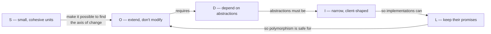

- **SRP** gives you small units with clear reasons to change, so you can see *where* the extension points belong.
- **OCP** is the goal — new behaviour as new code — and it is **achieved through DIP** (depend on abstractions) and **protected by LSP** (implementations must be trustworthy).
- **ISP** keeps those abstractions small and client-shaped, which makes them **easy to implement honestly** (LSP) and **cheap to fake** (DIP-friendly tests).

### End-to-end: a checkout that uses all five

Imagine the full checkout flow of our shop, assembled from the ✅ pieces:

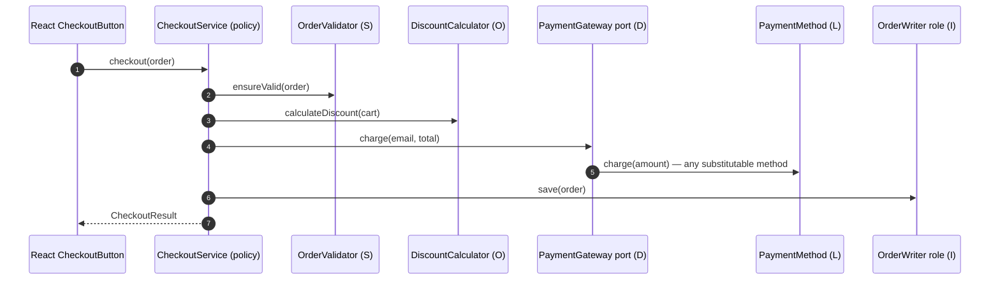

| Step | Principle at work |
| --- | --- |
| Validation, pricing, storage and notification are separate collaborators | **S** |
| A new promotion is a new `DiscountPolicy`; the calculator is untouched | **O** |
| Any `PaymentMethod` can be used to charge; only refundable ones are offered for refunds | **L** |
| The checkout depends on `OrderWriter`, not on the whole store | **I** |
| The checkout depends on ports it owns; Stripe/SMTP/SQL are adapters wired in the composition root | **D** |

<a id="idioms"></a>

## 🌍 SOLID idioms per language

| | 🟣 C# | 🐍 Python | 🐹 Go | 🔷 TypeScript | ⚛️ React |
| --- | --- | --- | --- | --- | --- |
| **Abstraction** | `interface` (nominal) | `Protocol` (structural) / `ABC` | implicit `interface` (structural) | `interface` / type (structural) | props types, hooks, context |
| **S** | small `sealed` classes, records | modules, functions, small classes | packages, small structs, funcs | modules, pure functions | hooks + pure functions + dumb components |
| **O** | Strategy + DI `IEnumerable<T>` | protocols, callables, entry points | small interfaces + func adapters | interfaces, object literals | composition, `children`, registries |
| **L** | contract tests via `[MemberData]`; `sealed` by default | `mypy --strict`, parametrized contract tests | `var _ I = (*T)(nil)`, table tests | `@ts-expect-error`, `describe.each` | honour HTML props, `forwardRef`, `...rest` |
| **I** | role interfaces, `IReadOnly*` | small protocols declared by clients | consumer-defined tiny interfaces | `Pick<>`, tiny interfaces | narrow props |
| **D** | ctor injection, `Program.cs` | ctor params, `main()` composition | "accept interfaces, return structs", `main()` | ctor params, entry point | Context providers in `main.tsx` |
| **Type checking of contracts** | compiler | mypy/pyright | compiler | compiler | compiler |
| **Typical anti-pattern** | `NotSupportedException` overrides | `raise NotImplementedError` overrides | Java-style giant interfaces next to impl | `any`, `instanceof` chains | god components, prop drilling of whole objects |

> [!TIP]
> **Structural vs nominal typing.** In Python, Go and TypeScript a type satisfies an interface just by having the right methods. This makes ISP and DIP almost free: the *client* declares the small interface it needs, and existing types already satisfy it without being modified (which is OCP at its best).

<a id="patterns"></a>

## 🧩 SOLID and design patterns

Most classic design patterns are SOLID principles applied to a recurring problem:

| Pattern | Main principle | How |
| --- | --- | --- |
| **Strategy** | OCP, DIP | Interchangeable algorithms behind one interface (our `DiscountPolicy`). |
| **Adapter** | DIP, ISP | Makes a vendor API fit an interface owned by your code (`StripePaymentGateway`). |
| **Decorator** | OCP, SRP | Add behaviour (logging, caching, retries) by wrapping, not editing. |
| **Template Method** | OCP | Fixed algorithm skeleton, variable steps — via inheritance (prefer Strategy). |
| **Observer / Events** | OCP, DIP | Publishers don't know subscribers; new reactions = new subscribers. |
| **Factory / Abstract Factory** | DIP | Isolates `new` of concrete types from the policy. |
| **Facade** | SRP | A thin coordinator over cohesive collaborators (our `OrderService`). |
| **Composite** | LSP | Leaves and composites are substitutable through one interface. |
| **Null Object** | LSP | A do-nothing implementation that still honours the contract. |
| **Repository** | DIP, ISP | Persistence behind a port owned by the domain; split readers and writers when needed. |
| **Chain of Responsibility / Middleware** | OCP, SRP | Each handler has one job; pipelines are extended by adding handlers. |

[⬆ Back to top](#toc)

---

# Part IV — Expert Level

<a id="architecture"></a>

## 🏛️ SOLID at architecture scale

SOLID scales up from classes to **components** (assemblies, packages, services). Robert C. Martin defines six component principles that mirror SOLID:

| Component principle | Mirrors | Statement |
| --- | --- | --- |
| **REP** — Reuse/Release Equivalence | — | The unit of reuse is the unit of release: version what you share. |
| **CCP** — Common Closure | SRP | Gather into a component the classes that change for the same reasons at the same times. |
| **CRP** — Common Reuse | ISP | Don't force users of a component to depend on things they don't need. |
| **ADP** — Acyclic Dependencies | — | No cycles in the component dependency graph. |
| **SDP** — Stable Dependencies | DIP | Depend in the direction of stability. |
| **SAP** — Stable Abstractions | DIP, OCP | A component should be as abstract as it is stable. |

### Measuring it

For a component, with **Ca** = incoming dependencies and **Ce** = outgoing dependencies:

- **Instability** `I = Ce / (Ca + Ce)` — 0 = maximally stable (many depend on it), 1 = maximally unstable.
- **Abstractness** `A = abstract types / total types`.
- **Distance from the main sequence** `D = |A + I − 1|` — near 0 is healthy. Stable-and-concrete (*zone of pain*: hard to change, everybody depends on it) and unstable-and-abstract (*zone of uselessness*) are both bad.

Tools like NDepend (.NET), `go mod graph` + custom scripts, `import-linter` (Python) or `dependency-cruiser` (TypeScript) can enforce these rules in CI.

### Clean / Hexagonal Architecture

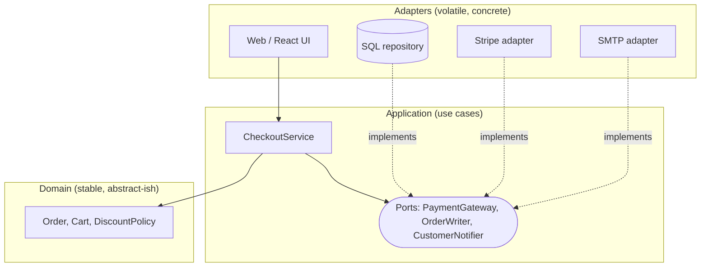

This is DIP applied to the whole system: **every source-code arrow points inward**, toward business policy. In microservices, the same ideas reappear: one service per business capability (SRP/CCP), versioned contracts consumers can rely on (LSP), consumer-driven contracts and BFFs (ISP), and anti-corruption layers that translate external models (DIP).

<a id="functional"></a>

## λ SOLID through a functional lens

SOLID was phrased for OOP, but the ideas are about **dependencies**, so they translate:

| Principle | Functional equivalent |
| --- | --- |
| **S** | Small, pure functions with one purpose; separate pure core from effectful shell ("functional core, imperative shell"). |
| **O** | Higher-order functions: pass behaviour as a parameter (`discountPolicies: (cart) => amount[]`). |
| **L** | Parametricity and lawful type classes: anything that is a `Monoid` must obey the monoid laws. |
| **I** | Functions that take only the data they need (not the whole record). |
| **D** | Pass effects/capabilities as parameters (or use effect systems, reader monad); the core never performs I/O directly. |

> **The expression problem.** OOP makes it easy to add new *types* (a new `DiscountPolicy` class) but hard to add new *operations* (every class must implement the new method). Functional sum types + pattern matching make it easy to add *operations* but hard to add *types*. OCP tells you to pick the representation that makes the **most frequent change** cheap. If you add new discount kinds every week, use polymorphism; if the set of kinds is closed and you keep adding new operations over them (pricing, reporting, auditing), a discriminated union with exhaustive `switch` is the better design.

<a id="when-not"></a>

## 🛑 When NOT to apply SOLID

SOLID is a means, not an end. Every abstraction has a cost: indirection, more files, more names to learn. Apply the principles when the **benefit (cheaper future change) exceeds that cost**.

- **Prototypes, spikes, scripts, one-off migrations** — optimise for speed; throw them away.
- **Stable, simple code** — a 20-line function that has not changed in two years doesn't need an interface.
- **Before the second use case** — wait for the real axis of change (*YAGNI*: "You Aren't Gonna Need It"). The *Rule of Three*: refactor toward an abstraction on the third repetition.
- **When it hides the domain** — if a newcomer needs 9 files to understand "apply a discount", you went too far. Prefer **KISS**.
- **Performance-critical hot paths** — virtual dispatch and allocations rarely matter, but when profiling says they do, concrete code wins.

> **Heuristic:** apply SOLID **reactively** where change hurts, and **proactively** only at boundaries you *know* are volatile (I/O, vendors, time, UI frameworks).

<a id="misconceptions"></a>

## ❓ Common misconceptions

| Myth | Reality |
| --- | --- |
| "SRP = a class should do one thing." | SRP = one **reason to change** (one actor). "Do one thing" is about functions. |
| "OCP = never edit existing code." | Fix bugs and refactor freely. OCP is about not editing working code **to add a new variant** along an expected axis. |
| "LSP is about inheritance only." | It applies to any substitution: interfaces, duck typing, React components, API versions. |
| "ISP = one method per interface." | Split by **client need**. Cohesive groups of methods belong together. |
| "DIP = use a DI container." | DIP is about **direction and ownership** of dependencies. Constructor parameters are enough. |
| "Every class needs an interface." | Only volatile dependencies and real extension points do. |
| "SOLID is only for OOP." | The ideas apply to functions, modules, components, services and APIs. |
| "SOLID code is always longer." | Locally maybe; globally it is usually smaller because duplication and special cases disappear. |

<a id="refactoring"></a>

## 🛠️ Refactoring legacy code toward SOLID

Legacy code is "code without tests" (Michael Feathers). Never refactor it blind:

1. **Pin current behaviour with characterisation tests** — test what the code *does*, even if it's wrong. (In this repository, the ❌ versions have tests proving the ✅ versions behave identically.)
2. **Find a seam** — a place where you can change behaviour without editing in place: a constructor parameter, a virtual method, a module boundary.
3. **Break dependencies** with small safe moves: *Extract Method*, *Extract Class* (SRP), *Extract Interface* (ISP/DIP), *Parameterize Constructor* (DIP), *Replace Conditional with Polymorphism* (OCP), *Replace Inheritance with Delegation* (LSP).
4. **Use the Strangler Fig** pattern for big changes: build the new design next to the old one, route traffic gradually, delete the old code.
5. **Commit in tiny steps**, running tests after each one. Refactoring and behaviour changes go in **separate commits**.
6. **Prioritise by pain**: hotspots = files with high churn × high complexity. Fix where people actually work.

<a id="review-checklist"></a>

## ✅ Code review checklist

Copy this into your pull-request template:

```markdown
### Design (SOLID)
- [ ] **S** Each new/changed class has one reason to change (one actor). No "and" in its description.
- [ ] **O** Adding the next variant of this feature will not require editing tested code.
- [ ] **L** No overrides that throw "not supported", no type checks on abstractions; contract tests cover all implementations.
- [ ] **I** Dependencies are the narrowest role the class needs; test doubles are small.
- [ ] **D** Business code doesn't new-up or import infrastructure; interfaces are owned by their users; wiring happens in the composition root.
- [ ] **Balance** No speculative abstractions (YAGNI): every interface has a reason to exist today.
```

<a id="interview"></a>

## 🎤 Interview questions

<details>
<summary><b>1. What does "reason to change" mean in SRP?</b></summary>

A source of change requests — an **actor** (a person, team or role). A class serving several actors couples their changes together. Example: tax rules (finance) and email wording (marketing) in the same `OrderService`.
</details>

<details>
<summary><b>2. How can a class be both open and closed?</b></summary>

Its **source code is closed** (not edited to add a variant) while its **behaviour is open** (extended by plugging in new implementations of an abstraction it depends on). Strategy, Decorator and plugins are typical mechanisms.
</details>

<details>
<summary><b>3. Give an LSP violation that compiles and type-checks.</b></summary>

`GiftCardPayment.Refund()` throwing `NotSupportedException`; `Square` overriding `SetWidth` to also set height; a React `IconButton` accepting `disabled` but rendering a `<div>`. The type system checks signatures, not behaviour.
</details>

<details>
<summary><b>4. How do you test for LSP?</b></summary>

With **contract tests**: a single suite, parameterised over every implementation, asserting the behavioural contract (inputs accepted, outputs guaranteed, exceptions allowed).
</details>

<details>
<summary><b>5. What's the difference between ISP and SRP?</b></summary>

SRP is about the **implementation** having one reason to change (cohesion of a module). ISP is about **clients** not depending on members they don't use (cohesion of an interface, from the consumer's side). A class can implement several small interfaces and still satisfy SRP.
</details>

<details>
<summary><b>6. Is DIP the same as dependency injection?</b></summary>

No. DIP is a principle about the **direction and ownership** of dependencies. DI is a technique for supplying dependencies from outside. You can do DI without DIP (injecting a concrete `StripeClient`) and DIP without a container (constructor parameters + composition root).
</details>

<details>
<summary><b>7. Where should an interface live: next to its implementation or its consumer?</b></summary>

Next to (and owned by) its **consumer**, the high-level policy. That's what "inversion" means. Go makes this the idiom; in C#/Java put ports in the application/domain project, adapters in infrastructure.
</details>

<details>
<summary><b>8. When is a <code>switch</code> statement acceptable under OCP?</b></summary>

When it's over a **closed** set that won't grow, when it lives in a single factory/composition point, or when you model a closed sum type and expect to add operations more often than types (the expression problem).
</details>

<details>
<summary><b>9. How do SOLID principles apply to React?</b></summary>

S: separate hooks (data), pure functions (logic) and presentational components. O: composition via `children`/render props/registries. L: components honour the props contract they declare. I: narrow props. D: inject services via context/props instead of importing SDKs.
</details>

<details>
<summary><b>10. Can over-applying SOLID be harmful?</b></summary>

Yes: needless indirection, interface-per-class, fragmentation into tiny classes, speculative extension points. Balance with YAGNI and KISS; abstract along axes of change you've actually observed.
</details>

[⬆ Back to top](#toc)

---

# Part V — Practice

<a id="exercises"></a>

## 🏋️ Exercises

Each exercise builds on the code in this repository. Do them in the language you want to master — or in two languages to feel the differences. Run the tests after each change.

| # | Level | Principle | Exercise | Hint |
| --- | --- | --- | --- | --- |
| 1 | 🟢 | S | Add an **SMS confirmation** in addition to the email. Which class changes? Which must *not*? | Only the notification side (or a new notifier coordinated by `OrderService`). `PriceCalculator` must stay untouched. |
| 2 | 🟢 | O | Add a **Black Friday** discount of 30% valid on a given date range. | A new `DiscountPolicy`. Inject the current date (a clock) instead of reading it inside — that's DIP too. |
| 3 | 🟡 | O | Change the combination rule from "best wins" to "stack, capped at 40%". | Only `DiscountCalculator` changes. Is the rule itself an axis of change? Consider a `CombinationStrategy`. |
| 4 | 🟡 | L | Add **Bizum** (refundable) and **Cash on delivery** (not refundable). Make them pass the contract tests. | Add them to the parameterised data — no new tests needed. |
| 5 | 🟡 | L | Write a `Square`/`Rectangle` pair that **does** respect LSP. | Make them immutable, with `WithWidth`/`WithHeight` returning new shapes, or don't relate them by inheritance. |
| 6 | 🟡 | I | Add a `CsvExporter` that exports a month's orders. Which interface does it need? | Maybe a new role (`OrderQuery.ForMonth`) rather than adding methods to `OrderReader`. |
| 7 | 🟠 | D | Add **Adyen** as a second payment provider selectable by configuration. | New adapter + composition-root change only. `CheckoutService` must not change. |
| 8 | 🟠 | D | Make `CheckoutService` retry transient payment failures **without editing it**. | A *decorator*: `RetryingPaymentGateway : PaymentGateway` wrapping another gateway. |
| 9 | 🔴 | All | Implement the full checkout from the [sequence diagram](#together) as a use case that combines all five ✅ examples. | Keep the use case free of infrastructure; write it test-first with fakes. |
| 10 | 🔴 | All | Pick a 300+ line class from a real project you know. Write characterisation tests, then refactor it toward SOLID in < 10 small commits. | Follow [the legacy refactoring steps](#refactoring). |

<a id="cheat-sheet"></a>

## 📋 Cheat sheet

| | Principle | One-liner | Smell | Fix | Pattern |
| --- | --- | --- | --- | --- | --- |
| **S** | Single Responsibility | One actor, one reason to change | God class, "Manager", mixed imports | Extract class per actor + coordinator | Facade |
| **O** | Open/Closed | Add code, don't edit code | Growing `switch` on type codes | Abstraction on the axis of change | Strategy, Decorator, Plugin |
| **L** | Liskov Substitution | Subtypes keep the base's promises | `NotSupported` overrides, type checks | Split contracts by capability, contract tests | Composition over inheritance |
| **I** | Interface Segregation | Clients depend only on what they use | Fat interfaces, huge fakes, whole-object props | Role interfaces, narrow props | Adapter, Role interface |
| **D** | Dependency Inversion | Policy owns abstractions; details implement them | `new` of infrastructure, vendor imports in domain | Ports & adapters, composition root | Adapter, Factory, Ports & Adapters |

<a id="glossary"></a>

## 📖 Glossary

| Term | Meaning |
| --- | --- |
| **Abstraction** | An interface/protocol/type that describes *what* without *how*. |
| **Actor** | A person, team or system that can request changes to a module (SRP). |
| **Adapter** | Code that makes an external API conform to an interface you own. |
| **Axis of change** | A dimension along which a system repeatedly changes (new promotions, new providers). |
| **Cohesion** | How strongly the elements of a module belong together. |
| **Composition root** | The single place where concrete implementations are created and wired. |
| **Contract** | Pre-conditions, post-conditions and invariants a type promises to honour. |
| **Contract test** | A test suite run against every implementation of an abstraction. |
| **Coupling** | How much one module depends on/knows about another. |
| **Dependency Injection** | Supplying a dependency from outside instead of creating it inside. |
| **Port** | An abstraction owned by the application core (Hexagonal Architecture). |
| **Role interface** | A small interface describing one role a class plays for one kind of client. |
| **Seam** | A place where behaviour can be changed without editing the code in place. |
| **Structural typing** | A type satisfies an interface by shape (Go, TS, Python `Protocol`), not by declaration. |
| **Test double** | A fake, stub, spy or mock standing in for a real dependency in tests. |

[⬆ Back to top](#toc)

---

<a id="running"></a>

## ▶️ Running the code

Every folder is an independent project. Each one contains the ❌ `bad` and ✅ `good` version of every principle plus tests that prove both versions behave the same and show what the ✅ design makes possible.

### 🟣 C# / .NET 8

```bash
cd dotnet
dotnet test
```

Warnings are errors and the latest recommended .NET analyzers are enabled ([`Directory.Build.props`](dotnet/Directory.Build.props)).

### 🐍 Python 3.12+

```bash
cd python
python -m venv .venv && source .venv/bin/activate
pip install -e ".[dev]"
pytest            # tests
mypy              # strict static typing
ruff check .      # lint
```

### 🐹 Go 1.22+

```bash
cd go
go vet ./...
go test ./...
```

### 🔷 TypeScript 5

```bash
cd typescript
npm ci
npm run typecheck
npm test
```

### ⚛️ React 18

```bash
cd react
npm ci
npm test          # component tests (Vitest + Testing Library)
npm run dev       # gallery of the ✅ components at http://localhost:5173
```

### 📝 Keeping this README in sync

```bash
python3 scripts/sync_readme.py          # regenerate the code blocks from source
python3 scripts/sync_readme.py --check  # what CI runs
```

<a id="structure"></a>

## 🗂️ Repository structure

```text
.
├── README.md                     ← this master class
├── CHANGELOG.md                  ← generated from Conventional Commits by release-please
├── CONTRIBUTING.md               ← how to contribute (equivalence rules, checks, commits)
├── CODE_OF_CONDUCT.md · SECURITY.md · LICENSE (MIT)
├── scripts/sync_readme.py        ← keeps README code identical to the tested sources
├── .github/
│   ├── workflows/ci.yml          ← builds, tests and reports coverage for all five projects
│   ├── workflows/codeql.yml      ← security and quality scanning
│   ├── workflows/pr-title.yml    ← enforces Conventional Commit PR titles
│   ├── workflows/release-please.yml ← versioning, changelog and GitHub Releases
│   ├── dependabot.yml            ← weekly dependency updates for every toolchain
│   └── ISSUE_TEMPLATE/ · pull_request_template.md · CODEOWNERS
├── .editorconfig · .gitattributes ← consistent formatting and LF line endings
├── .gitignore                    ← shared rules (OS, editors, secrets, logs)
├── dotnet/
│   ├── .gitignore                ← .NET / Visual Studio / Rider
│   ├── src/SolidPrinciples/{Srp,Ocp,Lsp,Isp,Dip}/{Bad,Good}/*.cs
│   └── tests/SolidPrinciples.Tests/*Tests.cs
├── python/
│   ├── .gitignore                ← Python
│   ├── solid/{srp,ocp,lsp,isp,dip}/{bad,good}.py
│   └── tests/test_*.py
├── go/
│   ├── .gitignore                ← Go
│   └── {srp,ocp,lsp,isp,dip}/{bad,good}/*.go   (tests in good/*_test.go)
├── typescript/
│   ├── .gitignore                ← Node.js / TypeScript
│   ├── src/{srp,ocp,lsp,isp,dip}/{bad,good}.ts
│   └── tests/*.test.ts
└── react/
    ├── .gitignore                ← Node.js / Vite / React
    └── src/{srp,ocp,lsp,isp,dip}/{bad,good}/*.tsx  (tests in src/<principle>/*.test.tsx)
```

<a id="reading"></a>

## 📚 Further reading

- Robert C. Martin — *Agile Software Development: Principles, Patterns, and Practices* (2002)
- Robert C. Martin — *Clean Architecture: A Craftsman's Guide to Software Structure and Design* (2017)
- Robert C. Martin — *Design Principles and Design Patterns* (paper, 2000)
- Bertrand Meyer — *Object-Oriented Software Construction* (1988, 2nd ed. 1997)
- Barbara Liskov & Jeannette Wing — *A Behavioral Notion of Subtyping* (ACM TOPLAS, 1994)
- Michael Feathers — *Working Effectively with Legacy Code* (2004)
- Martin Fowler — *Refactoring: Improving the Design of Existing Code* (2nd ed., 2018)
- Erich Gamma, Richard Helm, Ralph Johnson, John Vlissides — *Design Patterns: Elements of Reusable Object-Oriented Software* (1994)
- Mark Seemann & Steven van Deursen — *Dependency Injection Principles, Practices, and Patterns* (2019)
- Alistair Cockburn — *Hexagonal Architecture* (Ports and Adapters, 2005)

<a id="contributing"></a>

## 🤝 Contributing

Contributions are welcome — clearer explanations, new exercises or better examples. Please read
[CONTRIBUTING.md](CONTRIBUTING.md) first: every example must stay equivalent across the five languages,
commits follow [Conventional Commits](https://www.conventionalcommits.org/en/v1.0.0/), and CI must be green.
Security issues: see [SECURITY.md](SECURITY.md).

### How this repository is run

The repository itself applies the practices it teaches:

| Practice | How |
| --- | --- |
| **Quality gates** | CI builds and tests five toolchains, enforces strict typing, linters and formatters, and publishes coverage on every pull request. |
| **Security** | CodeQL scanning, Dependabot updates, least-privilege workflow permissions and a private vulnerability reporting policy. |
| **Traceable history** | Conventional Commits, enforced on pull request titles; signed commits on a protected `main`. |
| **Automated releases** | release-please derives the next version and the [CHANGELOG](CHANGELOG.md) from the commit history. |
| **Docs as code** | The README's code blocks are generated from the tested sources and verified in CI. |

<a id="license"></a>

## 📄 License

Released under the [MIT License](LICENSE).

<a id="author"></a>

## 👤 About the author

Created and maintained by **Daniel F Yepes O** ([@danielfyo](https://github.com/danielfyo)).

If this master class helped you, consider giving it a ⭐ and sharing it with your team.

---

<p align="center"><b>Happy refactoring!</b> If this guide helped you, ⭐ the repository and share it with your team.<br/><a href="#top">⬆ Back to top</a></p>
